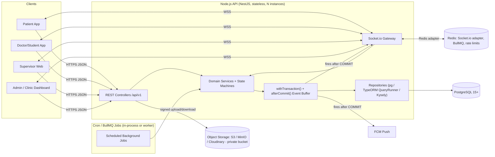
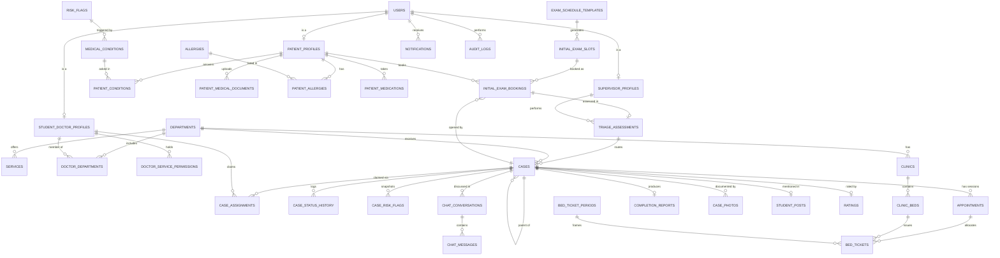
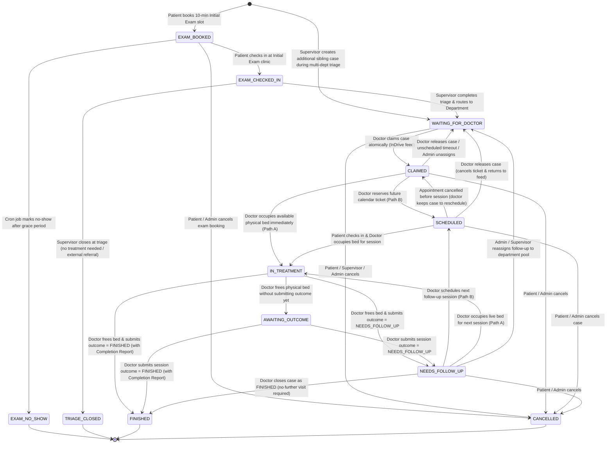
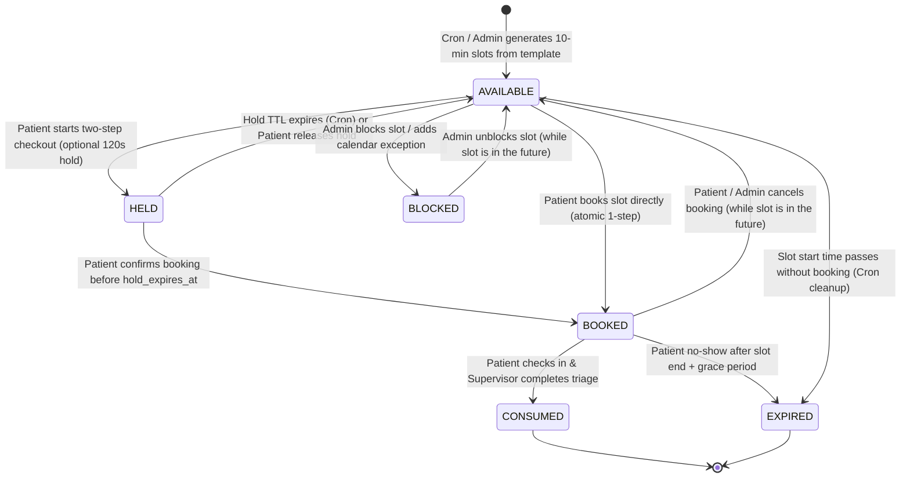
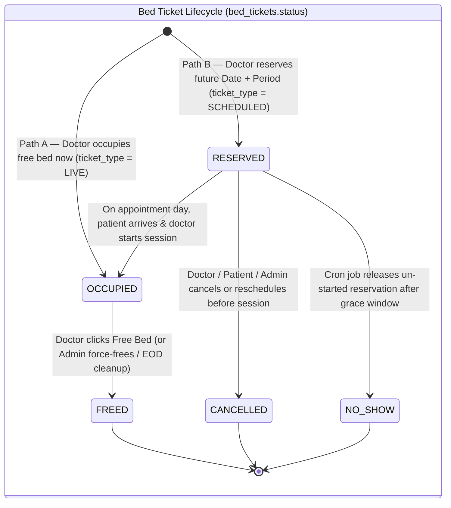
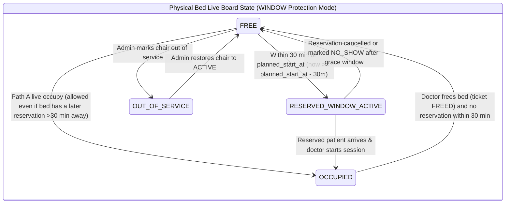

# TeethLink — BACKEND SYSTEM PLAN

> **Dental Hospital Queuing & Patient–Doctor/Student Matching System**
> Scope: **Backend & Database only** (PostgreSQL schema, business logic, state machines, concurrency/locking, REST API contract, Socket.io real-time layer, background jobs).
> Out of scope: Frontend UI, AI model/prompting (AI Assistant = external black box; see §0.5).
> Source-of-truth rule: **Supervisor's Workflow > attached v3 files.** Useful v3 tables are reused and adapted.
> Status: Planning document — **no application/controller code**. SQL appears only as schema DDL and transaction/locking specifications.

---

## Table of Contents

- [0. Architecture Overview & Global Conventions](#0-architecture-overview--global-conventions)
- [1. Gap Analysis & Schema Migration Plan](#1-gap-analysis--schema-migration-plan)
- [2. Complete PostgreSQL Database Schema](#2-complete-postgresql-database-schema)
- [3. State Machines & Concurrency / Locking Logic](#3-state-machines--concurrency--locking-logic)
- [4. RESTful API Specification](#4-restful-api-specification)
- [5. Real-Time Socket.io Events & Background Jobs](#5-real-time-socketio-events--background-jobs)
- [6. Appendices (Settings, Error Codes, Seed Data, Test Scenarios)](#6-appendices)

---

## 0. Architecture Overview & Global Conventions

### 0.1 Runtime architecture



### 0.2 NestJS module map

| Module | Responsibility | Main tables |
|---|---|---|
| `AuthModule` | Phone+password login, JWT access/refresh, OTP (optional), guards (`JwtAuthGuard`, `RolesGuard`, `AccountActiveGuard`) | `users`, `refresh_tokens`, `phone_otps` |
| `UsersModule` / `AdminModule` | Account approval, suspension, admin CRUD for catalogs | `users`, profiles |
| `PatientsModule` | Registration, medical questionnaire, documents, risk-flag computation | `patient_profiles`, `patient_conditions`, `patient_medical_documents`, `patient_allergies`, `patient_medications` |
| `FilesModule` | Upload validation, private storage, short-lived signed URLs, access checks | `files` |
| `ExamSchedulingModule` | Slot templates, exceptions, slot generation, booking/hold/cancel/reschedule | `exam_schedule_templates`, `calendar_exceptions`, `initial_exam_slots`, `initial_exam_bookings` |
| `TriageModule` | Daily triage list, check-in, assessment, routing to departments | `triage_assessments`, `cases` |
| `DepartmentsModule` | Departments, services (sub-procedures), doctor memberships & permissions | `departments`, `services`, `doctor_departments`, `doctor_service_permissions` |
| `CasesModule` | **Case State Machine** (single place allowed to change `cases.status`), history | `cases`, `case_status_history`, `case_assignments`, `case_risk_flags` |
| `DoctorFeedModule` | InDrive-style waiting list, atomic claim, release, hide | `cases`, `doctor_hidden_cases` |
| `BedsModule` | Clinics, beds, periods, live board, ticket allocation (Path A/B), free bed | `clinics`, `clinic_beds`, `bed_ticket_periods`, `bed_tickets` |
| `AppointmentsModule` | Treatment sessions, check-in, reschedule, cancel, no-show | `appointments` |
| `TreatmentModule` | Session outcome, completion report, photos, posts, ratings | `completion_reports`, `case_photos`, `student_posts`, `ratings` |
| `ChatModule` | Conversations, messages, read receipts, contact exposure, call logs | `chat_conversations`, `chat_messages`, `call_logs` |
| `NotificationsModule` | In-app notifications + FCM push | `notifications`, `user_devices` |
| `RealtimeModule` | Socket.io gateway, room authorization, post-commit `afterCommit()` emit helpers | — |
| `ReportsModule` | Daily exam report, live bed occupancy, bed booking log, KPIs | views |
| `AuditModule` | Append-only audit trail interceptor | `audit_logs` |
| `JobsModule` | Cron/queue jobs (§5.3) | `system_settings` |

**Layering rule:** Controller → Application Service (opens the transaction) → Domain Service / State Machine (validates transitions) → Repository (SQL). Controllers never touch `status` columns directly.

> [!IMPORTANT]
> **ORM note:** The locking strategy relies on `SELECT … FOR UPDATE [NOWAIT | SKIP LOCKED]`, partial unique indexes and SQLSTATE handling (`23505`, `55P03`, `40P01`). Use `node-postgres` (`pg`) with **TypeORM QueryRunner** or **Kysely/Knex** to get explicit transaction control. Prisma lacks native `SKIP LOCKED`, so if the team chooses it, those queries must be raw SQL.

### 0.3 Global API conventions

| Topic | Convention |
|---|---|
| Base URL | `/api/v1` |
| Auth | `Authorization: Bearer <accessToken>` (JWT, 15 min). Refresh token (30 days, rotating, hashed in DB). |
| JWT claims | `sub` (user_id), `role`, `status`, `tv` (token_version, for forced logout), `deptIds` (doctors only). |
| Content type | `application/json`; uploads use `multipart/form-data`. |
| Success envelope | `{ "success": true, "data": { ... }, "meta": { "page": 1, "pageSize": 20, "total": 134 } }` |
| Error envelope | `{ "success": false, "error": { "code": "SLOT_UNAVAILABLE", "message": "Human readable", "details": { } }, "requestId": "uuid" }` |
| Idempotency | Mutating "race" endpoints (book slot, claim case, occupy bed, reserve ticket, send chat message) accept `Idempotency-Key: <uuid>`. Same key + same user within 24 h returns the original response (stored in Redis `idem:{userId}:{key}`). |
| Pagination | Cursor-based for feeds/chat (`?cursor=&limit=`), page-based for admin lists (`?page=&pageSize=`). |
| Time | DB stores `TIMESTAMPTZ` (UTC). Hospital-local dates (`DATE`) and times (`TIME`) are interpreted in `Africa/Cairo` (setting `hospital_timezone`). API returns ISO-8601 with offset. |
| IDs | `BIGINT` identity internally; human references: `case_number` (`TL-0001042`), `booking_ref` (`EX-0000315`), `ticket_code`. |
| Localization | `Accept-Language: ar|en` → catalog names returned in that language (`name_ar` / `name_en`). |
| Rate limits | Auth: 5 req/min/IP for login/OTP. Race endpoints: 10 req/10 s/user. |
| Status codes | `200` OK, `201` Created, `204` No Content, `400` validation, `401` unauthenticated, `403` forbidden (role/ownership/account status), `404`, `409` conflict (race lost / invalid state transition), `422` business rule violation, `423` locked (account blocked), `429` rate-limited. |

### 0.4 Roles & privacy matrix

| Role | Description | Account activation |
|---|---|---|
| `PATIENT` | Registers with name + phone + password + medical questionnaire; books Initial Exam slots. | **ACTIVE immediately** (optional phone OTP before booking — setting `require_phone_otp`). |
| `DOCTOR` | Dental student / intern / doctor belonging to one or more departments. Claims cases, uses beds, treats, documents. | `PENDING_APPROVAL` → Admin approves and assigns departments. |
| `SUPERVISOR` | Triage examiner at the Initial Examination clinic; routes cases to departments; optional reviewer of completion reports. | Created by Admin (or self-register → approval). |
| `ADMIN` | Administration & Clinic Dashboard: slot config, beds, catalogs, accounts, reports. | Seeded / created by Admin. |

| Data | Patient (owner) | Doctor in dept feed (before claim) | Assigned doctor (after claim) | Supervisor | Admin |
|---|---|---|---|---|---|
| Name | ✅ | ❌ (age, gender only) | ✅ | ✅ | ✅ |
| Phone | ✅ | ❌ | ✅ (while case active) | ✅ | ✅ |
| Medical questionnaire + attachments | ✅ | Risk-flag chips only | ✅ full + signed doc URLs | ✅ full | ✅ |
| Sensitive conditions (`is_sensitive`, e.g. infectious) | ✅ | ❌ | ✅ | ✅ | ✅ |
| Doctor phone & profile | ✅ after claim | — | — | ✅ | ✅ |

### 0.5 AI Assistant (out of scope)

Treated as an external black box. Backend impact is limited to: **no tables, no endpoints required**. If the frontend team later needs a server-side proxy (to hide an API key), add a single pass-through `POST /api/v1/assistant/messages` with rate limiting and no persistence. AI output never changes routing, risk flags, or case status.

---

## 1. Gap Analysis & Schema Migration Plan

### 1.1 Workflow conflicts (v3 files → Supervisor's workflow)

| # | v3 behaviour (attached files) | Supervisor's workflow (wins) | Backend consequence |
|---|---|---|---|
| G1 | Patient browses services and creates a request (`CASE-1042`, *Waiting for Student*) from home, with photos & preferred time/location. | **No specialized booking from home.** Patient can only book a **10-minute Initial Exam slot**. | Remove patient-created requests, `CaseRequestPhotos`, `CaseConditions`, `preferred_time/location`. Case is born at slot booking (`EXAM_BOOKED`). |
| G2 | Every account (incl. patients) waits for Admin approval. | Patient registers with Name, Phone, Password and books. | Patients are `ACTIVE` on registration; Admin approval only for `DOCTOR`/`SUPERVISOR`. |
| G3 | Email + password login. | Phone + password. | `users.phone` UNIQUE NOT NULL (E.164); `email` optional. |
| G4 | Detailed medical profile (10 categories) without documents. | 4–6 **critical Yes/No + checklist** questions; **Yes ⇒ upload prescription/diagnosis** or flag *"will bring physically"*. | `medical_conditions` becomes the configurable questionnaire catalog (`is_critical`, `requires_document_if_yes`, `checklist_options`); new `patient_medical_documents`; `patient_profiles.medical_document_status` + `medical_attachment_url`. |
| G5 | Matching = students with service permission linked to a supervisor; the **student's supervisor approves the claim** (*Awaiting Supervisor Approval*). | **Supervisor triages physically and routes** to a department; **broadcast to ALL department doctors**; first claim wins instantly — no post-claim approval. | Supervisor becomes the routing actor (`triage_assessments`, `cases.routed_by_supervisor_id`). Claim goes straight to `CLAIMED`. Supervisor ID linking kept only as optional academic link. |
| G6 | Phone hidden until supervisor accepts; no chat. | After claim: patient notified "Dr. X accepted", doctor profile + phone exposed, **real-time chat + call**. | New `chat_conversations`, `chat_messages`, `call_logs`; contact exposure gated by active assignment. |
| G7 | Student proposes appointment from fixed time slots (09:00, 10:30…); patient accepts/rejects within a deadline. | Doctor chooses **Path A** (occupy a free physical bed now) or **Path B** (calendar future date/time → reserved ticket). Patient is **notified**, not asked to accept. | `appointments` redesigned (no `patient_response`/`response_deadline`); new `clinics`, `clinic_beds`, `bed_ticket_periods`, `bed_tickets`. |
| G8 | Appointment = time slot of fixed duration. | **Beds have no fixed duration**: occupied until the doctor frees them. | Live ticket is open-ended (`occupied_at`, `freed_at NULL`); uniqueness via partial unique index `WHERE status='OCCUPIED'`. |
| G9 | Complete Case → *Under Review* → Supervisor approves → *Completed*. | Doctor sets **`NEEDS_FOLLOW_UP`** (schedule next session) or **`FINISHED`** directly. | Case finishes without supervisor gate. Supervisor review of `completion_reports` kept as **optional** and only gates public portfolio posts. |
| G10 | Hold timeouts on supervisor/patient responses. | New timing risks: exam no-shows, reserved-bed no-shows, forgotten occupied beds, unclaimed cases. | New jobs (§5.3): slot generation, no-show marking, reservation release, stale bed alerts, unclaimed escalation. |
| G11 | AI request assistant & summary. | Not in backend scope. | No AI tables (see §0.5). |

### 1.2 Table-by-table migration matrix

Legend: 🟢 **KEEP** (as-is or cosmetic) · 🟡 **MODIFY** · 🔵 **NEW** · 🔴 **REMOVE** · 🟣 **RENAME/SPLIT**

| Old table (`schema.png` / relational PDF) | Decision | New table | What changes |
|---|---|---|---|
| `Users` | 🟡 MODIFY | `users` | + `full_name` (moved from profiles), `phone` UNIQUE NOT NULL, `email` nullable, `account_status` enum adds `ACTIVE/SUSPENDED/DEACTIVATED`, `role` enum `PATIENT/DOCTOR/SUPERVISOR/ADMIN`, `phone_verified_at`, `approved_by/at`, `token_version`, `preferred_language`, `profile_photo_file_id`, `updated_at`, `deleted_at`. |
| `PatientProfiles` | 🟡 MODIFY | `patient_profiles` | PK = `user_id`. `age` → `date_of_birth`; + `gender`, `questionnaire_completed_at`, `has_critical_condition`, `medical_document_status`, **`medical_attachment_url`**, `latest_medical_document_id`, `data_sharing_consent_at`, `no_show_count`, `booking_blocked_until`. `full_name/phone/photo` moved to `users`. `photo_consent` kept. |
| `StudentProfiles` | 🟣 RENAME + MODIFY | `student_doctor_profiles` | PK = `user_id`. + `doctor_category`, `university_id_number` UNIQUE, `availability_status` (FREE/BUSY/OFF — informational, never filters broadcast), `max_active_cases`, `id_proof_file_id`. `supervisor_id` kept **nullable** (academic link only). |
| `SupervisorProfiles` | 🟡 MODIFY | `supervisor_profiles` | PK = `user_id`; `supervisor_code` UNIQUE kept; + `department_id`, `is_triage_examiner`, `title`. `name/contact_info` moved to `users`. |
| `Services` | 🟣 SPLIT | `departments` + `services` | Department (Restorative/Filling, Endodontics, Periodontics/Cleaning, Surgery/Extraction, Prosthodontics, Pediatric, Orthodontics) is the broadcast target. `services` become sub-procedures (root canal, regular filling…) with FK to department, `requires_permission`, `min_academic_year`. |
| `StudentServicePermissions` | 🟣 RENAME | `doctor_service_permissions` | Same idea (`doctor_id`, `service_id`, `granted_by`, `is_active`). Now an **optional claim gate** only for services flagged `requires_permission`. |
| — | 🔵 NEW | `doctor_departments` | M:N doctor ↔ department membership. **Defines who receives the broadcast.** |
| `MedicalConditions` | 🟡 MODIFY | `medical_conditions` | Becomes questionnaire catalog: + `code`, `name_ar/en`, `question_text_ar/en`, `is_critical`, `requires_document_if_yes`, `checklist_options` JSONB, `risk_flag_id`, `is_sensitive`, `display_order`. |
| `PatientConditions` | 🟡 MODIFY | `patient_conditions` | + `has_condition` (Yes/No), `selected_options` JSONB (checklist), `document_status`, `answered_at`. PK (`patient_id`,`condition_id`). |
| — | 🔵 NEW | `patient_medical_documents` | Uploaded prescriptions/diagnosis reports (FK `files`), linked to the condition they support, verifiable by the supervisor at triage. |
| `Allergies`, `PatientAllergies` | 🟢 KEEP | same | + `code`, `name_ar/en`, `risk_flag_id` on catalog. |
| `PatientMedications` | 🟢 KEEP | same | + `is_anticoagulant`, `frequency`. |
| `RiskFlags` | 🟢 KEEP | `risk_flags` | + `code`, `severity`, bilingual names. Flags are still **rule-based** (condition/allergy → flag), never AI. |
| `CaseRiskFlags` | 🟢 KEEP | `case_risk_flags` | Now a **snapshot** taken when the supervisor routes the case. |
| `CaseConditions` | 🔴 REMOVE | — | Replaced by patient-level questionnaire + `cases.medical_snapshot` JSONB + `case_risk_flags`. |
| `CaseRequestPhotos` | 🔴 REMOVE | — | Patients no longer create requests from home. Triage photos (if any) go to `case_photos` with `photo_type='TRIAGE'`. |
| `StudentDeclinedCases` | 🟣 RENAME | `doctor_hidden_cases` | "Not for me" — hides a case from that doctor's feed only. |
| `Cases` | 🟡 MODIFY (major) | `cases` | Patient journey record. + `parent_case_id` (multi-department triage), `triage_id`, `routed_by_supervisor_id`, `department_id` (required on routing), `service_id` (**optional** at triage — set by supervisor or later by the claiming/treating doctor), `tooth_numbers` SMALLINT[] (FDI), `tooth_type`, `procedure_details`, `priority`, `assigned_doctor_id`, `broadcasted_at`, `claimed_at`, `finished_at`, `medical_snapshot`, `total_sessions`, `version`. Removed `preferred_time/location`, `supervisor_decision`, `rejection_reason`. New status enum (§3.1). |
| — | 🔵 NEW | `case_assignments` | Claim history (claim / release / reassign). Partial unique: one active assignment per case. |
| — | 🔵 NEW | `case_status_history` | Every state transition with actor & reason (thesis traceability + debugging). |
| `Appointments` | 🟡 MODIFY | `appointments` | Now = **treatment session** of a case: `session_no`, `path` (`LIVE_BED` / `SCHEDULED`), `appointment_date`, `period_id`, `planned_start_at`, `status`, `started_at`, `ended_at`, `outcome`, `procedure_performed`, `session_notes`. Removed `patient_response`, `response_deadline`, `place` (→ bed/clinic via ticket). |
| — | 🔵 NEW | `clinics`, `clinic_beds` | Physical clinic rooms and dental chairs/beds per department. |
| — | 🔵 NEW | `bed_ticket_periods` | Admin-configured day periods (e.g. Morning 08:00–12:00, Afternoon 12:00–16:00) used for **future reservations**. |
| — | 🔵 NEW | `bed_tickets` *(the "bed_tickets_and_schedules" entity)* | One table for **both** live open-ended occupancy (`ticket_type='LIVE'`) and future reservations (`ticket_type='SCHEDULED'`). |
| — | 🔵 NEW | `exam_schedule_templates`, `calendar_exceptions` | Admin's working hours per weekday (10-min granularity, N stations) and holidays/closures. |
| — | 🔵 NEW | `initial_exam_slots` | Pre-generated 10-minute slot rows (lockable). |
| — | 🔵 NEW | `initial_exam_bookings` | Patient ↔ slot booking (supports cancel/reschedule history). |
| — | 🔵 NEW | `triage_assessments` | Supervisor's exam findings and routing decision per booking. |
| `CompletionReports` | 🟡 MODIFY | `completion_reports` | Written when case → `FINISHED`. `supervisor_decision` → optional `review_status` (`NOT_REQUIRED/PENDING/APPROVED/REVISION_REQUESTED`). + `final_diagnosis`, `materials_used`, `post_care_instructions`, `total_sessions`. |
| `CasePhotos` | 🟡 MODIFY | `case_photos` | FK directly to `case_id` (+ optional `appointment_id`, `report_id`), `file_id`, `photo_type` (`BEFORE/AFTER/DURING/XRAY/TRIAGE`). |
| `StudentPosts` | 🟢 KEEP | `student_posts` (+ `student_post_photos`) | Mention of a FINISHED case; publish requires patient `photo_consent`. |
| `Ratings` | 🟢 KEEP | `ratings` | + `doctor_id`, sub-scores. One per case. |
| `Notifications` | 🟡 MODIFY | `notifications` | + `type`, `title`, `data` JSONB, `read_at`, `push_sent_at`. |
| `AuditLogs` | 🟡 MODIFY | `audit_logs` | + `actor_role`, `before_data`, `after_data`, `ip_address`, `request_id`. Append-only. |
| — | 🔵 NEW | `chat_conversations`, `chat_messages`, `call_logs` | Doctor–patient communication after claim. |
| — | 🔵 NEW | `files` | Central file metadata (medical docs, photos, chat attachments). |
| — | 🔵 NEW | `user_devices`, `refresh_tokens`, `phone_otps` | Push tokens, sessions, optional OTP. |
| — | 🔵 NEW | `system_settings` | Runtime configuration parameters. |

### 1.3 How the open design points are modeled

#### (a) Daily 10-minute Initial Exam slot generation

- Admin defines **`exam_schedule_templates`** per weekday: `start_time`, `end_time`, `slot_minutes = 10`, `stations` (number of parallel examination chairs at the Initial Exam clinic, default 1).
  - Example: Sun–Thu 08:00–16:00, 10 min, 2 stations → 48 times × 2 = **96 bookable slot rows/day**.
- **`calendar_exceptions`** close a day (holiday) or override hours.
- A nightly job (`generate-exam-slots`, §5.3) materializes **one row per (date, start_time, station_no)** for `today … today + exam_booking_window_days` (default 2). It is idempotent (`ON CONFLICT DO NOTHING` on the unique key).
- **Why physical rows instead of computing on the fly?** Rows give us a **lockable object** (`FOR UPDATE`) and a clear lifecycle. A unique booking per row is enforced by a partial unique index, so the zero-double-booking guarantee lives in the database.
- Patients see **times**, not stations: the listing groups rows by `start_time` and returns `remaining`. Booking picks any free station row at that time with `FOR UPDATE SKIP LOCKED`. When `remaining` reaches 0, Socket.io tells all viewers to remove the time (real-time disappearance).

#### (b) Live open-ended bed tickets (Path A)

- A live ticket is a `bed_tickets` row with `ticket_type='LIVE'`, `status='OCCUPIED'`, `occupied_at=now()` and **no end time**.
- The bed stays occupied until the doctor calls *Free Bed* → `status='FREED'`, `freed_at=now()`.
- DB guarantee: `CREATE UNIQUE INDEX … ON bed_tickets(bed_id) WHERE status='OCCUPIED'` — **a bed can never have two occupants**, regardless of application bugs.

#### (c) Future calendar reservations (Path B) — "Tickets" without fixed durations

Procedure durations are unknown, so we cannot reserve exact minute ranges. We also cannot use an open-ended range, because it would block all future time on that bed. Instead we use **ticket capacity per period** combined with a **rolling pre-arrival protection window (`WINDOW` mode)**:

- Admin defines **`bed_ticket_periods`** (e.g. `MORNING 08:00–12:00`, `AFTERNOON 12:00–16:00`).
- A **ticket = (bed, date, period)**. With 20 active beds and 2 periods there are **20 tickets per period** — this is exactly the supervisor's "*20 beds = 20 tickets*".
- Reserving creates a `bed_tickets` row with `ticket_type='SCHEDULED'`, `status='RESERVED'`, `service_date`, `period_id`, and `planned_start_at` (the arrival time the patient is told, which must fall inside the period).
- DB guarantees:
  - `UNIQUE (bed_id, service_date, period_id) WHERE status='RESERVED'` — when a doctor lists calendar tickets for that day/period, reserved beds are **excluded**.
  - `UNIQUE (doctor_id, planned_start_at) WHERE status='RESERVED'` (`uq_bt_doctor_planned_start`) and `UNIQUE (patient_id, planned_start_at) WHERE status='RESERVED'` (`uq_bt_patient_planned_start`) — a doctor cannot book two patients at the exact same timestamp, **but CAN schedule multiple cases at different times within the same period** (e.g., treating one patient now at 09:00 and scheduling another case for 10:30 on the same morning).
- **On the day (`WINDOW` protection mode — default, `reservation_protect_minutes = 30`):**
  - A `RESERVED` ticket only blocks its bed from Path A live occupancy when `service_date = CURRENT_DATE AND now() >= (planned_start_at - INTERVAL '30 minutes')`.
  - Before that 30-minute window (e.g. from 08:00 to 11:00 for an 11:30 reservation), other doctors **can** occupy the bed live so physical chairs never sit idle for hours.
  - If a live session on that bed overruns into `planned_start_at`, the **Automatic Bed-Swap fallback** in `start-session` (§3.4.3C) seamlessly assigns the arriving reserved patient to another free bed in the same department (`swapped_from_bed_id` is recorded on `bed_tickets`).
  - *(Optional setting `reservation_protection_mode = "STRICT"` is retained if a clinic ever wants whole-period blocking, but `"WINDOW"` with `reservation_protect_minutes = 30` is the default).*

#### (d) Appointment vs. Ticket (why two tables)

- **`appointments`** = the *clinical session* of a case (session #1, #2…, outcome, notes). It survives bed swaps and reschedules.
- **`bed_tickets`** = the *physical resource allocation* (which chair, when, occupied/freed).
- Every open appointment has exactly one active ticket (partial unique indexes on `appointment_id` and `case_id`).

#### (e) Multi-department triage

One exam can produce several treatment needs (e.g. cleaning + filling):
- The case created at booking becomes the **primary case** routed to the first department.
- Each additional department gets a **sibling case** (`parent_case_id` = primary) created directly in `WAITING_FOR_DOCTOR`.
- Each case has its own doctor, chat, and sessions.

#### (f) Supervisor's role is now triage

- `supervisor_profiles.is_triage_examiner` marks supervisors who staff the Initial Exam clinic.
- The v3 student↔supervisor `supervisor_code` link is kept **optional** for academic reporting and the optional completion-report review. It no longer blocks claiming.

---

## 2. Complete PostgreSQL Database Schema

> Target: **PostgreSQL 15+** (uses `UNIQUE NULLS NOT DISTINCT`). Default isolation: `READ COMMITTED` + explicit row locks.
> Every table with `updated_at` gets the generic trigger `set_updated_at()` (BEFORE UPDATE → `NEW.updated_at = now()`).
> Creation order below respects FK dependencies (circular FKs are added with `ALTER TABLE` at the end of the relevant group).

### 2.1 Extensions, sequences & enum types

```sql
CREATE EXTENSION IF NOT EXISTS citext;      -- case-insensitive email
CREATE EXTENSION IF NOT EXISTS pgcrypto;    -- gen_random_uuid()

CREATE SEQUENCE case_number_seq       START 1000;
CREATE SEQUENCE exam_booking_ref_seq  START 1;

-- Accounts
CREATE TYPE user_role            AS ENUM ('PATIENT','DOCTOR','SUPERVISOR','ADMIN');
CREATE TYPE account_status       AS ENUM ('PENDING_APPROVAL','ACTIVE','REJECTED','SUSPENDED','DEACTIVATED');
CREATE TYPE gender_type          AS ENUM ('MALE','FEMALE');
CREATE TYPE doctor_category      AS ENUM ('UNDERGRAD_STUDENT','INTERN','POSTGRAD','STAFF_DOCTOR');
CREATE TYPE availability_status  AS ENUM ('AVAILABLE','BUSY','OFF_DUTY');

-- Medical
CREATE TYPE medical_doc_status   AS ENUM ('NOT_REQUIRED','UPLOADED','WILL_BRING_PHYSICALLY','VERIFIED','MISSING');
CREATE TYPE medical_doc_type     AS ENUM ('PRESCRIPTION','DIAGNOSIS_REPORT','LAB_RESULT','OTHER');
CREATE TYPE risk_severity        AS ENUM ('INFO','CAUTION','HIGH');

-- Files
CREATE TYPE file_purpose         AS ENUM ('MEDICAL_DOCUMENT','PROFILE_PHOTO','CASE_PHOTO','CHAT_ATTACHMENT','DOCTOR_ID_PROOF');

-- Initial exam
CREATE TYPE exam_slot_status     AS ENUM ('AVAILABLE','HELD','BOOKED','BLOCKED','CONSUMED','EXPIRED');
CREATE TYPE exam_booking_status  AS ENUM ('BOOKED','CHECKED_IN','EXAMINED','CANCELLED','NO_SHOW');
CREATE TYPE exception_scope      AS ENUM ('EXAM_CLINIC','DEPARTMENT','HOSPITAL');
CREATE TYPE triage_outcome       AS ENUM ('ROUTED','NO_TREATMENT_NEEDED','REFERRED_OUT');

-- Cases
CREATE TYPE case_status AS ENUM (
  'EXAM_BOOKED','EXAM_CHECKED_IN','EXAM_NO_SHOW','TRIAGE_CLOSED',
  'WAITING_FOR_DOCTOR','CLAIMED','SCHEDULED','IN_TREATMENT',
  'AWAITING_OUTCOME','NEEDS_FOLLOW_UP','FINISHED','CANCELLED'
);
CREATE TYPE case_priority        AS ENUM ('ROUTINE','PRIORITY','URGENT');
CREATE TYPE tooth_type           AS ENUM ('INCISOR','CANINE','PREMOLAR','MOLAR','MULTIPLE','NOT_APPLICABLE');
CREATE TYPE assignment_end_reason AS ENUM ('DOCTOR_RELEASED','AUTO_RELEASED_UNSCHEDULED','ADMIN_REASSIGNED','CASE_CANCELLED');

-- Beds / appointments
CREATE TYPE bed_operational_status AS ENUM ('ACTIVE','OUT_OF_SERVICE','RETIRED');
CREATE TYPE appointment_path     AS ENUM ('LIVE_BED','SCHEDULED');
CREATE TYPE appointment_status   AS ENUM ('SCHEDULED','IN_PROGRESS','COMPLETED','CANCELLED','NO_SHOW','RESCHEDULED');
CREATE TYPE session_outcome      AS ENUM ('NEEDS_FOLLOW_UP','FINISHED');
CREATE TYPE bed_ticket_type      AS ENUM ('LIVE','SCHEDULED');
CREATE TYPE bed_ticket_status    AS ENUM ('RESERVED','OCCUPIED','FREED','CANCELLED','NO_SHOW');
CREATE TYPE bed_free_reason      AS ENUM ('DOCTOR_FINISHED','ADMIN_FORCED','AUTO_END_OF_DAY');

-- Documentation / communication
CREATE TYPE photo_type           AS ENUM ('BEFORE','AFTER','DURING','XRAY','TRIAGE');
CREATE TYPE review_status        AS ENUM ('NOT_REQUIRED','PENDING','APPROVED','REVISION_REQUESTED');
CREATE TYPE conversation_status  AS ENUM ('OPEN','READ_ONLY','CLOSED');
CREATE TYPE message_type         AS ENUM ('TEXT','IMAGE','FILE','SYSTEM','CALL_EVENT');
CREATE TYPE call_type            AS ENUM ('PHONE_DIAL','VOIP');
CREATE TYPE call_status          AS ENUM ('INITIATED','RINGING','ANSWERED','MISSED','DECLINED','ENDED');
```

> [!NOTE]
> `notifications.type` and `audit_logs.action` are `VARCHAR` validated by application enums (frequent additions; avoids `ALTER TYPE` migrations).

### 2.2 Accounts, files & profiles

```sql
CREATE TABLE users (
  user_id               BIGINT GENERATED ALWAYS AS IDENTITY PRIMARY KEY,
  role                  user_role      NOT NULL,
  full_name             VARCHAR(120)   NOT NULL,
  phone                 VARCHAR(16)    NOT NULL,                 -- E.164, e.g. +201001234567
  email                 CITEXT,
  password_hash         VARCHAR(255)   NOT NULL,                 -- argon2id / bcrypt
  account_status        account_status NOT NULL DEFAULT 'PENDING_APPROVAL',
  rejection_reason      TEXT,
  approved_by           BIGINT REFERENCES users(user_id),
  approved_at           TIMESTAMPTZ,
  phone_verified_at     TIMESTAMPTZ,
  profile_photo_file_id BIGINT,                                  -- FK added after files
  preferred_language    CHAR(2)        NOT NULL DEFAULT 'ar',
  token_version         INT            NOT NULL DEFAULT 0,       -- bump to revoke all JWTs
  last_login_at         TIMESTAMPTZ,
  created_at            TIMESTAMPTZ    NOT NULL DEFAULT now(),
  updated_at            TIMESTAMPTZ    NOT NULL DEFAULT now(),
  deleted_at            TIMESTAMPTZ,
  CONSTRAINT uq_users_phone        UNIQUE (phone),
  CONSTRAINT ck_users_phone_e164   CHECK (phone ~ '^\+[1-9][0-9]{7,14}$'),
  CONSTRAINT ck_users_lang         CHECK (preferred_language IN ('ar','en')),
  CONSTRAINT ck_users_reject_reason CHECK (account_status <> 'REJECTED' OR rejection_reason IS NOT NULL)
);
CREATE UNIQUE INDEX uq_users_email ON users(email) WHERE email IS NOT NULL;
CREATE INDEX ix_users_role_status  ON users(role, account_status);

CREATE TABLE files (
  file_id        BIGINT GENERATED ALWAYS AS IDENTITY PRIMARY KEY,
  owner_user_id  BIGINT       NOT NULL REFERENCES users(user_id),
  purpose        file_purpose NOT NULL,
  storage_key    TEXT         NOT NULL UNIQUE,                   -- e.g. medical/2026/11/<uuid>.pdf
  original_name  VARCHAR(255),
  mime_type      VARCHAR(100) NOT NULL,
  size_bytes     INT          NOT NULL,
  sha256         CHAR(64),
  is_private     BOOLEAN      NOT NULL DEFAULT TRUE,
  created_at     TIMESTAMPTZ  NOT NULL DEFAULT now(),
  CONSTRAINT ck_files_mime CHECK (mime_type IN ('image/jpeg','image/png','image/webp','image/heic','application/pdf')),
  CONSTRAINT ck_files_size CHECK (size_bytes > 0 AND size_bytes <= 10485760)          -- 10 MB
);
ALTER TABLE users ADD CONSTRAINT fk_users_photo FOREIGN KEY (profile_photo_file_id) REFERENCES files(file_id);

CREATE TABLE departments (
  department_id  BIGINT GENERATED ALWAYS AS IDENTITY PRIMARY KEY,
  code           VARCHAR(30)  NOT NULL UNIQUE,                   -- RESTORATIVE, ENDO, PERIO, SURGERY, PROSTHO, PEDO, ORTHO
  name_en        VARCHAR(80)  NOT NULL,
  name_ar        VARCHAR(80)  NOT NULL,
  description    TEXT,
  is_active      BOOLEAN      NOT NULL DEFAULT TRUE,
  display_order  SMALLINT     NOT NULL DEFAULT 0,
  created_at     TIMESTAMPTZ  NOT NULL DEFAULT now(),
  updated_at     TIMESTAMPTZ  NOT NULL DEFAULT now()
);

CREATE TABLE services (                                          -- sub-procedures within a department
  service_id          BIGINT GENERATED ALWAYS AS IDENTITY PRIMARY KEY,
  department_id       BIGINT       NOT NULL REFERENCES departments(department_id),
  code                VARCHAR(40)  NOT NULL UNIQUE,              -- ROOT_CANAL, CLASS_I_FILLING, SCALING ...
  name_en             VARCHAR(100) NOT NULL,
  name_ar             VARCHAR(100) NOT NULL,
  description         TEXT,
  requires_permission BOOLEAN      NOT NULL DEFAULT FALSE,       -- if TRUE, claim needs doctor_service_permissions
  min_academic_year   SMALLINT,
  typical_sessions    SMALLINT     NOT NULL DEFAULT 1,
  is_active           BOOLEAN      NOT NULL DEFAULT TRUE,
  created_at          TIMESTAMPTZ  NOT NULL DEFAULT now(),
  updated_at          TIMESTAMPTZ  NOT NULL DEFAULT now(),
  CONSTRAINT uq_services_dept_pair UNIQUE (service_id, department_id),   -- target of composite FK from cases
  CONSTRAINT uq_services_dept_name UNIQUE (department_id, name_en),
  CONSTRAINT ck_services_year      CHECK (min_academic_year IS NULL OR min_academic_year BETWEEN 1 AND 7),
  CONSTRAINT ck_services_sessions  CHECK (typical_sessions BETWEEN 1 AND 20)
);

CREATE TABLE supervisor_profiles (
  supervisor_id      BIGINT PRIMARY KEY REFERENCES users(user_id) ON DELETE CASCADE,
  supervisor_code    VARCHAR(12) NOT NULL UNIQUE,                -- issued on approval (kept from v3)
  department_id      BIGINT REFERENCES departments(department_id),
  title              VARCHAR(60),                                -- Dr., Assoc. Prof. ...
  specialty          VARCHAR(120),
  is_triage_examiner BOOLEAN     NOT NULL DEFAULT TRUE,
  created_at         TIMESTAMPTZ NOT NULL DEFAULT now(),
  updated_at         TIMESTAMPTZ NOT NULL DEFAULT now()
);

CREATE TABLE student_doctor_profiles (
  doctor_id            BIGINT PRIMARY KEY REFERENCES users(user_id) ON DELETE CASCADE,
  doctor_category      doctor_category     NOT NULL DEFAULT 'UNDERGRAD_STUDENT',
  university_id_number VARCHAR(30)         NOT NULL UNIQUE,
  university           VARCHAR(120),
  college              VARCHAR(120),
  academic_year        SMALLINT,
  supervisor_id        BIGINT REFERENCES supervisor_profiles(supervisor_id),   -- optional academic link
  availability_status  availability_status NOT NULL DEFAULT 'AVAILABLE',       -- informational only
  max_active_cases     SMALLINT            NOT NULL DEFAULT 5,
  id_proof_file_id     BIGINT REFERENCES files(file_id),
  bio                  TEXT,
  created_at           TIMESTAMPTZ NOT NULL DEFAULT now(),
  updated_at           TIMESTAMPTZ NOT NULL DEFAULT now(),
  CONSTRAINT ck_doc_year     CHECK (academic_year IS NULL OR academic_year BETWEEN 1 AND 7),
  CONSTRAINT ck_doc_max_case CHECK (max_active_cases BETWEEN 1 AND 30)
);

CREATE TABLE doctor_departments (                                -- who receives a department broadcast
  doctor_id     BIGINT      NOT NULL REFERENCES student_doctor_profiles(doctor_id) ON DELETE CASCADE,
  department_id BIGINT      NOT NULL REFERENCES departments(department_id),
  is_primary    BOOLEAN     NOT NULL DEFAULT FALSE,
  is_active     BOOLEAN     NOT NULL DEFAULT TRUE,
  assigned_by   BIGINT      REFERENCES users(user_id),
  assigned_at   TIMESTAMPTZ NOT NULL DEFAULT now(),
  PRIMARY KEY (doctor_id, department_id)
);
CREATE UNIQUE INDEX uq_doctor_primary_department ON doctor_departments(doctor_id) WHERE is_primary;
CREATE INDEX ix_doctor_departments_dept ON doctor_departments(department_id) WHERE is_active;

CREATE TABLE doctor_service_permissions (
  permission_id BIGINT GENERATED ALWAYS AS IDENTITY PRIMARY KEY,
  doctor_id     BIGINT      NOT NULL REFERENCES student_doctor_profiles(doctor_id) ON DELETE CASCADE,
  service_id    BIGINT      NOT NULL REFERENCES services(service_id),
  granted_by    BIGINT      NOT NULL REFERENCES users(user_id),
  is_active     BOOLEAN     NOT NULL DEFAULT TRUE,
  granted_at    TIMESTAMPTZ NOT NULL DEFAULT now(),
  revoked_at    TIMESTAMPTZ,
  CONSTRAINT uq_doctor_service UNIQUE (doctor_id, service_id),
  CONSTRAINT ck_perm_revoked   CHECK (is_active OR revoked_at IS NOT NULL)
);
```

### 2.3 Medical questionnaire, documents & risk flags

```sql
CREATE TABLE risk_flags (
  risk_flag_id     BIGINT GENERATED ALWAYS AS IDENTITY PRIMARY KEY,
  code             VARCHAR(40)   NOT NULL UNIQUE,                -- CARDIAC, ANTICOAGULANT, UNCONTROLLED_DIABETES ...
  name_en          VARCHAR(80)   NOT NULL,
  name_ar          VARCHAR(80)   NOT NULL,
  severity         risk_severity NOT NULL DEFAULT 'CAUTION',
  rule_description TEXT,
  is_active        BOOLEAN       NOT NULL DEFAULT TRUE
);

CREATE TABLE medical_conditions (                                -- questionnaire catalog (admin-configurable)
  condition_id             BIGINT GENERATED ALWAYS AS IDENTITY PRIMARY KEY,
  code                     VARCHAR(40)  NOT NULL UNIQUE,         -- DIABETES, HYPERTENSION, HEART, ANTICOAGULANT ...
  category                 VARCHAR(60)  NOT NULL,
  name_en                  VARCHAR(100) NOT NULL,
  name_ar                  VARCHAR(100) NOT NULL,
  question_text_en         TEXT         NOT NULL,
  question_text_ar         TEXT         NOT NULL,
  is_critical              BOOLEAN      NOT NULL DEFAULT FALSE,  -- one of the 4–6 registration questions
  requires_document_if_yes BOOLEAN      NOT NULL DEFAULT FALSE,
  checklist_options        JSONB        NOT NULL DEFAULT '[]',   -- [{"code":"TYPE_2","en":"Type 2","ar":"النوع الثاني"}]
  risk_flag_id             BIGINT REFERENCES risk_flags(risk_flag_id),  -- rule: YES => this flag
  is_sensitive             BOOLEAN      NOT NULL DEFAULT FALSE,  -- hidden from feed previews
  applies_to_gender        gender_type,                          -- e.g. pregnancy => FEMALE
  display_order            SMALLINT     NOT NULL DEFAULT 0,
  is_active                BOOLEAN      NOT NULL DEFAULT TRUE,
  created_at               TIMESTAMPTZ  NOT NULL DEFAULT now(),
  updated_at               TIMESTAMPTZ  NOT NULL DEFAULT now(),
  CONSTRAINT ck_mc_checklist_array CHECK (jsonb_typeof(checklist_options) = 'array')
);
-- App rule (AdminService): number of active is_critical questions must stay between 4 and 6.

CREATE TABLE allergies (
  allergy_id   BIGINT GENERATED ALWAYS AS IDENTITY PRIMARY KEY,
  code         VARCHAR(40)  NOT NULL UNIQUE,
  name_en      VARCHAR(100) NOT NULL,
  name_ar      VARCHAR(100) NOT NULL,
  risk_flag_id BIGINT REFERENCES risk_flags(risk_flag_id),
  is_active    BOOLEAN      NOT NULL DEFAULT TRUE
);

CREATE TABLE patient_profiles (
  patient_id                 BIGINT PRIMARY KEY REFERENCES users(user_id) ON DELETE CASCADE,
  date_of_birth              DATE,
  gender                     gender_type,
  national_id                VARCHAR(14) UNIQUE,                 -- optional
  address_area               VARCHAR(120),
  emergency_contact_phone    VARCHAR(16),
  questionnaire_completed_at TIMESTAMPTZ,
  has_critical_condition     BOOLEAN     NOT NULL DEFAULT FALSE,   -- any critical answer = YES
  medical_document_status    medical_doc_status NOT NULL DEFAULT 'NOT_REQUIRED',  -- aggregate of patient_conditions
  medical_attachment_url     TEXT,                               -- storage key of latest document (API returns signed URL)
  latest_medical_document_id BIGINT,                             -- FK added below
  medical_notes              TEXT,
  photo_consent              BOOLEAN     NOT NULL DEFAULT FALSE,
  photo_consent_updated_at   TIMESTAMPTZ,
  data_sharing_consent_at    TIMESTAMPTZ NOT NULL,               -- consent to share medical data with care team
  no_show_count              SMALLINT    NOT NULL DEFAULT 0,
  booking_blocked_until      TIMESTAMPTZ,
  created_at                 TIMESTAMPTZ NOT NULL DEFAULT now(),
  updated_at                 TIMESTAMPTZ NOT NULL DEFAULT now(),
  CONSTRAINT ck_pp_dob       CHECK (date_of_birth IS NULL OR date_of_birth BETWEEN DATE '1900-01-01' AND CURRENT_DATE),
  CONSTRAINT ck_pp_doc_state CHECK (has_critical_condition OR medical_document_status IN ('NOT_REQUIRED','UPLOADED','VERIFIED'))
);

CREATE TABLE patient_conditions (                                -- questionnaire answers
  patient_id       BIGINT      NOT NULL REFERENCES patient_profiles(patient_id) ON DELETE CASCADE,
  condition_id     BIGINT      NOT NULL REFERENCES medical_conditions(condition_id),
  has_condition    BOOLEAN     NOT NULL,                         -- Yes / No
  selected_options JSONB       NOT NULL DEFAULT '[]',            -- checklist codes, e.g. ["TYPE_2","UNCONTROLLED"]
  details          TEXT,
  document_status  medical_doc_status NOT NULL DEFAULT 'NOT_REQUIRED',
  answered_at      TIMESTAMPTZ NOT NULL DEFAULT now(),
  updated_at       TIMESTAMPTZ NOT NULL DEFAULT now(),
  PRIMARY KEY (patient_id, condition_id),
  CONSTRAINT ck_pc_no_doc_when_no CHECK (has_condition OR document_status = 'NOT_REQUIRED'),
  CONSTRAINT ck_pc_options_array  CHECK (jsonb_typeof(selected_options) = 'array')
);
CREATE INDEX ix_pc_yes ON patient_conditions(patient_id) WHERE has_condition;

CREATE TABLE patient_medical_documents (
  document_id   BIGINT GENERATED ALWAYS AS IDENTITY PRIMARY KEY,
  patient_id    BIGINT           NOT NULL REFERENCES patient_profiles(patient_id) ON DELETE CASCADE,
  file_id       BIGINT           NOT NULL UNIQUE REFERENCES files(file_id),
  condition_id  BIGINT           REFERENCES medical_conditions(condition_id),   -- which "Yes" it supports
  document_type medical_doc_type NOT NULL DEFAULT 'PRESCRIPTION',
  diagnosis_date DATE,
  notes         TEXT,
  is_current    BOOLEAN          NOT NULL DEFAULT TRUE,
  verified_by   BIGINT           REFERENCES users(user_id),       -- supervisor at triage
  verified_at   TIMESTAMPTZ,
  uploaded_at   TIMESTAMPTZ      NOT NULL DEFAULT now(),
  CONSTRAINT ck_pmd_verified CHECK ((verified_by IS NULL) = (verified_at IS NULL))
);
CREATE INDEX ix_pmd_patient ON patient_medical_documents(patient_id, uploaded_at DESC);
ALTER TABLE patient_profiles ADD CONSTRAINT fk_pp_latest_doc
  FOREIGN KEY (latest_medical_document_id) REFERENCES patient_medical_documents(document_id);

CREATE TABLE patient_allergies (
  patient_id BIGINT NOT NULL REFERENCES patient_profiles(patient_id) ON DELETE CASCADE,
  allergy_id BIGINT NOT NULL REFERENCES allergies(allergy_id),
  notes      TEXT,
  PRIMARY KEY (patient_id, allergy_id)
);

CREATE TABLE patient_medications (
  medication_id    BIGINT GENERATED ALWAYS AS IDENTITY PRIMARY KEY,
  patient_id       BIGINT       NOT NULL REFERENCES patient_profiles(patient_id) ON DELETE CASCADE,
  medication_name  VARCHAR(120) NOT NULL,
  dosage           VARCHAR(60),
  frequency        VARCHAR(60),
  is_anticoagulant BOOLEAN      NOT NULL DEFAULT FALSE,
  notes            TEXT,
  created_at       TIMESTAMPTZ  NOT NULL DEFAULT now()
);

-- Rule-based risk flags computed live (never AI)
CREATE VIEW v_patient_risk_flags AS
  SELECT pc.patient_id, rf.risk_flag_id, rf.code, rf.severity, 'CONDITION' AS source, mc.code AS source_code
  FROM patient_conditions pc
  JOIN medical_conditions mc ON mc.condition_id = pc.condition_id
  JOIN risk_flags rf         ON rf.risk_flag_id = mc.risk_flag_id
  WHERE pc.has_condition
UNION
  SELECT pa.patient_id, rf.risk_flag_id, rf.code, rf.severity, 'ALLERGY', a.code
  FROM patient_allergies pa
  JOIN allergies a   ON a.allergy_id   = pa.allergy_id
  JOIN risk_flags rf ON rf.risk_flag_id = a.risk_flag_id
UNION
  SELECT pm.patient_id, rf.risk_flag_id, rf.code, rf.severity, 'MEDICATION', 'ANTICOAGULANT'
  FROM patient_medications pm
  JOIN risk_flags rf ON rf.code = 'ANTICOAGULANT'
  WHERE pm.is_anticoagulant;
```

### 2.4 Initial Examination scheduling (10-minute slots)

```sql
CREATE TABLE exam_schedule_templates (
  template_id    BIGINT GENERATED ALWAYS AS IDENTITY PRIMARY KEY,
  day_of_week    SMALLINT    NOT NULL,                           -- ISO: 1=Mon … 7=Sun
  start_time     TIME        NOT NULL,                           -- 08:00
  end_time       TIME        NOT NULL,                           -- 16:00
  slot_minutes   SMALLINT    NOT NULL DEFAULT 10,
  stations       SMALLINT    NOT NULL DEFAULT 1,                 -- parallel exam chairs
  effective_from DATE        NOT NULL DEFAULT CURRENT_DATE,
  effective_to   DATE,
  is_active      BOOLEAN     NOT NULL DEFAULT TRUE,
  created_by     BIGINT      REFERENCES users(user_id),
  created_at     TIMESTAMPTZ NOT NULL DEFAULT now(),
  updated_at     TIMESTAMPTZ NOT NULL DEFAULT now(),
  CONSTRAINT ck_est_dow      CHECK (day_of_week BETWEEN 1 AND 7),
  CONSTRAINT ck_est_range    CHECK (end_time > start_time),
  CONSTRAINT ck_est_minutes  CHECK (slot_minutes BETWEEN 5 AND 60),
  CONSTRAINT ck_est_divides  CHECK ((EXTRACT(EPOCH FROM (end_time - start_time))::INT / 60) % slot_minutes = 0),
  CONSTRAINT ck_est_stations CHECK (stations BETWEEN 1 AND 20),
  CONSTRAINT ck_est_eff      CHECK (effective_to IS NULL OR effective_to >= effective_from)
);
-- App rule: active templates for the same weekday and overlapping effective dates must not overlap in time.

CREATE TABLE calendar_exceptions (
  exception_id      BIGINT GENERATED ALWAYS AS IDENTITY PRIMARY KEY,
  exception_date    DATE            NOT NULL,
  scope             exception_scope NOT NULL,
  department_id     BIGINT REFERENCES departments(department_id),   -- only when scope = DEPARTMENT
  is_closed         BOOLEAN         NOT NULL DEFAULT TRUE,
  custom_start_time TIME,
  custom_end_time   TIME,
  reason            VARCHAR(200),
  created_by        BIGINT REFERENCES users(user_id),
  created_at        TIMESTAMPTZ     NOT NULL DEFAULT now(),
  CONSTRAINT uq_cal_exception UNIQUE NULLS NOT DISTINCT (exception_date, scope, department_id),
  CONSTRAINT ck_cal_dept      CHECK ((scope = 'DEPARTMENT') = (department_id IS NOT NULL)),
  CONSTRAINT ck_cal_custom    CHECK (is_closed OR (custom_start_time IS NOT NULL AND custom_end_time > custom_start_time))
);

CREATE TABLE initial_exam_slots (
  slot_id            BIGINT GENERATED ALWAYS AS IDENTITY PRIMARY KEY,
  exam_date          DATE             NOT NULL,
  start_time         TIME             NOT NULL,
  end_time           TIME             NOT NULL,
  station_no         SMALLINT         NOT NULL DEFAULT 1,
  starts_at          TIMESTAMPTZ      NOT NULL,                  -- exam_date+start_time in hospital TZ
  ends_at            TIMESTAMPTZ      NOT NULL,
  status             exam_slot_status NOT NULL DEFAULT 'AVAILABLE',
  held_by_patient_id BIGINT REFERENCES patient_profiles(patient_id),
  hold_expires_at    TIMESTAMPTZ,
  blocked_reason     VARCHAR(200),
  template_id        BIGINT REFERENCES exam_schedule_templates(template_id),
  version            INT              NOT NULL DEFAULT 0,
  created_at         TIMESTAMPTZ      NOT NULL DEFAULT now(),
  updated_at         TIMESTAMPTZ      NOT NULL DEFAULT now(),
  CONSTRAINT uq_slot_time_station UNIQUE (exam_date, start_time, station_no),   -- idempotent generation
  CONSTRAINT ck_slot_range        CHECK (end_time > start_time AND ends_at > starts_at),
  CONSTRAINT ck_slot_hold         CHECK ((status = 'HELD') = (held_by_patient_id IS NOT NULL AND hold_expires_at IS NOT NULL)),
  CONSTRAINT ck_slot_blocked      CHECK (status <> 'BLOCKED' OR blocked_reason IS NOT NULL)
);
CREATE INDEX ix_slots_available ON initial_exam_slots(exam_date, start_time) WHERE status = 'AVAILABLE';
CREATE INDEX ix_slots_holds     ON initial_exam_slots(hold_expires_at)       WHERE status = 'HELD';
CREATE UNIQUE INDEX uq_slot_one_hold_per_patient ON initial_exam_slots(held_by_patient_id) WHERE status = 'HELD';
```

### 2.5 Cases, exam bookings & triage

```sql
CREATE TABLE cases (
  case_id                 BIGINT GENERATED ALWAYS AS IDENTITY PRIMARY KEY,
  case_number             VARCHAR(20)   NOT NULL UNIQUE
                          DEFAULT ('TL-' || lpad(nextval('case_number_seq')::TEXT, 7, '0')),
  patient_id              BIGINT        NOT NULL REFERENCES patient_profiles(patient_id),
  parent_case_id          BIGINT        REFERENCES cases(case_id),            -- sibling cases from one triage
  triage_id               BIGINT,                                             -- FK added after triage_assessments
  routed_by_supervisor_id BIGINT        REFERENCES supervisor_profiles(supervisor_id),
  department_id           BIGINT        REFERENCES departments(department_id),
  service_id              BIGINT,
  tooth_numbers           SMALLINT[]    NOT NULL DEFAULT '{}',                -- FDI notation
  tooth_type              tooth_type,
  procedure_details       TEXT,                                               -- "Root canal – lower left first molar"
  triage_notes            TEXT,
  priority                case_priority NOT NULL DEFAULT 'ROUTINE',
  status                  case_status   NOT NULL DEFAULT 'EXAM_BOOKED',
  assigned_doctor_id      BIGINT        REFERENCES student_doctor_profiles(doctor_id),
  broadcasted_at          TIMESTAMPTZ,
  claimed_at              TIMESTAMPTZ,
  finished_at             TIMESTAMPTZ,
  closed_reason           TEXT,
  medical_snapshot        JSONB,                                              -- frozen conditions/allergies/meds at routing
  total_sessions          SMALLINT      NOT NULL DEFAULT 0,
  escalation_level        SMALLINT      NOT NULL DEFAULT 0,                   -- unclaimed escalation counter
  version                 INT           NOT NULL DEFAULT 0,                   -- optimistic concurrency
  created_at              TIMESTAMPTZ   NOT NULL DEFAULT now(),
  updated_at              TIMESTAMPTZ   NOT NULL DEFAULT now(),
  CONSTRAINT fk_cases_service_in_dept FOREIGN KEY (service_id, department_id)
    REFERENCES services(service_id, department_id),               -- MATCH SIMPLE: allows service_id IS NULL at triage; validates pair when set
  CONSTRAINT ck_cases_routing_fields CHECK (
    status IN ('EXAM_BOOKED','EXAM_CHECKED_IN','EXAM_NO_SHOW','TRIAGE_CLOSED','CANCELLED')
    OR (department_id IS NOT NULL AND broadcasted_at IS NOT NULL)), -- service_id is optional at triage (can be set later by doctor)
  CONSTRAINT ck_cases_doctor_required CHECK (
    status NOT IN ('CLAIMED','SCHEDULED','IN_TREATMENT','AWAITING_OUTCOME','NEEDS_FOLLOW_UP','FINISHED')
    OR (assigned_doctor_id IS NOT NULL AND claimed_at IS NOT NULL)),
  CONSTRAINT ck_cases_waiting_unassigned CHECK (status <> 'WAITING_FOR_DOCTOR' OR assigned_doctor_id IS NULL),
  CONSTRAINT ck_cases_finished_at  CHECK (status <> 'FINISHED' OR finished_at IS NOT NULL),
  CONSTRAINT ck_cases_no_self_parent CHECK (parent_case_id IS NULL OR parent_case_id <> case_id),
  CONSTRAINT ck_cases_fdi CHECK (tooth_numbers <@ ARRAY[
      11,12,13,14,15,16,17,18, 21,22,23,24,25,26,27,28,
      31,32,33,34,35,36,37,38, 41,42,43,44,45,46,47,48,
      51,52,53,54,55, 61,62,63,64,65, 71,72,73,74,75, 81,82,83,84,85]::SMALLINT[])
);
-- InDrive feed: waiting cases of a department, urgent first, oldest first
CREATE INDEX ix_cases_feed ON cases(department_id, priority DESC, broadcasted_at)
  WHERE status = 'WAITING_FOR_DOCTOR';
CREATE INDEX ix_cases_doctor_active ON cases(assigned_doctor_id, status)
  WHERE status IN ('CLAIMED','SCHEDULED','IN_TREATMENT','AWAITING_OUTCOME','NEEDS_FOLLOW_UP');
CREATE INDEX ix_cases_patient ON cases(patient_id, created_at DESC);
CREATE INDEX ix_cases_parent  ON cases(parent_case_id) WHERE parent_case_id IS NOT NULL;

CREATE TABLE initial_exam_bookings (
  booking_id      BIGINT GENERATED ALWAYS AS IDENTITY PRIMARY KEY,
  booking_ref     VARCHAR(20)         NOT NULL UNIQUE
                  DEFAULT ('EX-' || lpad(nextval('exam_booking_ref_seq')::TEXT, 7, '0')),
  slot_id         BIGINT              NOT NULL REFERENCES initial_exam_slots(slot_id),
  patient_id      BIGINT              NOT NULL REFERENCES patient_profiles(patient_id),
  case_id         BIGINT              NOT NULL REFERENCES cases(case_id),
  status          exam_booking_status NOT NULL DEFAULT 'BOOKED',
  rescheduled_from_booking_id BIGINT  REFERENCES initial_exam_bookings(booking_id),
  booked_at       TIMESTAMPTZ         NOT NULL DEFAULT now(),
  checked_in_at   TIMESTAMPTZ,
  checked_in_by   BIGINT              REFERENCES users(user_id),
  examined_at     TIMESTAMPTZ,
  cancelled_at    TIMESTAMPTZ,
  cancel_reason   VARCHAR(200),
  cancelled_by    BIGINT              REFERENCES users(user_id),
  no_show_at      TIMESTAMPTZ,
  idempotency_key UUID,
  created_at      TIMESTAMPTZ         NOT NULL DEFAULT now(),
  updated_at      TIMESTAMPTZ         NOT NULL DEFAULT now(),
  CONSTRAINT ck_eb_checkin  CHECK (status NOT IN ('CHECKED_IN','EXAMINED') OR checked_in_at IS NOT NULL),
  CONSTRAINT ck_eb_cancel   CHECK (status <> 'CANCELLED' OR cancelled_at IS NOT NULL)
);
-- ZERO DOUBLE-BOOKING of a slot (DB-level safety net)
CREATE UNIQUE INDEX uq_exam_booking_slot_active    ON initial_exam_bookings(slot_id)
  WHERE status IN ('BOOKED','CHECKED_IN','EXAMINED');
-- One upcoming exam per patient
CREATE UNIQUE INDEX uq_exam_booking_patient_active ON initial_exam_bookings(patient_id)
  WHERE status IN ('BOOKED','CHECKED_IN');
-- One live booking per case (reschedule creates a new row for the same case)
CREATE UNIQUE INDEX uq_exam_booking_case_active    ON initial_exam_bookings(case_id)
  WHERE status IN ('BOOKED','CHECKED_IN','EXAMINED');
CREATE UNIQUE INDEX uq_exam_booking_idem ON initial_exam_bookings(patient_id, idempotency_key)
  WHERE idempotency_key IS NOT NULL;

CREATE TABLE triage_assessments (
  triage_id              BIGINT GENERATED ALWAYS AS IDENTITY PRIMARY KEY,
  booking_id             BIGINT         NOT NULL UNIQUE REFERENCES initial_exam_bookings(booking_id),
  patient_id             BIGINT         NOT NULL REFERENCES patient_profiles(patient_id),
  supervisor_id          BIGINT         NOT NULL REFERENCES supervisor_profiles(supervisor_id),
  chief_complaint        TEXT,
  clinical_findings      TEXT,
  diagnosis_summary      TEXT           NOT NULL,
  outcome                triage_outcome NOT NULL,
  referral_note          TEXT,
  medical_docs_verified  BOOLEAN        NOT NULL DEFAULT FALSE,
  examined_at            TIMESTAMPTZ    NOT NULL DEFAULT now(),
  CONSTRAINT ck_triage_referral CHECK (outcome <> 'REFERRED_OUT' OR referral_note IS NOT NULL)
);
ALTER TABLE cases ADD CONSTRAINT fk_cases_triage FOREIGN KEY (triage_id) REFERENCES triage_assessments(triage_id);

CREATE TABLE case_risk_flags (                                   -- snapshot at routing time
  case_id      BIGINT      NOT NULL REFERENCES cases(case_id) ON DELETE CASCADE,
  risk_flag_id BIGINT      NOT NULL REFERENCES risk_flags(risk_flag_id),
  snapshot_at  TIMESTAMPTZ NOT NULL DEFAULT now(),
  PRIMARY KEY (case_id, risk_flag_id)
);

CREATE TABLE case_assignments (                                  -- claim / release history
  assignment_id BIGINT GENERATED ALWAYS AS IDENTITY PRIMARY KEY,
  case_id       BIGINT      NOT NULL REFERENCES cases(case_id),
  doctor_id     BIGINT      NOT NULL REFERENCES student_doctor_profiles(doctor_id),
  assigned_at   TIMESTAMPTZ NOT NULL DEFAULT now(),
  ended_at      TIMESTAMPTZ,
  end_reason    assignment_end_reason,
  ended_by      BIGINT      REFERENCES users(user_id),
  notes         TEXT,
  CONSTRAINT ck_ca_end CHECK ((ended_at IS NULL) = (end_reason IS NULL))
);
-- ZERO DOUBLE-CLAIM safety net: one active assignment per case
CREATE UNIQUE INDEX uq_case_active_assignment ON case_assignments(case_id) WHERE ended_at IS NULL;
CREATE INDEX ix_ca_doctor ON case_assignments(doctor_id, assigned_at DESC);

CREATE TABLE case_status_history (
  history_id  BIGINT GENERATED ALWAYS AS IDENTITY PRIMARY KEY,
  case_id     BIGINT      NOT NULL REFERENCES cases(case_id) ON DELETE CASCADE,
  from_status case_status,
  to_status   case_status NOT NULL,
  changed_by  BIGINT      REFERENCES users(user_id),             -- NULL = system job
  reason      TEXT,
  metadata    JSONB       NOT NULL DEFAULT '{}',
  changed_at  TIMESTAMPTZ NOT NULL DEFAULT now()
);
CREATE INDEX ix_csh_case ON case_status_history(case_id, changed_at);

CREATE TABLE case_status_transitions (                           -- whitelist used by DB trigger (defense in depth)
  from_status case_status NOT NULL,
  to_status   case_status NOT NULL,
  PRIMARY KEY (from_status, to_status)
);
-- Trigger trg_cases_valid_transition (BEFORE UPDATE OF status ON cases):
--   if OLD.status <> NEW.status and (OLD.status, NEW.status) not in case_status_transitions
--   → RAISE EXCEPTION USING ERRCODE = 'P0001', MESSAGE = 'ILLEGAL_CASE_TRANSITION'.
--   Also increments NEW.version and inserts case_status_history if the app did not.

CREATE TABLE doctor_hidden_cases (                               -- "not for me" (ex StudentDeclinedCases)
  doctor_id BIGINT      NOT NULL REFERENCES student_doctor_profiles(doctor_id) ON DELETE CASCADE,
  case_id   BIGINT      NOT NULL REFERENCES cases(case_id) ON DELETE CASCADE,
  hidden_at TIMESTAMPTZ NOT NULL DEFAULT now(),
  PRIMARY KEY (doctor_id, case_id)
);
```

### 2.6 Clinics, beds, periods, appointments & bed tickets

```sql
CREATE TABLE clinics (
  clinic_id     BIGINT GENERATED ALWAYS AS IDENTITY PRIMARY KEY,
  department_id BIGINT      NOT NULL REFERENCES departments(department_id),
  clinic_number VARCHAR(10) NOT NULL UNIQUE,                     -- "C3"
  name          VARCHAR(80),
  building      VARCHAR(40),
  floor         VARCHAR(10),
  is_active     BOOLEAN     NOT NULL DEFAULT TRUE,
  created_at    TIMESTAMPTZ NOT NULL DEFAULT now(),
  updated_at    TIMESTAMPTZ NOT NULL DEFAULT now()
);

CREATE TABLE clinic_beds (
  bed_id                 BIGINT GENERATED ALWAYS AS IDENTITY PRIMARY KEY,
  clinic_id              BIGINT                 NOT NULL REFERENCES clinics(clinic_id),
  bed_number             SMALLINT               NOT NULL,
  label                  VARCHAR(30)            NOT NULL UNIQUE,   -- "C3-B07" (= ticket number shown to patient)
  operational_status     bed_operational_status NOT NULL DEFAULT 'ACTIVE',
  out_of_service_reason  VARCHAR(200),
  is_reservable          BOOLEAN                NOT NULL DEFAULT TRUE,   -- FALSE = live-only bed
  version                INT                    NOT NULL DEFAULT 0,
  created_at             TIMESTAMPTZ            NOT NULL DEFAULT now(),
  updated_at             TIMESTAMPTZ            NOT NULL DEFAULT now(),
  CONSTRAINT uq_bed_in_clinic UNIQUE (clinic_id, bed_number),
  CONSTRAINT ck_bed_number    CHECK (bed_number > 0),
  CONSTRAINT ck_bed_oos       CHECK (operational_status <> 'OUT_OF_SERVICE' OR out_of_service_reason IS NOT NULL)
);

CREATE TABLE bed_ticket_periods (
  period_id     BIGINT GENERATED ALWAYS AS IDENTITY PRIMARY KEY,
  code          VARCHAR(20) NOT NULL UNIQUE,                     -- MORNING, AFTERNOON
  name_en       VARCHAR(40) NOT NULL,
  name_ar       VARCHAR(40) NOT NULL,
  start_time    TIME        NOT NULL,
  end_time      TIME        NOT NULL,
  display_order SMALLINT    NOT NULL DEFAULT 0,
  is_active     BOOLEAN     NOT NULL DEFAULT TRUE,
  CONSTRAINT ck_period_range CHECK (end_time > start_time)
);
-- App rule: active periods must not overlap.

CREATE TABLE appointments (                                      -- treatment SESSIONS of a case
  appointment_id      BIGINT GENERATED ALWAYS AS IDENTITY PRIMARY KEY,
  case_id             BIGINT             NOT NULL REFERENCES cases(case_id),
  session_no          SMALLINT           NOT NULL,
  doctor_id           BIGINT             NOT NULL REFERENCES student_doctor_profiles(doctor_id),
  patient_id          BIGINT             NOT NULL REFERENCES patient_profiles(patient_id),
  department_id       BIGINT             NOT NULL REFERENCES departments(department_id),
  path                appointment_path   NOT NULL,
  appointment_date    DATE               NOT NULL,
  period_id           BIGINT             REFERENCES bed_ticket_periods(period_id),
  planned_start_at    TIMESTAMPTZ        NOT NULL,
  status              appointment_status NOT NULL DEFAULT 'SCHEDULED',
  checked_in_at       TIMESTAMPTZ,
  started_at          TIMESTAMPTZ,
  ended_at            TIMESTAMPTZ,
  outcome             session_outcome,
  procedure_performed TEXT,
  session_notes       TEXT,
  next_steps          TEXT,
  rescheduled_from_id BIGINT             REFERENCES appointments(appointment_id),
  cancel_reason       VARCHAR(200),
  created_by          BIGINT             NOT NULL REFERENCES users(user_id),
  created_at          TIMESTAMPTZ        NOT NULL DEFAULT now(),
  updated_at          TIMESTAMPTZ        NOT NULL DEFAULT now(),
  CONSTRAINT uq_appt_session      UNIQUE (case_id, session_no),
  CONSTRAINT ck_appt_period       CHECK (path <> 'SCHEDULED' OR period_id IS NOT NULL),
  CONSTRAINT ck_appt_started      CHECK (status <> 'IN_PROGRESS' OR started_at IS NOT NULL),
  CONSTRAINT ck_appt_completed    CHECK (status <> 'COMPLETED' OR (started_at IS NOT NULL AND ended_at IS NOT NULL)),
  CONSTRAINT ck_appt_order        CHECK (ended_at IS NULL OR ended_at >= started_at),
  CONSTRAINT ck_appt_outcome      CHECK (outcome IS NULL OR status = 'COMPLETED')
);
CREATE UNIQUE INDEX uq_appt_one_open_per_case ON appointments(case_id) WHERE status IN ('SCHEDULED','IN_PROGRESS');
CREATE INDEX ix_appt_doctor_date  ON appointments(doctor_id, appointment_date);
CREATE INDEX ix_appt_patient_date ON appointments(patient_id, appointment_date);

CREATE TABLE bed_tickets (                                       -- = "bed_tickets_and_schedules"
  ticket_id        BIGINT GENERATED ALWAYS AS IDENTITY PRIMARY KEY,
  ticket_code      VARCHAR(32)       NOT NULL UNIQUE,           -- BT-20261112-C3B07-MOR / BT-…-LIVE-<id>
  ticket_type      bed_ticket_type   NOT NULL,                  -- LIVE (Path A) | SCHEDULED (Path B)
  status           bed_ticket_status NOT NULL,
  bed_id           BIGINT            NOT NULL REFERENCES clinic_beds(bed_id),
  department_id    BIGINT            NOT NULL REFERENCES departments(department_id),
  appointment_id   BIGINT            NOT NULL REFERENCES appointments(appointment_id),
  case_id          BIGINT            NOT NULL REFERENCES cases(case_id),
  doctor_id        BIGINT            NOT NULL REFERENCES student_doctor_profiles(doctor_id),
  patient_id       BIGINT            NOT NULL REFERENCES patient_profiles(patient_id),
  service_date     DATE              NOT NULL,
  period_id        BIGINT            REFERENCES bed_ticket_periods(period_id),
  planned_start_at TIMESTAMPTZ       NOT NULL,
  reserved_at      TIMESTAMPTZ,
  occupied_at      TIMESTAMPTZ,                                  -- live tickets are OPEN-ENDED (no end time)
  freed_at         TIMESTAMPTZ,
  freed_by         BIGINT            REFERENCES users(user_id),
  free_reason      bed_free_reason,
  cancelled_at     TIMESTAMPTZ,
  cancel_reason    VARCHAR(200),
  swapped_from_bed_id BIGINT         REFERENCES clinic_beds(bed_id),
  created_by       BIGINT            NOT NULL REFERENCES users(user_id),
  version          INT               NOT NULL DEFAULT 0,
  created_at       TIMESTAMPTZ       NOT NULL DEFAULT now(),
  updated_at       TIMESTAMPTZ       NOT NULL DEFAULT now(),
  CONSTRAINT ck_bt_live_never_reserved CHECK (ticket_type = 'SCHEDULED' OR status IN ('OCCUPIED','FREED','CANCELLED')),
  CONSTRAINT ck_bt_sched_period   CHECK (ticket_type <> 'SCHEDULED' OR period_id IS NOT NULL),
  CONSTRAINT ck_bt_reserved_at    CHECK (status <> 'RESERVED' OR reserved_at IS NOT NULL),
  CONSTRAINT ck_bt_occupied_at    CHECK (status <> 'OCCUPIED' OR (occupied_at IS NOT NULL AND freed_at IS NULL)),
  CONSTRAINT ck_bt_freed          CHECK (status <> 'FREED' OR (occupied_at IS NOT NULL AND freed_at >= occupied_at AND free_reason IS NOT NULL)),
  CONSTRAINT ck_bt_cancelled      CHECK (status NOT IN ('CANCELLED','NO_SHOW') OR cancelled_at IS NOT NULL)
);

-- ===== ZERO DOUBLE-BOOKING GUARANTEES (partial unique indexes) =====
-- 1) A physical bed has at most ONE occupant right now (open-ended live occupancy)
CREATE UNIQUE INDEX uq_bt_bed_occupied        ON bed_tickets(bed_id)                          WHERE status = 'OCCUPIED';
-- 2) A bed can be reserved only once per date + period (future "ticket")
CREATE UNIQUE INDEX uq_bt_bed_period_reserved ON bed_tickets(bed_id, service_date, period_id) WHERE status = 'RESERVED';
-- 3) A case / an appointment holds at most one active ticket
CREATE UNIQUE INDEX uq_bt_case_active         ON bed_tickets(case_id)        WHERE status IN ('RESERVED','OCCUPIED');
CREATE UNIQUE INDEX uq_bt_appt_active         ON bed_tickets(appointment_id) WHERE status IN ('RESERVED','OCCUPIED');
-- 4) A doctor treats one patient at a time; a patient sits on one bed at a time
CREATE UNIQUE INDEX uq_bt_doctor_occupied      ON bed_tickets(doctor_id)  WHERE status = 'OCCUPIED';
CREATE UNIQUE INDEX uq_bt_patient_occupied     ON bed_tickets(patient_id) WHERE status = 'OCCUPIED';
-- 5) A doctor / patient cannot book two reservations at the exact same timestamp,
--    but CAN schedule multiple cases at different times within the same period (e.g., 09:00 and 10:30)
CREATE UNIQUE INDEX uq_bt_doctor_planned_start  ON bed_tickets(doctor_id,  planned_start_at) WHERE status = 'RESERVED';
CREATE UNIQUE INDEX uq_bt_patient_planned_start ON bed_tickets(patient_id, planned_start_at) WHERE status = 'RESERVED';
-- Query support
CREATE INDEX ix_bt_dept_date   ON bed_tickets(department_id, service_date, period_id) WHERE status IN ('RESERVED','OCCUPIED');
CREATE INDEX ix_bt_reserved_due ON bed_tickets(planned_start_at) WHERE status = 'RESERVED';
CREATE INDEX ix_bt_occupied_since ON bed_tickets(occupied_at)    WHERE status = 'OCCUPIED';
CREATE INDEX ix_bt_report      ON bed_tickets(service_date, department_id);

-- Live board view (derived bed state with 30-min WINDOW reservation protection)
CREATE VIEW v_bed_live_board AS
SELECT b.bed_id, b.label, b.bed_number, c.clinic_id, c.clinic_number, c.department_id, b.operational_status,
       occ.ticket_id AS occupied_ticket_id, occ.occupied_at, occ.doctor_id AS occupied_by_doctor_id,
       occ.patient_id AS occupied_patient_id, occ.case_id AS occupied_case_id,
       res.ticket_id AS upcoming_reserved_ticket_id, res.planned_start_at AS reserved_planned_start_at,
       CASE WHEN b.operational_status <> 'ACTIVE' THEN 'OUT_OF_SERVICE'
            WHEN occ.ticket_id IS NOT NULL       THEN 'OCCUPIED'
            WHEN res.ticket_id IS NOT NULL       THEN 'RESERVED_WINDOW_ACTIVE'
            ELSE 'FREE' END AS live_status
FROM clinic_beds b
JOIN clinics c ON c.clinic_id = b.clinic_id
LEFT JOIN bed_tickets occ ON occ.bed_id = b.bed_id AND occ.status = 'OCCUPIED'
LEFT JOIN LATERAL (
  SELECT bt.ticket_id, bt.planned_start_at
  FROM bed_tickets bt
  WHERE bt.bed_id = b.bed_id
    AND bt.status = 'RESERVED'
    AND bt.service_date = CURRENT_DATE
    AND now() >= (bt.planned_start_at - INTERVAL '30 minutes')
  ORDER BY bt.planned_start_at ASC
  LIMIT 1
) res ON TRUE
WHERE b.operational_status <> 'RETIRED';
```

### 2.7 Communication

```sql
CREATE TABLE chat_conversations (
  conversation_id              BIGINT GENERATED ALWAYS AS IDENTITY PRIMARY KEY,
  case_id                      BIGINT              NOT NULL REFERENCES cases(case_id),
  patient_id                   BIGINT              NOT NULL REFERENCES patient_profiles(patient_id),
  doctor_id                    BIGINT              NOT NULL REFERENCES student_doctor_profiles(doctor_id),
  status                       conversation_status NOT NULL DEFAULT 'OPEN',
  opened_at                    TIMESTAMPTZ         NOT NULL DEFAULT now(),
  read_only_at                 TIMESTAMPTZ,
  closed_at                    TIMESTAMPTZ,
  last_message_id              BIGINT,
  last_message_at              TIMESTAMPTZ,
  patient_last_read_message_id BIGINT              NOT NULL DEFAULT 0,
  doctor_last_read_message_id  BIGINT              NOT NULL DEFAULT 0,
  CONSTRAINT uq_conv_case_doctor UNIQUE (case_id, doctor_id),   -- re-claim by another doctor = new conversation
  CONSTRAINT ck_conv_parties     CHECK (patient_id <> doctor_id)
);
CREATE UNIQUE INDEX uq_conv_case_open ON chat_conversations(case_id) WHERE status = 'OPEN';
CREATE INDEX ix_conv_patient ON chat_conversations(patient_id, last_message_at DESC);
CREATE INDEX ix_conv_doctor  ON chat_conversations(doctor_id,  last_message_at DESC);

CREATE TABLE chat_messages (
  message_id         BIGINT GENERATED ALWAYS AS IDENTITY PRIMARY KEY,
  conversation_id    BIGINT       NOT NULL REFERENCES chat_conversations(conversation_id) ON DELETE CASCADE,
  sender_id          BIGINT       REFERENCES users(user_id),     -- NULL for SYSTEM messages
  message_type       message_type NOT NULL DEFAULT 'TEXT',
  body               TEXT,
  attachment_file_id BIGINT       REFERENCES files(file_id),
  client_message_id  UUID,                                       -- idempotent send / optimistic UI
  metadata           JSONB        NOT NULL DEFAULT '{}',
  created_at         TIMESTAMPTZ  NOT NULL DEFAULT now(),
  deleted_at         TIMESTAMPTZ,
  CONSTRAINT ck_msg_body_len   CHECK (body IS NULL OR char_length(body) <= 4000),
  CONSTRAINT ck_msg_text       CHECK (message_type <> 'TEXT' OR body IS NOT NULL),
  CONSTRAINT ck_msg_attachment CHECK (message_type NOT IN ('IMAGE','FILE') OR attachment_file_id IS NOT NULL),
  CONSTRAINT ck_msg_sender     CHECK ((message_type = 'SYSTEM') = (sender_id IS NULL))
);
CREATE UNIQUE INDEX uq_msg_client_id ON chat_messages(conversation_id, sender_id, client_message_id)
  WHERE client_message_id IS NOT NULL;
CREATE INDEX ix_msg_conv ON chat_messages(conversation_id, message_id DESC);
ALTER TABLE chat_conversations ADD CONSTRAINT fk_conv_last_msg FOREIGN KEY (last_message_id) REFERENCES chat_messages(message_id);

CREATE TABLE call_logs (
  call_id         BIGINT GENERATED ALWAYS AS IDENTITY PRIMARY KEY,
  conversation_id BIGINT      NOT NULL REFERENCES chat_conversations(conversation_id),
  initiator_id    BIGINT      NOT NULL REFERENCES users(user_id),
  callee_id       BIGINT      NOT NULL REFERENCES users(user_id),
  call_type       call_type   NOT NULL DEFAULT 'PHONE_DIAL',
  status          call_status NOT NULL DEFAULT 'INITIATED',
  started_at      TIMESTAMPTZ NOT NULL DEFAULT now(),
  answered_at     TIMESTAMPTZ,
  ended_at        TIMESTAMPTZ,
  CONSTRAINT ck_call_parties CHECK (initiator_id <> callee_id)
);
```

### 2.8 Documentation, ratings, notifications, audit & platform

```sql
CREATE TABLE completion_reports (
  report_id              BIGINT GENERATED ALWAYS AS IDENTITY PRIMARY KEY,
  case_id                BIGINT        NOT NULL UNIQUE REFERENCES cases(case_id),
  doctor_id              BIGINT        NOT NULL REFERENCES student_doctor_profiles(doctor_id),
  final_diagnosis        TEXT,
  procedure_summary      TEXT          NOT NULL,
  materials_used         TEXT,
  result                 TEXT,
  total_sessions         SMALLINT      NOT NULL,
  post_care_instructions TEXT,
  review_status          review_status NOT NULL DEFAULT 'NOT_REQUIRED',
  reviewer_supervisor_id BIGINT        REFERENCES supervisor_profiles(supervisor_id),
  review_notes           TEXT,
  reviewed_at            TIMESTAMPTZ,
  created_at             TIMESTAMPTZ   NOT NULL DEFAULT now(),
  updated_at             TIMESTAMPTZ   NOT NULL DEFAULT now(),
  CONSTRAINT ck_cr_sessions CHECK (total_sessions >= 1),
  CONSTRAINT ck_cr_review   CHECK (review_status NOT IN ('APPROVED','REVISION_REQUESTED') OR reviewed_at IS NOT NULL)
);

CREATE TABLE case_photos (
  photo_id       BIGINT GENERATED ALWAYS AS IDENTITY PRIMARY KEY,
  case_id        BIGINT      NOT NULL REFERENCES cases(case_id),
  appointment_id BIGINT      REFERENCES appointments(appointment_id),
  report_id      BIGINT      REFERENCES completion_reports(report_id),
  file_id        BIGINT      NOT NULL UNIQUE REFERENCES files(file_id),
  photo_type     photo_type  NOT NULL,
  caption        VARCHAR(300),
  uploaded_by    BIGINT      NOT NULL REFERENCES users(user_id),
  taken_at       TIMESTAMPTZ,
  created_at     TIMESTAMPTZ NOT NULL DEFAULT now()
);
CREATE INDEX ix_case_photos_case ON case_photos(case_id, photo_type);

CREATE TABLE student_posts (
  post_id                BIGINT GENERATED ALWAYS AS IDENTITY PRIMARY KEY,
  doctor_id              BIGINT      NOT NULL REFERENCES student_doctor_profiles(doctor_id),
  case_id                BIGINT      NOT NULL UNIQUE REFERENCES cases(case_id),   -- the "mention"
  description            TEXT        NOT NULL,
  is_published           BOOLEAN     NOT NULL DEFAULT FALSE,
  published_at           TIMESTAMPTZ,
  approved_by_supervisor BIGINT      REFERENCES supervisor_profiles(supervisor_id),
  created_at             TIMESTAMPTZ NOT NULL DEFAULT now(),
  updated_at             TIMESTAMPTZ NOT NULL DEFAULT now(),
  CONSTRAINT ck_post_published CHECK (NOT is_published OR published_at IS NOT NULL)
);
CREATE TABLE student_post_photos (
  post_id  BIGINT   NOT NULL REFERENCES student_posts(post_id) ON DELETE CASCADE,
  photo_id BIGINT   NOT NULL REFERENCES case_photos(photo_id),
  position SMALLINT NOT NULL DEFAULT 0,
  PRIMARY KEY (post_id, photo_id)
);

CREATE TABLE ratings (
  rating_id          BIGINT GENERATED ALWAYS AS IDENTITY PRIMARY KEY,
  case_id            BIGINT      NOT NULL UNIQUE REFERENCES cases(case_id),
  patient_id         BIGINT      NOT NULL REFERENCES patient_profiles(patient_id),
  doctor_id          BIGINT      NOT NULL REFERENCES student_doctor_profiles(doctor_id),
  score              SMALLINT    NOT NULL,
  communication_score SMALLINT,
  punctuality_score  SMALLINT,
  comment            TEXT,
  created_at         TIMESTAMPTZ NOT NULL DEFAULT now(),
  CONSTRAINT ck_rating_score CHECK (score BETWEEN 1 AND 5
    AND (communication_score IS NULL OR communication_score BETWEEN 1 AND 5)
    AND (punctuality_score  IS NULL OR punctuality_score  BETWEEN 1 AND 5))
);

CREATE TABLE notifications (
  notification_id BIGINT GENERATED ALWAYS AS IDENTITY PRIMARY KEY,
  user_id         BIGINT       NOT NULL REFERENCES users(user_id) ON DELETE CASCADE,
  type            VARCHAR(50)  NOT NULL,                         -- see §6.3
  title           VARCHAR(150) NOT NULL,
  body            TEXT         NOT NULL,
  data            JSONB        NOT NULL DEFAULT '{}',            -- deep-link payload {caseId, appointmentId,...}
  case_id         BIGINT       REFERENCES cases(case_id),
  is_read         BOOLEAN      NOT NULL DEFAULT FALSE,
  read_at         TIMESTAMPTZ,
  push_sent_at    TIMESTAMPTZ,
  created_at      TIMESTAMPTZ  NOT NULL DEFAULT now()
);
CREATE INDEX ix_notif_user_unread ON notifications(user_id, created_at DESC) WHERE NOT is_read;
CREATE INDEX ix_notif_user        ON notifications(user_id, created_at DESC);

CREATE TABLE user_devices (
  device_id    BIGINT GENERATED ALWAYS AS IDENTITY PRIMARY KEY,
  user_id      BIGINT      NOT NULL REFERENCES users(user_id) ON DELETE CASCADE,
  fcm_token    TEXT        NOT NULL UNIQUE,
  platform     VARCHAR(10) NOT NULL CHECK (platform IN ('ANDROID','IOS','WEB')),
  last_seen_at TIMESTAMPTZ NOT NULL DEFAULT now()
);

CREATE TABLE refresh_tokens (
  token_id    BIGINT GENERATED ALWAYS AS IDENTITY PRIMARY KEY,
  user_id     BIGINT      NOT NULL REFERENCES users(user_id) ON DELETE CASCADE,
  token_hash  CHAR(64)    NOT NULL UNIQUE,                       -- SHA-256 of opaque token
  family_id   UUID        NOT NULL,                              -- rotation family (reuse detection)
  expires_at  TIMESTAMPTZ NOT NULL,
  revoked_at  TIMESTAMPTZ,
  user_agent  TEXT,
  ip_address  INET,
  created_at  TIMESTAMPTZ NOT NULL DEFAULT now()
);

CREATE TABLE phone_otps (                                        -- optional (setting require_phone_otp)
  otp_id     BIGINT GENERATED ALWAYS AS IDENTITY PRIMARY KEY,
  phone      VARCHAR(16) NOT NULL,
  purpose    VARCHAR(20) NOT NULL CHECK (purpose IN ('VERIFY_PHONE','RESET_PASSWORD')),
  code_hash  CHAR(64)    NOT NULL,
  attempts   SMALLINT    NOT NULL DEFAULT 0,
  expires_at TIMESTAMPTZ NOT NULL,
  consumed_at TIMESTAMPTZ,
  created_at TIMESTAMPTZ NOT NULL DEFAULT now()
);
CREATE INDEX ix_otp_phone ON phone_otps(phone, purpose, created_at DESC);

CREATE TABLE audit_logs (                                        -- append-only
  log_id        BIGINT GENERATED ALWAYS AS IDENTITY PRIMARY KEY,
  actor_user_id BIGINT      REFERENCES users(user_id),           -- NULL = system
  actor_role    user_role,
  action        VARCHAR(60) NOT NULL,                            -- CASE_CLAIMED, BED_OCCUPIED, ACCOUNT_APPROVED ...
  entity_type   VARCHAR(40) NOT NULL,
  entity_id     BIGINT,
  before_data   JSONB,
  after_data    JSONB,
  ip_address    INET,
  user_agent    TEXT,
  request_id    UUID,
  created_at    TIMESTAMPTZ NOT NULL DEFAULT now()
);
CREATE INDEX ix_audit_entity ON audit_logs(entity_type, entity_id, created_at DESC);
CREATE INDEX ix_audit_actor  ON audit_logs(actor_user_id, created_at DESC);
-- Tamper resistance: REVOKE UPDATE, DELETE ON audit_logs FROM app_user;
-- plus trigger trg_audit_immutable raising an exception on UPDATE/DELETE.

CREATE TABLE system_settings (
  key        VARCHAR(60) PRIMARY KEY,
  value      JSONB       NOT NULL,
  description TEXT,
  updated_by BIGINT      REFERENCES users(user_id),
  updated_at TIMESTAMPTZ NOT NULL DEFAULT now()
);
```

### 2.9 Index & constraint summary — "zero double-booking at the database level"

| Guarantee | Enforced by |
|---|---|
| A 10-min slot row is never booked twice | `uq_exam_booking_slot_active` (partial unique on `slot_id`) + row lock |
| Slot generation never duplicates rows | `uq_slot_time_station (exam_date, start_time, station_no)` |
| A patient has at most one upcoming exam | `uq_exam_booking_patient_active` |
| A patient holds at most one slot at a time | `uq_slot_one_hold_per_patient` |
| A case is claimed by exactly one doctor | `uq_case_active_assignment` + `ck_cases_waiting_unassigned` + row lock |
| A bed has at most one live occupant | `uq_bt_bed_occupied` (`WHERE status='OCCUPIED'`) |
| A future ticket (bed × date × period) is reserved once | `uq_bt_bed_period_reserved` (`WHERE status='RESERVED'`) |
| One active ticket per case / appointment | `uq_bt_case_active`, `uq_bt_appt_active` |
| Doctor/patient not on two beds at once | `uq_bt_doctor_occupied`, `uq_bt_patient_occupied` |
| Doctor/patient not double-reserved at the exact same timestamp (allows multiple bookings across a period, e.g. 09:00 and 10:30) | `uq_bt_doctor_planned_start`, `uq_bt_patient_planned_start` |
| One open appointment per case | `uq_appt_one_open_per_case` |
| Service (when provided) always belongs to the routed department | composite FK `fk_cases_service_in_dept` (`MATCH SIMPLE`) |
| Illegal case transitions rejected even by buggy code | `case_status_transitions` + `trg_cases_valid_transition` |
| Duplicate chat sends (retries) ignored | `uq_msg_client_id` |
| One open chat per case | `uq_conv_case_open` |

### 2.10 ERD Update Guide (for `schema.jpg` and the Chen ERDs)

#### 2.10.0 Separation of Academic Thesis ERD Entities vs. Technical/Infrastructure Tables

To keep the university thesis Chen ERD and Relational Schema diagrams (`schema.jpg`, `dental_relational_model.pdf`, `01_..03_*.png`) clean, readable, and focused on domain modeling, tables are explicitly split into two groups:

##### Group A — Core Domain Entities to Draw in the Thesis ERD & Relational Model Diagrams (20 Entities)

| # | Entity / Table Name | Domain Sub-Diagram | Why It Belongs in the Academic ERD |
|---|---|---|---|
| 1 | `users` | `01_accounts_medical` | Supertype for all 4 system actors (`PATIENT`, `DOCTOR`, `SUPERVISOR`, `ADMIN`) |
| 2 | `patient_profiles` | `01_accounts_medical` | Patient subtype + medical attachment URL & questionnaire status |
| 3 | `student_doctor_profiles` | `01_accounts_medical` | Doctor/Student subtype + university data & optional academic supervisor link |
| 4 | `supervisor_profiles` | `01_accounts_medical` | Supervisor subtype + `supervisor_code` & triage examiner role |
| 5 | `medical_conditions` | `01_accounts_medical` | Configurable critical medical questionnaire catalog |
| 6 | `patient_conditions` | `01_accounts_medical` | Associative entity recording patient Yes/No + checklist answers & document status |
| 7 | `allergies` & `patient_allergies` | `01_accounts_medical` | Allergy catalog & patient allergy records |
| 8 | `risk_flags` (& `case_risk_flags`) | `01_accounts_medical` / `02` | Rule-based clinical alert badges |
| 9 | `departments` & `doctor_departments` | `02_cases_treatment` / `03` | Specialized hospital departments & doctor membership (InDrive broadcast target) |
| 10 | `services` & `doctor_service_permissions` | `03_permissions_notifications` | Sub-procedures within departments & optional student permission matrix |
| 11 | `initial_exam_slots` | `02_cases_treatment` | 10-minute Initial Examination time slots configured by Admin |
| 12 | `initial_exam_bookings` | `02_cases_treatment` | Patient's atomic booking of a 10-minute slot |
| 13 | `triage_assessments` | `02_cases_treatment` | Supervisor's physical examination findings & department routing decision |
| 14 | `cases` | `02_cases_treatment` | Central patient journey record from Initial Exam to Finished |
| 15 | `clinic_beds` (with `clinics`) | `02_cases_treatment` | Physical dental chairs/beds per department |
| 16 | `appointments` | `02_cases_treatment` | Treatment sessions (`session_no`, `LIVE_BED` vs `SCHEDULED`, outcome) |
| 17 | `bed_tickets` | `02_cases_treatment` | Open-ended live bed occupancy & future date/period ticket reservations |
| 18 | `chat_conversations` & `chat_messages` | `02_cases_treatment` | Post-claim real-time Doctor–Patient communication channel |
| 19 | `completion_reports` & `case_photos` | `02_cases_treatment` | Final treatment documentation, Before/After photos, and `student_posts` / `ratings` |
| 20 | `notifications` & `audit_logs` | `03_permissions_notifications` | Platform-wide in-app notifications & security audit trail |

##### Group B — Technical / Operational Tables (Implemented in PostgreSQL DDL, Omitted from Academic ERDs)

| Table Name | Technical Purpose (Why Omitted from Thesis Chen ERD) |
|---|---|
| `files` | Low-level Object Storage metadata (`storage_key`, `mime_type`, `sha256`); represented in ERDs simply as URL/file attributes on domain entities (`medical_attachment_url`, `photo_url`). |
| `patient_medical_documents` & `patient_medications` | Can be folded into `patient_profiles` (`medical_attachment_url`) on high-level ERDs if space is tight, while kept normalized in PostgreSQL DDL. |
| `exam_schedule_templates` & `calendar_exceptions` | Admin slot-generator configuration rules that feed `initial_exam_slots`. |
| `bed_ticket_periods` | Lookup table (`MORNING`, `AFTERNOON`) for `bed_tickets`; can be shown as a `period` attribute on `bed_tickets` in simplified ERDs. |
| `case_assignments` & `case_status_history` | Operational audit/history tables; on the main ERD, the `assigned_doctor_id` FK on `cases` suffices to show the `claims` relationship. |
| `case_status_transitions` | Internal state-machine validation lookup table for the DB trigger. |
| `doctor_hidden_cases` | UI feed preference table ("hide case for me"). |
| `student_post_photos` & `call_logs` | Auxiliary join/log tables under `student_posts` and `chat_conversations`. |
| `refresh_tokens`, `phone_otps`, `user_devices` | JWT session rotation, SMS OTP verification, and FCM push token storage. |
| `system_settings` | Runtime key-value configuration table. |

#### 2.10.1 Relationship & cardinality reference

| # | Entity A | Relationship (Chen diamond) | Entity B | Cardinality | Notes for the diagram |
|---|---|---|---|---|---|
| 1 | USERS | is a (ISA, disjoint) | PATIENT_PROFILES / STUDENT_DOCTOR_PROFILES / SUPERVISOR_PROFILES | 1 : 0..1 each | Specialization on `role`. PK of profile = FK `user_id`. |
| 2 | PATIENT_PROFILES | answers | MEDICAL_CONDITIONS | M : N via PATIENT_CONDITIONS | Relationship attributes: `has_condition`, `selected_options`, `document_status`. |
| 3 | PATIENT_PROFILES | uploads | PATIENT_MEDICAL_DOCUMENTS | 1 : M | Doc optionally *supports* one MEDICAL_CONDITION (M : 0..1). |
| 4 | PATIENT_PROFILES | has | ALLERGIES | M : N via PATIENT_ALLERGIES | — |
| 5 | PATIENT_PROFILES | takes | PATIENT_MEDICATIONS | 1 : M | weak-ish entity |
| 6 | MEDICAL_CONDITIONS / ALLERGIES | triggers | RISK_FLAGS | M : 0..1 | Rule mapping. |
| 7 | DEPARTMENTS | offers | SERVICES | 1 : M | — |
| 8 | STUDENT_DOCTOR_PROFILES | belongs to | DEPARTMENTS | M : N via DOCTOR_DEPARTMENTS | **Broadcast audience.** |
| 9 | STUDENT_DOCTOR_PROFILES | permitted for | SERVICES | M : N via DOCTOR_SERVICE_PERMISSIONS | optional gate |
| 10 | SUPERVISOR_PROFILES | supervises (academic) | STUDENT_DOCTOR_PROFILES | 1 : M (optional) | kept from v3 |
| 11 | EXAM_SCHEDULE_TEMPLATES | generates | INITIAL_EXAM_SLOTS | 1 : M | — |
| 12 | INITIAL_EXAM_SLOTS | booked by | INITIAL_EXAM_BOOKINGS | 1 : M (≤1 active) | history of cancellations |
| 13 | PATIENT_PROFILES | books | INITIAL_EXAM_BOOKINGS | 1 : M (≤1 upcoming) | — |
| 14 | INITIAL_EXAM_BOOKINGS | opens | CASES | M : 1 (≤1 active per case) | case born at booking |
| 15 | INITIAL_EXAM_BOOKINGS | assessed in | TRIAGE_ASSESSMENTS | 1 : 0..1 | — |
| 16 | SUPERVISOR_PROFILES | performs | TRIAGE_ASSESSMENTS | 1 : M | — |
| 17 | TRIAGE_ASSESSMENTS | routes | CASES | 1 : M | multi-department |
| 18 | CASES | is sibling of (recursive) | CASES | 1 : M | `parent_case_id` |
| 19 | CASES | routed to | DEPARTMENTS / SERVICES | M : 1 | — |
| 20 | STUDENT_DOCTOR_PROFILES | claims | CASES | M : N via CASE_ASSIGNMENTS (≤1 active per case) | + `assigned_doctor_id` shortcut (1 : M) |
| 21 | CASES | has | CASE_STATUS_HISTORY | 1 : M | weak entity |
| 22 | CASES | flagged with | RISK_FLAGS | M : N via CASE_RISK_FLAGS | snapshot |
| 23 | DEPARTMENTS | has | CLINICS | 1 : M | — |
| 24 | CLINICS | contains | CLINIC_BEDS | 1 : M | — |
| 25 | CASES | has sessions | APPOINTMENTS | 1 : M (≤1 open) | session_no |
| 26 | APPOINTMENTS | allocated | BED_TICKETS | 1 : M (≤1 active) | swaps/reschedules keep history |
| 27 | CLINIC_BEDS | issues | BED_TICKETS | 1 : M (≤1 OCCUPIED; ≤1 RESERVED per date+period) | — |
| 28 | BED_TICKET_PERIODS | frames | BED_TICKETS / APPOINTMENTS | 1 : M | — |
| 29 | CASES | discussed in | CHAT_CONVERSATIONS | 1 : M (≤1 OPEN) | — |
| 30 | CHAT_CONVERSATIONS | contains | CHAT_MESSAGES / CALL_LOGS | 1 : M | — |
| 31 | CASES | produces | COMPLETION_REPORTS | 1 : 0..1 | — |
| 32 | CASES | documented by | CASE_PHOTOS | 1 : M | photo types |
| 33 | CASES | mentioned in | STUDENT_POSTS | 1 : 0..1 | — |
| 34 | CASES | rated by | RATINGS | 1 : 0..1 | — |
| 35 | USERS | receives | NOTIFICATIONS | 1 : M | — |
| 36 | USERS | performs | AUDIT_LOGS | 1 : M | — |
| 37 | USERS | owns | FILES | 1 : M | referenced by docs, photos, messages |

#### 2.10.2 What to redraw in each existing diagram

| Diagram | Remove | Add | Modify |
|---|---|---|---|
| `01_accounts_medical.png` | `MEDICAL PROFILE` as separate 1:1 entity (merged into PATIENT_PROFILES attributes) | `PATIENT_MEDICAL_DOCUMENTS`, `RISK_FLAGS` link to conditions/allergies, `DOCTOR_DEPARTMENTS`, `DEPARTMENTS` | Rename `STUDENTS` → `STUDENT_DOCTORS`; `CONDITION CATALOG` gets `is_critical`, `requires_document_if_yes`; `PATIENT CONDITIONS` gets `has_condition`, `document_status`; USERS: `phone (UNIQUE)`, email optional. |
| `02_cases_treatment.png` | `CASE CONDITIONS`, request photos, `requests` relationship Patient→Service | `INITIAL_EXAM_SLOTS`, `INITIAL_EXAM_BOOKINGS`, `TRIAGE_ASSESSMENTS`, `CLINICS`, `CLINIC_BEDS`, `BED_TICKETS`, `CHAT_CONVERSATIONS`, `CHAT_MESSAGES` | CASES attributes (see 1.2); `is assigned to` becomes `claims`; APPOINTMENTS → treatment sessions (`session_no`, `path`, `outcome`); CASE REPORTS → COMPLETION_REPORTS with optional `review_status`. |
| `03_permissions_notifications.png` | — | `DEPARTMENTS` & `DOCTOR_DEPARTMENTS` between STUDENTS and SERVICES | `STUDENT SERVICES` → `DOCTOR_SERVICE_PERMISSIONS`; NOTIFICATIONS + `type`, `data`. |
| `schema.png` / relational PDF | `CaseConditions`, `CaseRequestPhotos`, Appointment `patient_response`, `response_deadline` | Group A Core Domain Entities (§2.10.0) | Apply column changes of §1.2; mark partial unique indexes as notes ("UNIQUE WHERE status='OCCUPIED'"). |

#### 2.10.3 Logical ERD (Mermaid — core entities)



---


## 3. State Machines & Concurrency / Locking Logic

### 3.1 Case Status Lifecycle

#### 3.1.1 State Transition Diagram



#### 3.1.2 Allowed Transitions & Guards (`case_status_transitions` seed & business rules)

| From Status | To Status | Triggering Actor | Pre-conditions / Guards | Side Effects (in same DB transaction) |
|---|---|---|---|---|
| *(new)* | `EXAM_BOOKED` | `PATIENT` | Patient `ACTIVE`, questionnaire complete, no active exam booking, slot `AVAILABLE` (or `HELD` by this patient). | Insert `cases` + `initial_exam_bookings`, lock & set `initial_exam_slots.status = 'BOOKED'`, emit `exam_slots.updated`. |
| `EXAM_BOOKED` | `EXAM_CHECKED_IN` | `SUPERVISOR` / `ADMIN` | Exam date is today (within check-in window). | Set `initial_exam_bookings.status = 'CHECKED_IN'`, `checked_in_at = now()`, emit `triage.queue_updated`. |
| `EXAM_BOOKED` | `EXAM_NO_SHOW` | `SYSTEM` (Cron) | `now() > slot.ends_at + exam_no_show_grace_minutes` and booking still `BOOKED`. | Set booking `NO_SHOW`, slot `EXPIRED`, increment `patient_profiles.no_show_count` (block if threshold reached). |
| `EXAM_BOOKED` | `CANCELLED` | `PATIENT` / `ADMIN` | `now() <= slot.starts_at - exam_cancel_cutoff_minutes` (for patient). | Set booking `CANCELLED`, return slot to `AVAILABLE` (if in future), emit `exam_slots.updated`. |
| `EXAM_CHECKED_IN` | `WAITING_FOR_DOCTOR` | `SUPERVISOR` | `triage_assessments` submitted with `outcome = 'ROUTED'`, valid `department_id` (`service_id` is optional at triage; validated against `department_id` if provided). | Snapshot `medical_snapshot` & `case_risk_flags`, set `broadcasted_at = now()`, set slot `CONSUMED` & booking `EXAMINED`, emit `dept.case_broadcasted` to `dept:{departmentId}`. |
| *(new sibling)* | `WAITING_FOR_DOCTOR` | `SUPERVISOR` | Multi-department triage (`routes.length > 1`). | Insert sibling `cases` (`parent_case_id = primary_case.case_id`), snapshot risk flags, emit `dept.case_broadcasted` to each routed department. |
| `EXAM_CHECKED_IN` | `TRIAGE_CLOSED` | `SUPERVISOR` | `triage_assessments.outcome IN ('NO_TREATMENT_NEEDED','REFERRED_OUT')`. | Set `closed_reason`, booking `EXAMINED`, slot `CONSUMED`, notify patient. |
| `WAITING_FOR_DOCTOR` | `CLAIMED` | `DOCTOR` | Doctor `ACTIVE`, member of `cases.department_id`, holds permission if `service_id IS NOT NULL AND service.requires_permission = TRUE`, active cases < `max_active_cases`. | Set `assigned_doctor_id`, `claimed_at = now()`, insert `case_assignments`, open `chat_conversations` + system welcome message, emit `dept.case_removed` to `dept:{departmentId}` and `case.claimed` to patient. |
| `CLAIMED` | `IN_TREATMENT` | `DOCTOR` (Path A) | Assigned doctor; target bed is `ACTIVE`, not `OCCUPIED`, and has no `RESERVED` ticket within its 30-min pre-arrival window (`now() >= planned_start_at - INTERVAL '30 minutes'`); doctor/patient not currently occupying another bed. | Insert `appointments` (`path='LIVE_BED'`, `status='IN_PROGRESS'`), insert `bed_tickets` (`ticket_type='LIVE'`, `status='OCCUPIED'`, `occupied_at=now()`), increment `total_sessions`, emit `beds.status_changed` & notify patient + Admin dashboard. |
| `CLAIMED` | `SCHEDULED` | `DOCTOR` (Path B) | Assigned doctor; target `(bed_id, service_date, period_id)` is `ACTIVE`, `is_reservable=TRUE`, not `RESERVED` for that date+period, date not closed in `calendar_exceptions`. | Insert `appointments` (`path='SCHEDULED'`, `status='SCHEDULED'`), insert `bed_tickets` (`ticket_type='SCHEDULED'`, `status='RESERVED'`), emit `beds.calendar_updated` & notify patient of appointment date/time/clinic/bed. |
| `CLAIMED` | `WAITING_FOR_DOCTOR` | `DOCTOR` / `SYSTEM` / `ADMIN` | Doctor releases before scheduling, or `unscheduled_claim_timeout_hours` elapsed, or Admin unassigns. | Close `case_assignments` (`ended_at=now()`), clear `assigned_doctor_id=NULL`, set `chat_conversations.status='CLOSED'`, re-emit `dept.case_broadcasted`. |
| `SCHEDULED` | `IN_TREATMENT` | `DOCTOR` | Appointment is for today's active period; reserved bed is free (or swapped to a free bed in same department). | Update `appointments.status='IN_PROGRESS'`, `started_at=now()`; update `bed_tickets.status='OCCUPIED'`, `occupied_at=now()`; increment `total_sessions`; emit `beds.status_changed`. |
| `SCHEDULED` | `CLAIMED` | `DOCTOR` / `SYSTEM` | Appointment cancelled or marked `NO_SHOW` while doctor keeps ownership of the case to reschedule. | Update `appointments.status IN ('CANCELLED','NO_SHOW')`, `bed_tickets.status IN ('CANCELLED','NO_SHOW')`, emit `beds.calendar_updated`. |
| `SCHEDULED` | `WAITING_FOR_DOCTOR` | `DOCTOR` / `ADMIN` | Doctor releases case while an appointment is scheduled. | Cancel open appointment & reserved ticket, close assignment & chat, clear `assigned_doctor_id`, re-broadcast to department. |
| `IN_TREATMENT` | `AWAITING_OUTCOME` | `DOCTOR` / `ADMIN` | Doctor frees physical bed (`POST /bed-tickets/:id/free`) without providing session outcome yet. | Set `bed_tickets.status='FREED'`, `freed_at=now()`; set `appointments.status='COMPLETED'`, `ended_at=now()`; emit `beds.status_changed`. |
| `IN_TREATMENT` | `NEEDS_FOLLOW_UP` | `DOCTOR` | Doctor frees bed and records `outcome='NEEDS_FOLLOW_UP'` in one step (or optionally schedules next visit right away). | Free `bed_tickets`, complete `appointments` with `outcome='NEEDS_FOLLOW_UP'`, emit `beds.status_changed` & notify patient. |
| `IN_TREATMENT` | `FINISHED` | `DOCTOR` | Doctor frees bed, records `outcome='FINISHED'`, and submits `completion_reports` (plus required before/after photos if configured). | Free `bed_tickets`, complete `appointments` (`outcome='FINISHED'`), insert `completion_reports`, set `cases.finished_at=now()`, set `chat_conversations.status='READ_ONLY'`, notify patient. |
| `AWAITING_OUTCOME` | `NEEDS_FOLLOW_UP` | `DOCTOR` | Assigned doctor submits outcome `NEEDS_FOLLOW_UP` for the just-completed session. | Update `appointments.outcome='NEEDS_FOLLOW_UP'`, notify patient. |
| `AWAITING_OUTCOME` | `FINISHED` | `DOCTOR` | Assigned doctor submits outcome `FINISHED` + `completion_reports`. | Update `appointments.outcome='FINISHED'`, insert `completion_reports`, set `cases.finished_at=now()`, set chat `READ_ONLY`, notify patient. |
| `NEEDS_FOLLOW_UP` | `IN_TREATMENT` | `DOCTOR` (Path A) | Same guards as `CLAIMED → IN_TREATMENT` (creates session `N+1`). | Insert new `appointments` (`session_no = last + 1`, `LIVE_BED`) + `bed_tickets` (`OCCUPIED`), emit `beds.status_changed`. |
| `NEEDS_FOLLOW_UP` | `SCHEDULED` | `DOCTOR` (Path B) | Same guards as `CLAIMED → SCHEDULED` (creates session `N+1`). | Insert new `appointments` (`session_no = last + 1`, `SCHEDULED`) + `bed_tickets` (`RESERVED`), notify patient. |
| `NEEDS_FOLLOW_UP` | `FINISHED` | `DOCTOR` | Doctor determines no additional session is needed and submits `completion_reports`. | Insert `completion_reports`, set `finished_at=now()`, set chat `READ_ONLY`. |
| `NEEDS_FOLLOW_UP` | `WAITING_FOR_DOCTOR` | `SUPERVISOR` / `ADMIN` | Reassignment requested (e.g., student graduated or unavailable). | Close active `case_assignments`, set chat `CLOSED`, clear `assigned_doctor_id`, re-broadcast to department. |
| `WAITING_FOR_DOCTOR`, `CLAIMED`, `SCHEDULED`, `NEEDS_FOLLOW_UP` | `CANCELLED` | `PATIENT` / `ADMIN` | No bed is currently `OCCUPIED` (`IN_TREATMENT` cannot be cancelled until the bed is freed). | Cancel any open `appointments` & `bed_tickets`, close active `case_assignments` & `chat_conversations`, notify all parties. |

---

### 3.2 Initial Exam 10-Minute Slot & Booking Lifecycle

#### 3.2.1 State Transition Diagram (`initial_exam_slots`)



#### 3.2.2 Slot & Booking Transition Table

| Slot From | Slot To | Booking Status Change | Trigger | Real-Time Broadcast (`exam_slots:{date}`) |
|---|---|---|---|---|
| `AVAILABLE` | `HELD` | — | `POST /exam-slots/:slotId/hold` (optional 120 s hold) | If remaining free stations for `(exam_date, start_time)` drops to `0` → emit `exam_slot.unavailable` |
| `HELD` | `AVAILABLE` | — | Hold expiry job (`now() > hold_expires_at`) or explicit release | If remaining free stations becomes `> 0` → emit `exam_slot.available` |
| `AVAILABLE` / `HELD` | `BOOKED` | *(new)* → `BOOKED` | `POST /exam-bookings` | Decrement remaining count; if `0` → emit `exam_slot.unavailable` (slot disappears from all patients' screens) + emit `triage.exam_booked` to `triage:{date}` & `admin:dashboard` |
| `BOOKED` | `BOOKED` | `BOOKED` → `CHECKED_IN` | `POST /triage/bookings/:bookingId/check-in` | Emit `triage.patient_checked_in` to `triage:{date}` |
| `BOOKED` | `CONSUMED` | `CHECKED_IN` → `EXAMINED` | `POST /triage/bookings/:bookingId/assess` | Emit `triage.patient_examined` to `triage:{date}` |
| `BOOKED` | `AVAILABLE` | `BOOKED` → `CANCELLED` | `POST /exam-bookings/:bookingId/cancel` (future slot) | If remaining becomes `> 0` → emit `exam_slot.available` + emit `triage.exam_cancelled` |
| `BOOKED` | `EXPIRED` | `BOOKED` → `NO_SHOW` | Cron job `mark-exam-no-shows` | Emit `triage.exam_no_show` to `triage:{date}` & `admin:dashboard` |
| `AVAILABLE` | `BLOCKED` | — | Admin blocks slot or creates `calendar_exceptions` | Emit `exam_slot.unavailable` |

---

### 3.3 Physical Clinic Bed & Ticket Lifecycle

Physical beds have three layers of state that work together without redundancy:
1. **`clinic_beds.operational_status`** (`ACTIVE`, `OUT_OF_SERVICE`, `RETIRED`): hardware/maintenance state managed by Admin.
2. **`bed_tickets.status`** (`RESERVED`, `OCCUPIED`, `FREED`, `CANCELLED`, `NO_SHOW`): each session's allocation record.
3. **Derived Live Board Status** (`FREE`, `RESERVED_WINDOW_ACTIVE`, `OCCUPIED`, `OUT_OF_SERVICE`): computed in real time for the Clinic Dashboard and doctors' bed picker (`RESERVED_WINDOW_ACTIVE` applies only when `now() >= planned_start_at - INTERVAL '30 minutes'`).

#### 3.3.1 State Transition Diagrams





#### 3.3.2 Bed Ticket Transition Table

| Ticket Type | From Status | To Status | Appointment Status Change | Trigger & Concurrency Guard | Real-Time Events Emitted |
|---|---|---|---|---|---|
| `LIVE` (Path A) | *(new)* | `OCCUPIED` | *(new)* → `IN_PROGRESS` | `POST /cases/:caseId/occupy-bed` — locks `clinic_beds` row `FOR UPDATE NOWAIT`, checks no `OCCUPIED` ticket & no `RESERVED` ticket for today with `now() >= planned_start_at - INTERVAL '30 minutes'`. | `beds.status_changed` (`status: 'OCCUPIED'`) to `dept:{deptId}:beds` & `admin:dashboard`; `case.bed_assigned` to `user:{patientId}` |
| `SCHEDULED` (Path B) | *(new)* | `RESERVED` | *(new)* → `SCHEDULED` | `POST /cases/:caseId/schedule-bed` — locks `clinic_beds` row `FOR UPDATE`, inserts `bed_tickets` guarded by `uq_bt_bed_period_reserved`, `uq_bt_doctor_planned_start`, and `uq_bt_patient_planned_start`. | `beds.calendar_updated` to `dept:{deptId}:beds` & `admin:dashboard`; `case.appointment_scheduled` to `user:{patientId}` |
| `SCHEDULED` | `OCCUPIED` | `SCHEDULED` → `IN_PROGRESS` | `POST /appointments/:appointmentId/start-session` — locks ticket + bed; if reserved bed is still `OCCUPIED` by an overrunning live session, atomically swaps to a free bed in same department (`swapped_from_bed_id`). | `beds.status_changed` (`status: 'OCCUPIED'`) to `dept:{deptId}:beds` & `admin:dashboard`; `case.session_started` to `user:{patientId}` |
| `LIVE` / `SCHEDULED` | `OCCUPIED` | `FREED` | `IN_PROGRESS` → `COMPLETED` | `POST /bed-tickets/:ticketId/free` — locks ticket + bed; sets `freed_at = now()`, `free_reason = 'DOCTOR_FINISHED'`. | `beds.status_changed` (`status: 'FREE'`) to `dept:{deptId}:beds` & `admin:dashboard` |
| `SCHEDULED` | `RESERVED` | `CANCELLED` | `SCHEDULED` → `CANCELLED` / `RESCHEDULED` | Doctor reschedules (`POST /appointments/:id/reschedule`) or cancels (`POST /appointments/:id/cancel`). | `beds.calendar_updated`; if within 30-min protection window → `beds.status_changed` (`status: 'FREE'`) |
| `SCHEDULED` | `RESERVED` | `NO_SHOW` | `SCHEDULED` → `NO_SHOW` | Cron job `release-no-show-bed-reservations` when `now() > planned_start_at + bed_reservation_grace_minutes`. | `beds.status_changed` (`status: 'FREE'`) + `case.appointment_no_show` to doctor & patient |

---

### 3.4 Exact PostgreSQL Concurrency & Row-Level Locking Specifications

#### 3.4.0 Global Lock-Ordering Hierarchy & Post-Commit Event Helper (`afterCommit`)

1. **Deadlock-Free Lock Ordering:** Whenever a transaction locks more than one row across tables, it **must** acquire row locks in this exact order:
   1. `users` / `patient_profiles` / `student_doctor_profiles`
   2. `cases`
   3. `appointments`
   4. `initial_exam_slots` or `clinic_beds`
   5. `initial_exam_bookings` or `bed_tickets`
   And when locking multiple rows in the same table, always lock in `ORDER BY <primary_key> ASC`. Every critical transaction sets `SET LOCAL lock_timeout = '2s'` and `SET LOCAL statement_timeout = '5s'`.
2. **Post-Commit Domain Event Buffer (`withTransaction(async (tx, afterCommit) => ...)`):**
   - Domain services never emit Socket.io or FCM events mid-transaction (which could send phantom events if a subsequent statement rolls back).
   - Instead, the database transaction helper exposes `afterCommit(fn)`. Services queue their Socket.io and FCM emissions in memory during the transaction; the wrapper executes all registered `afterCommit` callbacks **immediately after `await client.query('COMMIT')` succeeds**, and discards the buffer automatically if `ROLLBACK` occurs. No separate `outbox_events` polling worker is required.

---

#### 3.4.1 Scenario 1 — Two Patients Booking the Exact Same 10-Minute Initial Exam Slot Simultaneously

Suppose Patient A (`$1 = 501`) and Patient B (`$1 = 502`) tap **"09:20 AM on 2026-11-12"** at the exact same millisecond.

**Case 1A: Patient picks a 10-minute time (`exam_date = $2`, `start_time = $3`) — Multi-station aware (`FOR UPDATE SKIP LOCKED`)**
If the Initial Exam clinic has 1 station, the first transaction locks the single row and the second gets 0 rows immediately without blocking. If the clinic has 2 stations, Transaction 1 locks Station 1 and Transaction 2 skips the locked Station 1 and locks Station 2 in parallel.

```sql
BEGIN;
SET LOCAL lock_timeout = '2s';
SET LOCAL statement_timeout = '5s';

-- 1) Lock patient profile first (serializes concurrent taps from the SAME patient
--    and verifies medical questionnaire + block status)
SELECT patient_id, questionnaire_completed_at, booking_blocked_until
FROM patient_profiles
WHERE patient_id = $1
FOR UPDATE;
-- App check: questionnaire_completed_at IS NOT NULL
-- App check: booking_blocked_until IS NULL OR booking_blocked_until < now()

-- 2) Ensure patient has no active upcoming exam booking (fast check; also enforced by uq_exam_booking_patient_active)
SELECT booking_id
FROM initial_exam_bookings
WHERE patient_id = $1 AND status IN ('BOOKED', 'CHECKED_IN')
LIMIT 1;
-- If row returned -> ROLLBACK and return 409 PATIENT_ALREADY_HAS_ACTIVE_EXAM

-- 3) Atomically pick & lock ONE available station row for that 10-min time
--    (or a row already HELD by this same patient). SKIP LOCKED skips any station currently locked by another TX.
WITH candidate AS (
  SELECT slot_id
  FROM initial_exam_slots
  WHERE exam_date = $2
    AND start_time = $3
    AND starts_at > now()
    AND (
      status = 'AVAILABLE'
      OR (status = 'HELD' AND held_by_patient_id = $1 AND hold_expires_at > now())
    )
  ORDER BY
    CASE WHEN held_by_patient_id = $1 THEN 0 ELSE 1 END,
    station_no ASC
  LIMIT 1
  FOR UPDATE SKIP LOCKED
)
UPDATE initial_exam_slots s
SET status             = 'BOOKED',
    held_by_patient_id = NULL,
    hold_expires_at    = NULL,
    version            = s.version + 1,
    updated_at         = now()
FROM candidate c
WHERE s.slot_id = c.slot_id
RETURNING s.slot_id, s.exam_date, s.start_time, s.end_time, s.station_no, s.starts_at, s.ends_at;
-- If 0 rows returned -> ROLLBACK and return 409 SLOT_UNAVAILABLE ("This 10-minute slot was just booked")

-- 4) Create the Case record in EXAM_BOOKED state
INSERT INTO cases (patient_id, status)
VALUES ($1, 'EXAM_BOOKED')
RETURNING case_id, case_number;

-- 5) Create the Initial Exam Booking (also guarded by uq_exam_booking_slot_active & uq_exam_booking_patient_active)
INSERT INTO initial_exam_bookings (slot_id, patient_id, case_id, status, idempotency_key)
VALUES ($slot_id, $1, $case_id, 'BOOKED', $4)
RETURNING booking_id, booking_ref, booked_at;

-- 6) Log initial case state history
INSERT INTO case_status_history (case_id, from_status, to_status, changed_by, reason)
VALUES ($case_id, NULL, 'EXAM_BOOKED', $1, 'Initial examination slot booked');

-- 7) Count remaining free stations for this 10-minute time (for real-time disappearance payload)
SELECT COUNT(*)::INT AS remaining_stations
FROM initial_exam_slots
WHERE exam_date = $2 AND start_time = $3 AND status = 'AVAILABLE';

COMMIT;

-- 8) Post-Commit Hook (afterCommit): executed in memory immediately after COMMIT succeeds
--    realtimeGateway.emitToRooms(
--      ['exam_slots:' + examDate, 'triage:' + examDate, 'admin:dashboard'],
--      'exam_slot.booked',
--      { examDate, startTime, endTime, remainingStations, isAvailable: remainingStations > 0,
--        bookingRef, caseId, caseNumber, patientId }
--    );
```

**Case 1B: Patient targets a specific `slot_id` directly (`FOR UPDATE NOWAIT`)**
If the UI passes a specific `slot_id`, replace Step 3 with:
```sql
SELECT slot_id, status, held_by_patient_id, hold_expires_at, starts_at
FROM initial_exam_slots
WHERE slot_id = $slot_id
FOR UPDATE NOWAIT;
```
- **Winner (Patient A):** Acquires the row lock immediately, sees `status = 'AVAILABLE'`, updates to `'BOOKED'`, and commits.
- **Loser (Patient B):** Either fails immediately with PostgreSQL `SQLSTATE 55P03` (`lock_not_available`, while Patient A's TX is in flight) or acquires the lock after Patient A commits and sees `status = 'BOOKED'`. In both cases the backend rolls back and returns **`409 Conflict` (`SLOT_UNAVAILABLE`)** in `< 5 ms`.

---

#### 3.4.2 Scenario 2 — Two Doctors Clicking "Claim Case" on the InDrive Department Feed at the Exact Same Millisecond

Suppose Supervisor routes Case `case_id = 1042` (`TL-0001042`) to the Restorative Department (`department_id = 1`). Doctor X (`$1 = 201`) and Doctor Y (`$1 = 202`) click **"Claim Case"** at the same millisecond.

```sql
BEGIN;
SET LOCAL lock_timeout = '2s';
SET LOCAL statement_timeout = '5s';

-- 1) Lock the Doctor's profile row (serializes concurrent claims by the SAME doctor
--    so they cannot exceed max_active_cases across parallel tabs)
SELECT d.doctor_id, d.max_active_cases, u.full_name AS doctor_name, u.phone AS doctor_phone, u.account_status
FROM student_doctor_profiles d
JOIN users u ON u.user_id = d.doctor_id
WHERE d.doctor_id = $1
FOR UPDATE;
-- App check: u.account_status = 'ACTIVE'

-- 2) Check doctor's current active case count against max_active_cases
SELECT COUNT(*)::INT AS active_count
FROM cases
WHERE assigned_doctor_id = $1
  AND status IN ('CLAIMED','SCHEDULED','IN_TREATMENT','AWAITING_OUTCOME','NEEDS_FOLLOW_UP');
-- If active_count >= max_active_cases -> ROLLBACK and return 422 DOCTOR_MAX_ACTIVE_CASES_REACHED

-- 3) Lock the target Case row with NOWAIT (fail-fast if another doctor is claiming it right this millisecond)
--    Uses LEFT JOIN services because service_id is optional at triage (may be NULL or set later by the doctor)
SELECT c.case_id, c.case_number, c.patient_id, c.department_id, c.service_id,
       c.status, c.assigned_doctor_id, COALESCE(s.requires_permission, FALSE) AS requires_permission
FROM cases c
LEFT JOIN services s ON s.service_id = c.service_id
WHERE c.case_id = $2
FOR UPDATE OF c NOWAIT;
-- If SQLSTATE 55P03 (lock_not_available) -> ROLLBACK and return 409 CASE_ALREADY_CLAIMED
-- If c.status <> 'WAITING_FOR_DOCTOR' OR c.assigned_doctor_id IS NOT NULL -> ROLLBACK and return 409 CASE_ALREADY_CLAIMED

-- 4) Verify doctor belongs to the routed department (and holds service permission if service_id is set & requires_permission = TRUE)
SELECT 1
FROM doctor_departments dd
WHERE dd.doctor_id = $1 AND dd.department_id = $case_department_id AND dd.is_active = TRUE;
-- If not found -> ROLLBACK and return 403 DOCTOR_NOT_IN_DEPARTMENT

-- Only when $case_service_id IS NOT NULL AND $requires_permission = TRUE:
SELECT 1
FROM doctor_service_permissions dsp
WHERE dsp.doctor_id = $1 AND dsp.service_id = $case_service_id AND dsp.is_active = TRUE;
-- If not found -> ROLLBACK and return 403 SERVICE_PERMISSION_REQUIRED

-- 5) Atomically assign the case to this doctor (and optionally set service_id = $3 if left NULL at triage)
UPDATE cases
SET status             = 'CLAIMED',
    assigned_doctor_id = $1,
    service_id         = COALESCE(service_id, $3),
    claimed_at         = now(),
    version            = version + 1,
    updated_at         = now()
WHERE case_id = $2;

-- 6) Insert active assignment record (also protected by partial unique index uq_case_active_assignment)
INSERT INTO case_assignments (case_id, doctor_id, assigned_at)
VALUES ($2, $1, now())
RETURNING assignment_id;

-- 7) Record state transition
INSERT INTO case_status_history (case_id, from_status, to_status, changed_by, reason)
VALUES ($2, 'WAITING_FOR_DOCTOR', 'CLAIMED', $1, 'Claimed from department broadcast feed');

-- 8) Open (or reopen) the Doctor–Patient real-time Chat Conversation + system message
INSERT INTO chat_conversations (case_id, patient_id, doctor_id, status, opened_at)
VALUES ($2, $patient_id, $1, 'OPEN', now())
ON CONFLICT (case_id, doctor_id) DO UPDATE
  SET status = 'OPEN', read_only_at = NULL, closed_at = NULL
RETURNING conversation_id;

INSERT INTO chat_messages (conversation_id, sender_id, message_type, body)
VALUES ($conversation_id, NULL, 'SYSTEM', 'Dr. ' || $doctor_name || ' has accepted your case.')
RETURNING message_id, created_at;

UPDATE chat_conversations
SET last_message_id = $message_id, last_message_at = $created_at
WHERE conversation_id = $conversation_id;

-- 9) Create persistent in-app notification for the Patient
INSERT INTO notifications (user_id, type, title, body, case_id, data)
VALUES (
  $patient_id,
  'CASE_CLAIMED',
  'Doctor Assigned to Your Case',
  'Dr. ' || $doctor_name || ' has accepted your case (' || $case_number || '). You can now chat or call.',
  $2,
  jsonb_build_object('caseId', $2, 'caseNumber', $case_number, 'doctorId', $1, 'conversationId', $conversation_id)
);

COMMIT;

-- 10) Post-Commit Hook (afterCommit): executed immediately after COMMIT succeeds
--     a) Remove case from all department doctors' Waiting Lists:
--        realtimeGateway.to('dept:' + caseDepartmentId).emit('dept.case_removed', { caseId, caseNumber, departmentId: caseDepartmentId, reason: 'CLAIMED', claimedByDoctorId: doctorId });
--     b) Notify Patient in real time + FCM push:
--        realtimeGateway.to('user:' + patientId).emit('case.claimed', { caseId, caseNumber, status: 'CLAIMED', conversationId, doctor: { ... } });
--        fcmService.sendToUser(patientId, ...);
```

**Why zero double-claiming is mathematically guaranteed:**
1. **In-flight serialization:** `FOR UPDATE OF c NOWAIT` on `cases` means the second transaction cannot even inspect the row until the first finishes; with `NOWAIT` it aborts immediately with `55P03` → `409 CASE_ALREADY_CLAIMED`.
2. **Post-commit check:** Any request arriving 1 ms later reads `status = 'CLAIMED'` under lock and aborts with `409 CASE_ALREADY_CLAIMED`.
3. **Database constraint net:** Even if application code had a bug, `uq_case_active_assignment` (`UNIQUE (case_id) WHERE ended_at IS NULL`) and `ck_cases_waiting_unassigned` cause PostgreSQL to reject a second active assignment with `23505`.

---

#### 3.4.3 Scenario 3 — Concurrent Clinic Bed / Ticket Operations

##### 3.4.3A Path A: Two Doctors Attempting to Occupy the Same Physical Bed Right Now (`LIVE` Open-Ended Ticket)

Doctor X (`$1 = 201`, Case `$2 = 1042`) and Doctor Y (`$1 = 202`, Case `$2 = 1045`) both select **Clinic C3 – Bed #1 (`bed_id = $3 = 7`)** at 2:00 PM.

```sql
BEGIN;
SET LOCAL lock_timeout = '2s';
SET LOCAL statement_timeout = '5s';

-- 1) Lock Doctor row (prevents one doctor occupying two beds in parallel requests)
SELECT doctor_id FROM student_doctor_profiles WHERE doctor_id = $1 FOR UPDATE;

-- 2) Lock Case row (verify ownership & valid state CLAIMED or NEEDS_FOLLOW_UP)
SELECT case_id, case_number, patient_id, department_id, assigned_doctor_id, status, total_sessions
FROM cases
WHERE case_id = $2
FOR UPDATE NOWAIT;
-- App check: assigned_doctor_id = $1 AND status IN ('CLAIMED', 'NEEDS_FOLLOW_UP')

-- 3) Lock the physical Clinic Bed row with NOWAIT
SELECT b.bed_id, b.label, b.bed_number, b.operational_status,
       c.clinic_id, c.clinic_number, c.department_id AS bed_department_id
FROM clinic_beds b
JOIN clinics c ON c.clinic_id = b.clinic_id
WHERE b.bed_id = $3
FOR UPDATE OF b NOWAIT;
-- If SQLSTATE 55P03 -> ROLLBACK and return 409 BED_ALREADY_OCCUPIED
-- App check: b.operational_status = 'ACTIVE' AND bed_department_id = cases.department_id

-- 4) Verify the bed is not currently OCCUPIED and not within the 30-min pre-arrival WINDOW of a RESERVED ticket today
SELECT ticket_id, status, ticket_type, doctor_id, planned_start_at
FROM bed_tickets
WHERE bed_id = $3
  AND (
    status = 'OCCUPIED'
    OR (
      status = 'RESERVED'
      AND service_date = CURRENT_DATE
      AND now() >= (planned_start_at - INTERVAL '30 minutes')
    )
  )
LIMIT 1;
-- If row found -> ROLLBACK and return 409 BED_UNAVAILABLE (specify whether OCCUPIED or RESERVED_WINDOW_ACTIVE)
-- Note: If the bed has a reservation later today (>30 min away, e.g. at 11:30 AM and it is currently 08:30 AM),
--       this check passes so the bed does NOT sit idle! If the live session overruns past 11:30 AM,
--       start-session (§3.4.3C) automatically swaps the arriving reserved patient onto another free bed.

-- 5) Create the treatment session Appointment (path = LIVE_BED, status = IN_PROGRESS)
INSERT INTO appointments (
  case_id, session_no, doctor_id, patient_id, department_id,
  path, appointment_date, period_id, planned_start_at,
  status, checked_in_at, started_at, created_by
)
VALUES (
  $2, $total_sessions + 1, $1, $patient_id, $department_id,
  'LIVE_BED', CURRENT_DATE, $current_period_id, now(),
  'IN_PROGRESS', now(), now(), $1
)
RETURNING appointment_id, session_no;

-- 6) Create the open-ended LIVE Bed Ticket (status = OCCUPIED, freed_at = NULL)
--    Protected by partial unique indexes:
--      uq_bt_bed_occupied, uq_bt_doctor_occupied, uq_bt_patient_occupied, uq_bt_case_active
INSERT INTO bed_tickets (
  ticket_code, ticket_type, status, bed_id, department_id,
  appointment_id, case_id, doctor_id, patient_id,
  service_date, period_id, planned_start_at, occupied_at, created_by
)
VALUES (
  'BT-' || to_char(CURRENT_DATE, 'YYYYMMDD') || '-' || $bed_label || '-L' || $appointment_id,
  'LIVE', 'OCCUPIED', $3, $department_id,
  $appointment_id, $2, $1, $patient_id,
  CURRENT_DATE, $current_period_id, now(), now(), $1
)
RETURNING ticket_id, ticket_code, occupied_at;

-- 7) Transition Case to IN_TREATMENT and increment total_sessions
UPDATE cases
SET status         = 'IN_TREATMENT',
    total_sessions = total_sessions + 1,
    version        = version + 1,
    updated_at     = now()
WHERE case_id = $2;

INSERT INTO case_status_history (case_id, from_status, to_status, changed_by, reason, metadata)
VALUES ($2, $old_status, 'IN_TREATMENT', $1, 'Occupied live clinic bed ' || $bed_label,
        jsonb_build_object('bedId', $3, 'ticketId', $ticket_id, 'appointmentId', $appointment_id));

-- 8) Notify Patient in DB + emit live dashboard & patient Socket.io events via afterCommit()
INSERT INTO notifications (user_id, type, title, body, case_id, data)
VALUES (
  $patient_id, 'BED_ASSIGNED_LIVE', 'Clinic Bed Ready Now',
  'Dr. ' || $doctor_name || ' booked Clinic ' || $clinic_number || ' / Bed ' || $bed_label || ' for your session now.',
  $2, jsonb_build_object('caseId', $2, 'bedId', $3, 'bedLabel', $bed_label, 'clinicNumber', $clinic_number, 'ticketId', $ticket_id)
);

COMMIT;

-- 9) Post-Commit Hook (afterCommit): executed immediately after COMMIT succeeds
--    realtimeGateway.emitToRooms(
--      ['dept:' + departmentId + ':beds', 'admin:dashboard', 'user:' + patientId],
--      'bed.occupied',
--      { ticketId, ticketCode, ticketType: 'LIVE', bedId, bedLabel, clinicNumber, departmentId,
--        liveStatus: 'OCCUPIED', occupiedAt, doctor: { doctorId, fullName: doctorName },
--        patient: { patientId, fullName: patientName }, caseId, caseNumber,
--        dashboardLogLine: `Bed ${bedLabel} booked by Dr. ${doctorName} with Patient ${patientName} at ${formattedTime}` }
--    );
```

##### 3.4.3B Path B: Two Doctors Attempting to Reserve the Last Future Ticket Slot Simultaneously (`SCHEDULED` Ticket)

When two doctors schedule for future `service_date = $3`, `period_id = $4`:
- **Option 1 (Doctor picks a specific `bed_id = $5`):** Lock `clinic_beds` row `WHERE bed_id = $5 FOR UPDATE NOWAIT` and insert into `bed_tickets` with `status = 'RESERVED'`. The partial unique index `uq_bt_bed_period_reserved (bed_id, service_date, period_id) WHERE status = 'RESERVED'` guarantees only one transaction succeeds; the second gets `55P03` or `23505` → `409 BED_ALREADY_RESERVED_FOR_PERIOD`.
- **Option 2 (Doctor picks Date + Period + Time and lets the backend auto-assign any of the 20 beds):** Use `FOR UPDATE SKIP LOCKED` across all reservable beds in the department so concurrent bookings for the *last* remaining ticket serialize cleanly:

```sql
-- Pick & lock one free reservable bed in the department for (service_date = $3, period_id = $4)
SELECT b.bed_id, b.label, b.bed_number, c.clinic_id, c.clinic_number
FROM clinic_beds b
JOIN clinics c ON c.clinic_id = b.clinic_id
WHERE c.department_id = $department_id
  AND c.is_active = TRUE
  AND b.operational_status = 'ACTIVE'
  AND b.is_reservable = TRUE
  AND NOT EXISTS (
    SELECT 1 FROM bed_tickets bt
    WHERE bt.bed_id = b.bed_id
      AND bt.service_date = $3
      AND bt.period_id = $4
      AND bt.status = 'RESERVED'
  )
  AND (
    $3 > CURRENT_DATE
    OR NOT EXISTS (
      SELECT 1 FROM bed_tickets bt2
      WHERE bt2.bed_id = b.bed_id AND bt2.status = 'OCCUPIED'
    )
  )
ORDER BY c.clinic_number ASC, b.bed_number ASC
LIMIT 1
FOR UPDATE OF b SKIP LOCKED;
-- If 0 rows returned -> ROLLBACK and return 409 NO_TICKETS_AVAILABLE_FOR_PERIOD
```

##### 3.4.3C Starting a Scheduled Session on the Day (with Automatic Bed-Swap Fallback)

When a patient arrives for a `SCHEDULED` appointment (`appointment_id = $2`), the reserved bed (`bed_id = B1`) might still be `OCCUPIED` by an earlier live session that overran. The transaction handles this without blocking clinical work:

1. Lock `cases`, `appointments`, and the `bed_tickets` row (`status = 'RESERVED'`).
2. Lock `clinic_beds` for `B1` (`FOR UPDATE`).
3. Check if `B1` is `ACTIVE` and has no `OCCUPIED` ticket:
   - **If `B1` is free:** Update `bed_tickets` → `status = 'OCCUPIED'`, `occupied_at = now()`.
   - **If `B1` is still `OCCUPIED` or `OUT_OF_SERVICE`:** Run the `FOR UPDATE OF b SKIP LOCKED` query above to lock another currently free bed `B2` in the same department, and update the ticket with `bed_id = B2`, `swapped_from_bed_id = B1`, `status = 'OCCUPIED'`, `occupied_at = now()`.
4. Update `appointments.status = 'IN_PROGRESS'` and `cases.status = 'IN_TREATMENT'`.

---

#### 3.4.4 PostgreSQL Error Code → HTTP Response Mapping (Repository Interceptor)

| PostgreSQL `SQLSTATE` | Constraint / Condition | HTTP Status | Application `error.code` |
|---|---|---|---|
| `55P03` (`lock_not_available`) | `FOR UPDATE NOWAIT` on `initial_exam_slots`, `cases`, or `clinic_beds` | `409 Conflict` | `RESOURCE_CONTENTION` / `SLOT_UNAVAILABLE` / `CASE_ALREADY_CLAIMED` / `BED_ALREADY_OCCUPIED` |
| `23505` (`unique_violation`) | `uq_exam_booking_slot_active` | `409 Conflict` | `SLOT_UNAVAILABLE` |
| `23505` (`unique_violation`) | `uq_exam_booking_patient_active` | `409 Conflict` | `PATIENT_ALREADY_HAS_ACTIVE_EXAM` |
| `23505` (`unique_violation`) | `uq_case_active_assignment` | `409 Conflict` | `CASE_ALREADY_CLAIMED` |
| `23505` (`unique_violation`) | `uq_bt_bed_occupied` | `409 Conflict` | `BED_ALREADY_OCCUPIED` |
| `23505` (`unique_violation`) | `uq_bt_bed_period_reserved` | `409 Conflict` | `BED_ALREADY_RESERVED_FOR_PERIOD` |
| `23505` (`unique_violation`) | `uq_bt_doctor_occupied` / `uq_bt_doctor_planned_start` | `409 Conflict` | `DOCTOR_SCHEDULE_CONFLICT` |
| `23505` (`unique_violation`) | `uq_bt_patient_occupied` / `uq_bt_patient_planned_start` | `409 Conflict` | `PATIENT_SCHEDULE_CONFLICT` |
| `23505` (`unique_violation`) | `uq_users_phone` | `409 Conflict` | `PHONE_ALREADY_REGISTERED` |
| `40P01` (`deadlock_detected`) | Unexpected lock cycle | Retry once in service; if still failing → `409 Conflict` | `CONCURRENT_MODIFICATION_RETRY` |
| `P0001` (`raise_exception`) | `trg_cases_valid_transition` | `409 Conflict` | `ILLEGAL_CASE_TRANSITION` |

---


## 4. RESTful API Specification

> All endpoints are prefixed with **`/api/v1`**.
> Standard headers: `Authorization: Bearer <accessToken>` (unless `Public`), `Accept-Language: ar | en`, and `Idempotency-Key: <uuid>` on mutating booking/claim/ticket/message endpoints.

---

### 4.1 Module 1 — Auth, Profiles & Patient Registration (with Medical History & File Upload)

#### `GET /api/v1/medical-catalog/questionnaire`
- **Auth / Role Guard:** `Public` (used on the Patient Registration screen before an account exists).
- **Query Params:** `?lang=ar|en` (optional; falls back to `Accept-Language`).
- **Response `200 OK`:**
```json
{
  "success": true,
  "data": {
    "criticalQuestions": [
      {
        "conditionId": 1,
        "code": "DIABETES",
        "name": "Diabetes Mellitus",
        "questionText": "Do you have Diabetes (Type 1 or Type 2)?",
        "isCritical": true,
        "requiresDocumentIfYes": true,
        "checklistOptions": [
          { "code": "TYPE_1", "label": "Type 1" },
          { "code": "TYPE_2", "label": "Type 2" },
          { "code": "CONTROLLED", "label": "Controlled on medication" },
          { "code": "UNCONTROLLED", "label": "Uncontrolled / Irregular" }
        ]
      },
      {
        "conditionId": 2,
        "code": "HYPERTENSION",
        "name": "Hypertension",
        "questionText": "Do you suffer from high blood pressure?",
        "isCritical": true,
        "requiresDocumentIfYes": true,
        "checklistOptions": [
          { "code": "CONTROLLED", "label": "Controlled" },
          { "code": "UNCONTROLLED", "label": "Uncontrolled (>140/90)" }
        ]
      },
      {
        "conditionId": 3,
        "code": "HEART_DISEASE",
        "name": "Cardiovascular Disease",
        "questionText": "Do you have any heart condition (angina, stents, prosthetic valve, rheumatic fever)?",
        "isCritical": true,
        "requiresDocumentIfYes": true,
        "checklistOptions": [
          { "code": "ANGINA_MI", "label": "Previous Angina / MI" },
          { "code": "STENT", "label": "Coronary Stent" },
          { "code": "PROSTHETIC_VALVE", "label": "Prosthetic Heart Valve" },
          { "code": "RHEUMATIC_FEVER", "label": "Rheumatic Heart Disease" }
        ]
      },
      {
        "conditionId": 4,
        "code": "ANTICOAGULANT_BLEEDING",
        "name": "Blood Thinners / Coagulation Disorder",
        "questionText": "Do you take blood thinners (Warfarin, Aspirin, Clopidogrel) or have a bleeding disorder?",
        "isCritical": true,
        "requiresDocumentIfYes": true,
        "checklistOptions": [
          { "code": "WARFARIN", "label": "Warfarin" },
          { "code": "ANTIPLATELET", "label": "Aspirin / Clopidogrel" },
          { "code": "HEMOPHILIA", "label": "Hemophilia / Coagulation Disorder" }
        ]
      }
    ],
    "additionalConditions": [],
    "allergies": [
      { "allergyId": 1, "code": "PENICILLIN", "name": "Penicillin / Antibiotics" },
      { "allergyId": 2, "code": "LOCAL_ANESTHETIC", "name": "Local Anaesthetic" },
      { "allergyId": 3, "code": "LATEX", "name": "Latex" },
      { "allergyId": 4, "code": "NSAIDS", "name": "Aspirin / NSAIDs" }
    ]
  }
}
```
- **Execution Logic:** Query `medical_conditions WHERE is_active = TRUE ORDER BY is_critical DESC, display_order ASC` and `allergies WHERE is_active = TRUE`, localizing labels according to `lang`.

---

#### `POST /api/v1/auth/register/patient`
- **Auth / Role Guard:** `Public` (rate-limited: 5 req / min / IP).
- **Content-Type:** `multipart/form-data` (supports uploading the prescription/diagnosis image or PDF in the same registration request) **or** `application/json` (if the file was pre-uploaded or the patient selects `WILL_BRING_PHYSICALLY`).
- **Request Fields / Body:**
  - `medicalDocument`: *(optional binary file part: JPEG/PNG/WEBP/PDF, ≤ 10 MB)*
  - `payload`: JSON object (or body fields):
```json
{
  "fullName": "Sara Ahmed Hassan",
  "phone": "+201001234567",
  "password": "StrongPassword123!",
  "dateOfBirth": "1995-04-18",
  "gender": "FEMALE",
  "addressArea": "6th of October, Giza",
  "photoConsent": true,
  "dataSharingConsent": true,
  "medicalQuestionnaire": {
    "conditions": [
      {
        "conditionId": 1,
        "hasCondition": true,
        "selectedOptions": ["TYPE_2", "CONTROLLED"],
        "details": "HbA1c 6.8% last month",
        "documentDelivery": "UPLOADED"
      },
      { "conditionId": 2, "hasCondition": false, "selectedOptions": [] },
      { "conditionId": 3, "hasCondition": false, "selectedOptions": [] },
      { "conditionId": 4, "hasCondition": false, "selectedOptions": [] }
    ],
    "allergies": [
      { "allergyId": 1, "notes": "Skin rash from Amoxicillin" }
    ],
    "medications": [
      { "medicationName": "Metformin", "dosage": "500mg", "frequency": "Twice daily", "isAnticoagulant": false }
    ],
    "medicalNotes": "No previous dental complications"
  }
}
```
- **Response `201 Created`:**
```json
{
  "success": true,
  "data": {
    "user": {
      "userId": 501,
      "role": "PATIENT",
      "fullName": "Sara Ahmed Hassan",
      "phone": "+201001234567",
      "accountStatus": "ACTIVE"
    },
    "patientProfile": {
      "patientId": 501,
      "hasCriticalCondition": true,
      "medicalDocumentStatus": "UPLOADED",
      "medicalAttachmentUrl": "https://storage.teethlink.local/signed/medical/2026/11/9f2c...pdf?exp=...",
      "riskFlags": [
        { "code": "DIABETES", "name": "Diabetes", "severity": "CAUTION" },
        { "code": "PENICILLIN_ALLERGY", "name": "Penicillin Allergy", "severity": "HIGH" }
      ]
    },
    "tokens": {
      "accessToken": "eyJhbGciOi...",
      "refreshToken": "rt_9f8a7b...",
      "expiresIn": 900
    }
  }
}
```
- **Error Codes:** `400 VALIDATION_ERROR`, `409 PHONE_ALREADY_REGISTERED`, `422 CRITICAL_QUESTIONS_INCOMPLETE`, `422 MEDICAL_DOCUMENT_OR_PHYSICAL_PLEDGE_REQUIRED`, `413 FILE_TOO_LARGE`.
- **Step-by-Step Backend Execution Logic:**
  1. Validate phone (E.164), password strength (≥ 8 chars), and `dataSharingConsent === true`.
  2. Fetch all active `medical_conditions WHERE is_critical = TRUE` and verify every critical question is answered in `medicalQuestionnaire.conditions`.
  3. **Critical Condition Document Rule:** If any critical condition has `hasCondition = true` and `requires_document_if_yes = true`:
     - Require **either** an uploaded `medicalDocument` file **or** explicit `documentDelivery = "WILL_BRING_PHYSICALLY"`. Otherwise reject with `422 MEDICAL_DOCUMENT_OR_PHYSICAL_PLEDGE_REQUIRED`.
  4. If a file is attached: verify magic bytes & MIME (`image/*` or `application/pdf`, ≤ 10 MB), compute `sha256`, stream to private Object Storage under `medical/{yyyy}/{mm}/{uuid}.{ext}`.
  5. Open DB transaction:
     - Insert `users` (`role = 'PATIENT'`, `account_status = 'ACTIVE'`, Argon2id `password_hash`).
     - If file uploaded: insert `files` (`purpose = 'MEDICAL_DOCUMENT'`).
     - Insert `patient_profiles` (`has_critical_condition`, `medical_document_status = 'UPLOADED' | 'WILL_BRING_PHYSICALLY' | 'NOT_REQUIRED'`, `medical_attachment_url = storage_key`, `questionnaire_completed_at = now()`).
     - Insert rows into `patient_conditions`, `patient_allergies`, `patient_medications`.
     - If file uploaded: insert `patient_medical_documents` and set `patient_profiles.latest_medical_document_id`.
     - Insert `refresh_tokens` and `audit_logs` (`PATIENT_REGISTERED`).
  6. Commit transaction; query `v_patient_risk_flags` for the response and sign `medical_attachment_url` (15-min TTL).

---

#### `POST /api/v1/auth/register/doctor`
- **Auth / Role Guard:** `Public`.
- **Request Body (`multipart/form-data` or JSON):**
```json
{
  "fullName": "Omar Khaled",
  "phone": "+201098765432",
  "email": "omar.k@o6u.edu.eg",
  "password": "StrongPassword123!",
  "doctorCategory": "UNDERGRAD_STUDENT",
  "universityIdNumber": "O6U-DENT-2026-1142",
  "university": "October 6 University",
  "college": "Faculty of Dentistry",
  "academicYear": 5,
  "requestedDepartmentIds": [1, 2],
  "supervisorCode": "SUP-0004"
}
```
- **Response `201 Created`:** `{ "userId": 201, "role": "DOCTOR", "accountStatus": "PENDING_APPROVAL" }`.
- **Error Codes:** `409 PHONE_ALREADY_REGISTERED`, `409 UNIVERSITY_ID_ALREADY_EXISTS`, `422 INVALID_SUPERVISOR_CODE`.
- **Execution Logic:** Validate optional `supervisorCode` against `supervisor_profiles` (joined with `users.account_status = 'ACTIVE'`); create `users` (`account_status = 'PENDING_APPROVAL'`), `student_doctor_profiles`, and `doctor_departments` (`is_active = FALSE` until Admin approves).

---

#### `POST /api/v1/auth/login` · `POST /api/v1/auth/refresh` · `POST /api/v1/auth/logout`
- **`POST /auth/login`** (`Public`): accepts `{ "phone": "+201001234567", "password": "...", "fcmToken": "...", "platform": "ANDROID" }`. Verifies Argon2id hash, checks `account_status`:
  - `ACTIVE` → issues access + refresh tokens, upserts `user_devices`.
  - `PENDING_APPROVAL` → `403 ACCOUNT_PENDING_APPROVAL`.
  - `REJECTED` / `SUSPENDED` → `403 ACCOUNT_SUSPENDED` (returns `rejectionReason`).
- **`POST /auth/refresh`** (`Public`): rotates refresh token within `family_id`; if a revoked token in the family is reused, revokes the entire family and increments `users.token_version`.
- **`POST /auth/logout`** (`Authenticated`): revokes current refresh token and removes `fcmToken` if provided.

---

#### `PUT /api/v1/patients/me/medical-profile` & `POST /api/v1/patients/me/medical-documents`
- **Auth / Role Guard:** `PATIENT` (`ACTIVE`).
- **Purpose:** Allows a patient to update their medical questionnaire answers, upload a new prescription/diagnosis document (or replace a `WILL_BRING_PHYSICALLY` pledge with an uploaded file), and update `photoConsent`.
- **Execution Logic:** Updates `patient_conditions`, `patient_allergies`, `patient_medications`, recomputes `has_critical_condition` and `medical_document_status`, updates `patient_profiles.medical_attachment_url`, and writes an `audit_logs` entry (`MEDICAL_PROFILE_UPDATED`).

---

#### `GET /api/v1/patients/:patientId/medical-profile`
- **Auth / Role Guard:** `PATIENT` (self only), `SUPERVISOR` (any patient), `DOCTOR` (only if `assigned_doctor_id = currentUser.id` on an active/historical case of this patient), `ADMIN`.
- **Response `200 OK`:**
```json
{
  "success": true,
  "data": {
    "patient": {
      "patientId": 501,
      "fullName": "Sara Ahmed Hassan",
      "phone": "+201001234567",
      "age": 31,
      "gender": "FEMALE"
    },
    "hasCriticalCondition": true,
    "medicalDocumentStatus": "UPLOADED",
    "medicalAttachmentUrl": "https://storage.teethlink.local/signed/medical/2026/11/9f2c...pdf?exp=...",
    "documents": [
      {
        "documentId": 12,
        "conditionCode": "DIABETES",
        "documentType": "PRESCRIPTION",
        "diagnosisDate": "2026-10-15",
        "signedUrl": "https://storage.teethlink.local/signed/medical/2026/11/9f2c...pdf?exp=...",
        "verifiedBySupervisor": true,
        "uploadedAt": "2026-11-10T18:00:00Z"
      }
    ],
    "riskFlags": [
      { "code": "DIABETES", "name": "Diabetes", "severity": "CAUTION" },
      { "code": "PENICILLIN_ALLERGY", "name": "Penicillin Allergy", "severity": "HIGH" }
    ],
    "conditions": [
      { "code": "DIABETES", "name": "Diabetes Mellitus", "hasCondition": true, "selectedOptions": ["TYPE_2", "CONTROLLED"], "details": "HbA1c 6.8%" }
    ],
    "allergies": [
      { "code": "PENICILLIN", "name": "Penicillin / Antibiotics", "notes": "Skin rash" }
    ],
    "medications": [
      { "medicationName": "Metformin", "dosage": "500mg", "frequency": "Twice daily", "isAnticoagulant": false }
    ]
  }
}
```

---

### 4.2 Module 2 — Initial Examination 10-Minute Slots (Patient Booking & Admin Config)

#### `GET /api/v1/exam-slots/availability`
- **Auth / Role Guard:** `PATIENT`, `SUPERVISOR`, `ADMIN`.
- **Query Params:** `?date=2026-11-12` (required; must be within `CURRENT_DATE .. CURRENT_DATE + exam_booking_window_days`).
- **Response `200 OK`:**
```json
{
  "success": true,
  "data": {
    "examDate": "2026-11-12",
    "slotDurationMinutes": 10,
    "isClinicClosed": false,
    "slots": [
      { "startTime": "08:00:00", "endTime": "08:10:00", "startsAt": "2026-11-12T06:00:00Z", "remainingStations": 2, "isAvailable": true },
      { "startTime": "08:10:00", "endTime": "08:20:00", "startsAt": "2026-11-12T06:10:00Z", "remainingStations": 1, "isAvailable": true }
    ]
  }
}
```
- **Execution Logic:**
  1. Validate `date` is within the allowed advance booking window (`exam_booking_window_days`, default 2 days ahead).
  2. Query `initial_exam_slots WHERE exam_date = $1 AND status = 'AVAILABLE' AND starts_at > now()`, grouped by `(start_time, end_time, starts_at)` with `COUNT(*) AS remaining_stations`, `ORDER BY start_time ASC`.
  3. Notice that fully booked 10-minute slots (`remaining_stations = 0`) are **omitted** (or returned only if `?includeUnavailable=true` for Admin view), matching the real-time disappearance behavior.

---

#### `POST /api/v1/exam-bookings`
- **Auth / Role Guard:** `PATIENT` (`ACTIVE`).
- **Headers:** `Idempotency-Key: <uuid>` (required).
- **Request Body:**
```json
{
  "examDate": "2026-11-12",
  "startTime": "08:10:00"
}
```
- **Response `201 Created`:**
```json
{
  "success": true,
  "data": {
    "bookingId": 315,
    "bookingRef": "EX-0000315",
    "caseId": 1042,
    "caseNumber": "TL-0001042",
    "caseStatus": "EXAM_BOOKED",
    "examDate": "2026-11-12",
    "startTime": "08:10:00",
    "endTime": "08:20:00",
    "stationNo": 1,
    "bringMedicalDocumentReminder": false
  }
}
```
- **Error Codes:** `409 SLOT_UNAVAILABLE`, `409 PATIENT_ALREADY_HAS_ACTIVE_EXAM`, `422 QUESTIONNAIRE_INCOMPLETE`, `422 OUTSIDE_BOOKING_WINDOW`, `423 PATIENT_BOOKING_BLOCKED`.
- **Execution Logic:** Executes the exact atomic transaction in **§3.4.1** (`FOR UPDATE SKIP LOCKED` on `initial_exam_slots`, inserts `cases` + `initial_exam_bookings`, and fires `exam_slot.booked` via `afterCommit()` immediately after `COMMIT`).

---

#### `POST /api/v1/exam-bookings/:bookingId/cancel` & `POST /api/v1/exam-bookings/:bookingId/reschedule`
- **Auth / Role Guard:** `PATIENT` (owner) or `ADMIN`.
- **Cancel Request Body:** `{ "reason": "Cannot attend on Thursday" }`.
- **Reschedule Request Body:** `{ "newExamDate": "2026-11-13", "newStartTime": "10:20:00" }`.
- **Execution Logic:**
  - Verify `booking.status = 'BOOKED'` and `now() <= slot.starts_at - exam_cancel_cutoff_minutes` (for patient).
  - Under transaction: lock old booking + old slot; set old booking `status = 'CANCELLED'` and old slot `status = 'AVAILABLE'`.
  - If rescheduling: in the **same transaction**, lock the new slot (`FOR UPDATE SKIP LOCKED`), set it `BOOKED`, and insert a new `initial_exam_bookings` row linked to the same `case_id` (`rescheduled_from_booking_id = old_booking_id`).
  - Emit `exam_slot.available` for the freed time and `exam_slot.booked` for the new time.

---

#### Admin Slot Configuration Endpoints
- **`PUT /api/v1/admin/exam-schedule-templates`** (`ADMIN`): Create/update daily working hours per weekday (`start_time`, `end_time`, `slot_minutes = 10`, `stations`).
- **`POST /api/v1/admin/calendar-exceptions`** (`ADMIN`): Mark holidays or custom hours for `EXAM_CLINIC`, `DEPARTMENT`, or `HOSPITAL`.
- **`POST /api/v1/admin/exam-slots/generate`** (`ADMIN`): Trigger immediate materialization of `initial_exam_slots` for `fromDate .. toDate` (`INSERT ... ON CONFLICT (exam_date, start_time, station_no) DO NOTHING`).

---

### 4.3 Module 3 — Supervisor Physical Triage & Department Routing

#### `GET /api/v1/triage/daily-list`
- **Auth / Role Guard:** `SUPERVISOR`, `ADMIN`.
- **Query Params:** `?date=2026-11-12&status=BOOKED|CHECKED_IN|EXAMINED|NO_SHOW`.
- **Response `200 OK`:**
```json
{
  "success": true,
  "data": {
    "examDate": "2026-11-12",
    "summary": { "totalBooked": 42, "checkedIn": 18, "examined": 15, "noShow": 2 },
    "items": [
      {
        "bookingId": 315,
        "bookingRef": "EX-0000315",
        "startTime": "08:10:00",
        "endTime": "08:20:00",
        "stationNo": 1,
        "bookingStatus": "CHECKED_IN",
        "checkedInAt": "2026-11-12T05:58:00Z",
        "caseId": 1042,
        "caseNumber": "TL-0001042",
        "patient": {
          "patientId": 501,
          "fullName": "Sara Ahmed Hassan",
          "phone": "+201001234567",
          "age": 31,
          "gender": "FEMALE",
          "hasCriticalCondition": true,
          "medicalDocumentStatus": "UPLOADED",
          "medicalAttachmentUrl": "https://storage.teethlink.local/signed/medical/2026/11/9f2c...pdf?exp=...",
          "riskFlags": [
            { "code": "DIABETES", "name": "Diabetes", "severity": "CAUTION" },
            { "code": "PENICILLIN_ALLERGY", "name": "Penicillin Allergy", "severity": "HIGH" }
          ]
        }
      }
    ]
  }
}
```

---

#### `POST /api/v1/triage/bookings/:bookingId/check-in`
- **Auth / Role Guard:** `SUPERVISOR`, `ADMIN`.
- **Request Body:** `{ "physicalDocumentPresented": true }` (optional — if the patient had pledged `WILL_BRING_PHYSICALLY`, the supervisor/reception can upload a photo of it or mark it verified).
- **Response `200 OK`:** `{ "bookingId": 315, "bookingStatus": "CHECKED_IN", "caseStatus": "EXAM_CHECKED_IN", "checkedInAt": "2026-11-12T06:05:00Z" }`.
- **Execution Logic:** Lock `cases` + `initial_exam_bookings`; verify `booking.status = 'BOOKED'`; update booking to `CHECKED_IN` (`checked_in_at = now()`, `checked_in_by = user.id`) and case to `EXAM_CHECKED_IN`; emit `triage.patient_checked_in`.

---

#### `POST /api/v1/triage/bookings/:bookingId/route`
- **Auth / Role Guard:** `SUPERVISOR` (`is_triage_examiner = TRUE`), `ADMIN`.
- **Request Body:**
```json
{
  "chiefComplaint": "Severe pain in lower left molar with cold drinks",
  "clinicalFindings": "Deep carious lesion on tooth #36 with pulp involvement",
  "diagnosisSummary": "Irreversible pulpitis on #36 requiring root canal treatment",
  "medicalDocsVerified": true,
  "outcome": "ROUTED",
  "routes": [
    {
      "departmentId": 2,
      "serviceId": 14,
      "toothNumbers": [36],
      "toothType": "MOLAR",
      "procedureDetails": "Root canal treatment – lower left first molar (#36)",
      "priority": "PRIORITY",
      "triageNotes": "Patient is diabetic (controlled) and allergic to Penicillin; prescribe Clindamycin if needed."
    }
  ]
}
```
- **Response `200 OK`:**
```json
{
  "success": true,
  "data": {
    "triageId": 88,
    "bookingId": 315,
    "bookingStatus": "EXAMINED",
    "routedCases": [
      {
        "caseId": 1042,
        "caseNumber": "TL-0001042",
        "status": "WAITING_FOR_DOCTOR",
        "departmentId": 2,
        "departmentName": "Endodontics Department",
        "serviceId": 14,
        "serviceName": "Root Canal — Molar",
        "toothNumbers": [36],
        "toothType": "MOLAR",
        "priority": "PRIORITY",
        "broadcastedAt": "2026-11-12T06:14:22Z"
      }
    ]
  }
}
```
- **Error Codes:** `400 VALIDATION_ERROR`, `404 BOOKING_NOT_FOUND`, `409 BOOKING_ALREADY_EXAMINED`, `422 INVALID_DEPARTMENT_SERVICE_PAIR`.
- **Step-by-Step Backend Execution Logic:**
  1. Begin transaction; lock `cases` (primary case) and `initial_exam_bookings` (`FOR UPDATE NOWAIT`).
  2. Allow execution if `booking.status IN ('BOOKED', 'CHECKED_IN')` (auto-fills `checked_in_at = now()` if supervisor routes directly without a separate check-in click).
  3. Validate each route's `departmentId` exists and is active. **`serviceId` is optional** — if provided, validate `(serviceId, departmentId)` exists in `services`; if omitted (`null`), the claiming or treating doctor can select/update the specific sub-service later.
  4. Insert `triage_assessments` row; if `medicalDocsVerified = true`, mark the patient's current `patient_medical_documents` as `verified_by = supervisorId, verified_at = now()` and `patient_profiles.medical_document_status = 'VERIFIED'`.
  5. Update `initial_exam_bookings.status = 'EXAMINED'`, `examined_at = now()`, and `initial_exam_slots.status = 'CONSUMED'`.
  6. If `outcome IN ('NO_TREATMENT_NEEDED', 'REFERRED_OUT')`:
     - Transition primary `cases.status → 'TRIAGE_CLOSED'`, record `closed_reason`, commit, and notify patient.
  7. If `outcome = 'ROUTED'`:
     - Build `medical_snapshot` JSONB from the patient's current conditions, allergies, medications, and `v_patient_risk_flags`.
     - Update the primary `cases` row with `routes[0]` (`department_id`, optional `service_id`, `tooth_numbers`, `tooth_type`, `procedure_details`, `priority`), `triage_id`, `routed_by_supervisor_id`, `medical_snapshot`, `status = 'WAITING_FOR_DOCTOR'`, `broadcasted_at = now()`.
     - Snapshot `case_risk_flags` for the primary case.
     - For any additional routes `routes[1..k]`: insert sibling `cases` rows (`parent_case_id = primary_case.case_id`, `status = 'WAITING_FOR_DOCTOR'`, `broadcasted_at = now()`) + `case_risk_flags`.
     - Query all active doctors in each target `department_id` (`SELECT doctor_id FROM doctor_departments WHERE department_id = $dept AND is_active = TRUE`) — **regardless of whether `availability_status` is `AVAILABLE` or `BUSY`**.
     - Insert `notifications` (`CASE_BROADCASTED`) for those department doctors and register an `afterCommit()` callback to emit `dept.case_broadcasted` to room `dept:{departmentId}` + send FCM push to all department doctors.
  8. Commit transaction (triggering the `afterCommit()` broadcast immediately).

---

### 4.4 Module 4 — Doctor/Student InDrive Feed, Waiting List & Atomic Case Claiming

#### `GET /api/v1/doctor/feed`
- **Auth / Role Guard:** `DOCTOR` (`ACTIVE`).
- **Query Params:** `?departmentId=2&serviceId=14&toothType=MOLAR&priority=PRIORITY&cursor=...&limit=20`.
- **Response `200 OK`:**
```json
{
  "success": true,
  "data": {
    "items": [
      {
        "caseId": 1042,
        "caseNumber": "TL-0001042",
        "department": { "departmentId": 2, "name": "Endodontics Department" },
        "service": { "serviceId": 14, "name": "Root Canal — Molar", "requiresPermission": false },
        "toothNumbers": [36],
        "toothType": "MOLAR",
        "procedureDetails": "Root canal treatment – lower left first molar (#36)",
        "triageNotes": "Patient is diabetic (controlled) and allergic to Penicillin.",
        "priority": "PRIORITY",
        "broadcastedAt": "2026-11-12T06:14:22Z",
        "patientPreview": {
          "age": 31,
          "gender": "FEMALE",
          "hasCriticalCondition": true,
          "medicalDocumentStatus": "VERIFIED"
        },
        "riskFlags": [
          { "code": "DIABETES", "name": "Diabetes", "severity": "CAUTION" },
          { "code": "PENICILLIN_ALLERGY", "name": "Penicillin Allergy", "severity": "HIGH" }
        ],
        "canCurrentDoctorClaim": true
      }
    ],
    "nextCursor": null
  }
}
```
- **Execution Logic:**
  1. Resolve the doctor's active departments from `doctor_departments`.
  2. Query `cases WHERE status = 'WAITING_FOR_DOCTOR' AND department_id = ANY($doctorDeptIds)` excluding `doctor_hidden_cases` for this doctor.
  3. **Privacy enforcement:** Return only `age`, `gender`, `riskFlags`, and clinical routing details — **never** `full_name` or `phone` in the unassigned feed.

---

#### `POST /api/v1/cases/:caseId/claim`
- **Auth / Role Guard:** `DOCTOR` (`ACTIVE`).
- **Headers:** `Idempotency-Key: <uuid>`.
- **Request Body:** `{ "serviceId": 14 }` *(optional — if `service_id` was left `NULL` by the Triage Supervisor, the claiming doctor can specify it on claim, or update it later via `PATCH /api/v1/cases/:caseId/service`)*.
- **Response `200 OK`:**
```json
{
  "success": true,
  "data": {
    "caseId": 1042,
    "caseNumber": "TL-0001042",
    "status": "CLAIMED",
    "claimedAt": "2026-11-12T06:15:01Z",
    "conversationId": 77,
    "patient": {
      "patientId": 501,
      "fullName": "Sara Ahmed Hassan",
      "phone": "+201001234567",
      "age": 31,
      "gender": "FEMALE",
      "medicalAttachmentUrl": "https://storage.teethlink.local/signed/medical/2026/11/9f2c...pdf?exp=...",
      "riskFlags": [
        { "code": "DIABETES", "name": "Diabetes", "severity": "CAUTION" },
        { "code": "PENICILLIN_ALLERGY", "name": "Penicillin Allergy", "severity": "HIGH" }
      ]
    }
  }
}
```
- **Error Codes:** `409 CASE_ALREADY_CLAIMED`, `403 DOCTOR_NOT_IN_DEPARTMENT`, `403 SERVICE_PERMISSION_REQUIRED`, `422 DOCTOR_MAX_ACTIVE_CASES_REACHED`.
- **Execution Logic:** Executes the exact atomic transaction in **§3.4.2** (`FOR UPDATE NOWAIT` on `cases` with `LEFT JOIN services`, inserts `case_assignments`, opens `chat_conversations`, notifies the patient, and fires `dept.case_removed` + `case.claimed` via `afterCommit()` so the case disappears immediately from every other doctor's Waiting List).

---

#### `PATCH /api/v1/cases/:caseId/service` · `POST /api/v1/cases/:caseId/hide` · `POST /api/v1/cases/:caseId/release`
- **`PATCH /cases/:caseId/service`** (`DOCTOR` — assigned doctor, or `SUPERVISOR`): Body `{ "serviceId": 14 }`. Sets or updates `cases.service_id` (validated by `fk_cases_service_in_dept` to belong to `cases.department_id`) when `service_id` was left `NULL` at triage or refined after examining the patient.
- **`POST /cases/:caseId/hide`** (`DOCTOR`): Inserts `(doctor_id, case_id)` into `doctor_hidden_cases ON CONFLICT DO NOTHING`. Hides the case from this doctor's feed only; other doctors still see it.
- **`POST /cases/:caseId/release`** (`DOCTOR` — assigned doctor only):
  - Request body: `{ "reason": "Patient schedule incompatible with my clinic hours" }`.
  - Under transaction: verify `cases.assigned_doctor_id = currentUser.id` and `cases.status IN ('CLAIMED', 'SCHEDULED')` (cannot release while a bed is `IN_TREATMENT`).
  - Cancel any open `appointments` and `bed_tickets`, close `case_assignments` (`end_reason = 'DOCTOR_RELEASED'`), close `chat_conversations`, reset `cases.status = 'WAITING_FOR_DOCTOR'`, `assigned_doctor_id = NULL`, `broadcasted_at = now()`, and re-emit `dept.case_broadcasted` via `afterCommit()`.


---

### 4.5 Module 5 — Clinic Beds / Tickets (Live Occupy, Free Bed & Calendar Reschedule)

#### `GET /api/v1/departments/:departmentId/beds/live-board`
- **Auth / Role Guard:** `DOCTOR`, `SUPERVISOR`, `ADMIN`.
- **Response `200 OK`:**
```json
{
  "success": true,
  "data": {
    "departmentId": 2,
    "departmentName": "Endodontics Department",
    "currentPeriod": { "periodId": 2, "code": "AFTERNOON", "startTime": "12:00:00", "endTime": "16:00:00" },
    "summary": { "totalBeds": 20, "free": 11, "occupied": 6, "reservedWindowActive": 2, "outOfService": 1 },
    "beds": [
      {
        "bedId": 7,
        "label": "C3-B01",
        "bedNumber": 1,
        "clinicNumber": "C3",
        "liveStatus": "FREE",
        "currentTicket": null,
        "nextReservationAt": "2026-11-12T15:30:00Z"
      },
      {
        "bedId": 8,
        "label": "C3-B02",
        "bedNumber": 2,
        "clinicNumber": "C3",
        "liveStatus": "OCCUPIED",
        "currentTicket": {
          "ticketId": 412,
          "ticketCode": "BT-20261112-C3B02-L89",
          "occupiedAt": "2026-11-12T12:05:00Z",
          "doctor": { "doctorId": 205, "fullName": "Dr. Ahmed Samir" },
          "caseNumber": "TL-0001039"
        },
        "nextReservationAt": null
      }
    ]
  }
}
```
- **Execution Logic:** Queries `v_bed_live_board WHERE department_id = $1`. Because `v_bed_live_board` uses **30-minute `WINDOW` protection** (`now() >= planned_start_at - INTERVAL '30 minutes'`), a bed with a reservation later in the shift (e.g. at 15:30 while it is 12:10) remains `FREE` for live Path A sessions and only transitions to `RESERVED_WINDOW_ACTIVE` 30 minutes before `planned_start_at`.

---

#### `POST /api/v1/cases/:caseId/occupy-bed` (Path A — Immediate / Same-Day Live Bed Assignment)
- **Auth / Role Guard:** `DOCTOR` (must be `cases.assigned_doctor_id`).
- **Headers:** `Idempotency-Key: <uuid>`.
- **Request Body:**
```json
{
  "bedId": 7,
  "notes": "Starting root canal access cavity on #36"
}
```
- **Response `201 Created`:**
```json
{
  "success": true,
  "data": {
    "caseId": 1042,
    "caseStatus": "IN_TREATMENT",
    "appointmentId": 90,
    "sessionNo": 1,
    "ticket": {
      "ticketId": 415,
      "ticketCode": "BT-20261112-C3B01-L90",
      "ticketType": "LIVE",
      "status": "OCCUPIED",
      "bedId": 7,
      "bedLabel": "C3-B01",
      "clinicNumber": "C3",
      "occupiedAt": "2026-11-12T12:10:00Z",
      "freedAt": null
    }
  }
}
```
- **Error Codes:** `403 NOT_CASE_DOCTOR`, `409 BED_ALREADY_OCCUPIED`, `409 BED_RESERVED_WINDOW_ACTIVE`, `409 DOCTOR_ALREADY_OCCUPYING_BED`, `422 INVALID_CASE_STATE`.
- **Execution Logic:** Executes the exact atomic transaction in **§3.4.3A** (`FOR UPDATE NOWAIT` on `clinic_beds`, verifies no `OCCUPIED` ticket and no `RESERVED` ticket within 30 minutes of `planned_start_at`, creates `appointments` + open-ended `bed_tickets` with `status = 'OCCUPIED'`, updates `cases.status = 'IN_TREATMENT'`, notifies the patient with clinic/bed number, and broadcasts `bed.occupied` via `afterCommit()`).

---

#### `GET /api/v1/departments/:departmentId/beds/calendar-availability` (Path B — Calendar Picker)
- **Auth / Role Guard:** `DOCTOR`, `SUPERVISOR`, `ADMIN`.
- **Query Params:** `?fromDate=2026-11-12&toDate=2026-11-26`.
- **Response `200 OK`:**
```json
{
  "success": true,
  "data": {
    "departmentId": 2,
    "totalReservableBeds": 20,
    "days": [
      {
        "date": "2026-11-13",
        "isClosed": false,
        "periods": [
          {
            "periodId": 1,
            "code": "MORNING",
            "startTime": "08:00:00",
            "endTime": "12:00:00",
            "totalTickets": 20,
            "reservedTickets": 14,
            "availableTickets": 6,
            "availableBeds": [
              { "bedId": 7, "label": "C3-B01", "clinicNumber": "C3" },
              { "bedId": 10, "label": "C3-B04", "clinicNumber": "C3" }
            ]
          }
        ]
      }
    ]
  }
}
```
- **Execution Logic:** For each date in range, check `calendar_exceptions` (`HOSPITAL` or `DEPARTMENT`). For open days and each active `bed_ticket_periods` row, list active reservable `clinic_beds` in the department minus beds that already have a `bed_tickets` row with `status = 'RESERVED' AND service_date = d AND period_id = p`. **Reserved beds are excluded so they cannot be double-booked.**

---

#### `POST /api/v1/cases/:caseId/schedule-bed` (Path B — Reserve Future Date & Time via Calendar)
- **Auth / Role Guard:** `DOCTOR` (must be `cases.assigned_doctor_id`).
- **Headers:** `Idempotency-Key: <uuid>`.
- **Request Body:**
```json
{
  "serviceDate": "2026-11-15",
  "periodId": 1,
  "plannedStartTime": "09:30:00",
  "bedId": 7,
  "notes": "First root canal session"
}
```
*(Note: `bedId` is optional — if omitted, the backend auto-picks the first available reservable bed in the department using `FOR UPDATE SKIP LOCKED` as shown in §3.4.3B).*
- **Response `201 Created`:**
```json
{
  "success": true,
  "data": {
    "caseId": 1042,
    "caseStatus": "SCHEDULED",
    "appointment": {
      "appointmentId": 91,
      "sessionNo": 1,
      "path": "SCHEDULED",
      "appointmentDate": "2026-11-15",
      "periodCode": "MORNING",
      "plannedStartAt": "2026-11-15T07:30:00Z",
      "status": "SCHEDULED"
    },
    "ticket": {
      "ticketId": 416,
      "ticketCode": "BT-20261115-C3B01-MOR",
      "ticketType": "SCHEDULED",
      "status": "RESERVED",
      "bedId": 7,
      "bedLabel": "C3-B01",
      "clinicNumber": "C3"
    }
  }
}
```
- **Error Codes:** `409 BED_ALREADY_RESERVED_FOR_PERIOD`, `409 NO_TICKETS_AVAILABLE_FOR_PERIOD`, `409 DOCTOR_SCHEDULE_CONFLICT`, `409 PATIENT_SCHEDULE_CONFLICT`, `422 CLINIC_CLOSED_ON_DATE`.
- **Step-by-Step Backend Execution Logic:**
  1. Verify `serviceDate >= CURRENT_DATE`, clinic not closed in `calendar_exceptions`, and `plannedStartTime` falls within `bed_ticket_periods(start_time .. end_time)`.
  2. Begin transaction; lock `student_doctor_profiles` (`FOR UPDATE`) and `cases` (`FOR UPDATE NOWAIT`); verify `cases.status IN ('CLAIMED', 'NEEDS_FOLLOW_UP')`.
  3. Lock target `clinic_beds` row (`FOR UPDATE NOWAIT` if `bedId` specified, or `FOR UPDATE SKIP LOCKED` across available beds in department if omitted).
  4. Insert `appointments` (`path = 'SCHEDULED'`, `status = 'SCHEDULED'`, `session_no = total_sessions + 1`).
  5. Insert `bed_tickets` (`ticket_type = 'SCHEDULED'`, `status = 'RESERVED'`, `reserved_at = now()`). Partial unique indexes `uq_bt_bed_period_reserved`, `uq_bt_doctor_planned_start`, and `uq_bt_patient_planned_start` guarantee zero double-booking at the exact same timestamp while allowing a doctor to schedule multiple cases at different times within the same period (e.g., 09:00 and 10:30).
  6. Update `cases.status = 'SCHEDULED'`, record `case_status_history`.
  7. Insert notification (`APPOINTMENT_SCHEDULED`) + system chat message for the patient with exact date, arrival time, clinic number, and bed label, and emit `beds.calendar_updated` + `case.appointment_scheduled` via `afterCommit()`.

---

#### `POST /api/v1/appointments/:appointmentId/start-session` (Patient Arrives for a Scheduled Ticket)
- **Auth / Role Guard:** `DOCTOR` (assigned doctor) or `ADMIN`.
- **Request Body:** `{ "preferredBedId": null }` *(optional override)*.
- **Response `200 OK`:** Returns updated `appointment` (`status: "IN_PROGRESS"`), `ticket` (`status: "OCCUPIED"`, `occupiedAt`, and `swappedFromBedId` if an automatic bed swap occurred), and `caseStatus: "IN_TREATMENT"`.
- **Execution Logic:** Executes **§3.4.3C** — transitions `bed_tickets` from `RESERVED → OCCUPIED` (swapping to a free bed in the same department if the originally reserved bed is still occupied by an overrunning live session), updates `appointments.status = 'IN_PROGRESS'`, increments `cases.total_sessions`, sets `cases.status = 'IN_TREATMENT'`, and emits `bed.occupied`.

---

#### `POST /api/v1/bed-tickets/:ticketId/free` (Free Physical Bed — End Occupancy)
- **Auth / Role Guard:** `DOCTOR` (ticket's `doctor_id`) or `ADMIN` (force-free).
- **Request Body:**
```json
{
  "outcome": "NEEDS_FOLLOW_UP",
  "procedurePerformed": "Completed biomechanical preparation of canals on #36; placed Ca(OH)2 dressing.",
  "sessionNotes": "Patient tolerated procedure well. Obturation scheduled next visit.",
  "nextSteps": "Return in 5 days for obturation and permanent restoration."
}
```
*(Note: `outcome` is optional in this call. If the doctor just wants to release the physical chair immediately for a colleague and fill out the clinical outcome 2 minutes later, they can omit `outcome` — the case transitions to `AWAITING_OUTCOME` and the bed is freed immediately).*
- **Response `200 OK`:**
```json
{
  "success": true,
  "data": {
    "ticketId": 415,
    "ticketStatus": "FREED",
    "bedId": 7,
    "bedLabel": "C3-B01",
    "bedLiveStatus": "FREE",
    "freedAt": "2026-11-12T13:25:10Z",
    "appointmentId": 90,
    "appointmentStatus": "COMPLETED",
    "caseId": 1042,
    "caseStatus": "NEEDS_FOLLOW_UP"
  }
}
```
- **Step-by-Step Backend Execution Logic:**
  1. Begin transaction; lock `cases`, `appointments`, `clinic_beds`, and `bed_tickets` (`FOR UPDATE NOWAIT`).
  2. Verify `bed_tickets.status = 'OCCUPIED'`.
  3. Update `bed_tickets`: `status = 'FREED'`, `freed_at = now()`, `freed_by = currentUser.id`, `free_reason = (role = 'ADMIN' ? 'ADMIN_FORCED' : 'DOCTOR_FINISHED')`.
  4. Update `appointments`: `status = 'COMPLETED'`, `ended_at = now()`, plus `outcome`, `procedure_performed`, `session_notes`, `next_steps` if provided.
  5. Update `cases.status`:
     - If `outcome` was omitted → `'AWAITING_OUTCOME'`.
     - If `outcome = 'NEEDS_FOLLOW_UP'` → `'NEEDS_FOLLOW_UP'`.
     - If `outcome = 'FINISHED'` → validate & insert `completion_reports` (see §4.6) and set `'FINISHED'`, `finished_at = now()`.
  6. Emit `bed.freed` to `dept:{departmentId}:beds` and `admin:dashboard` so the bed turns **FREE** immediately on all screens.

---

### 4.6 Module 6 — Treatment Session Outcome (Follow-up vs. Finish, Case Documentation, Portfolio & Rating)

#### `POST /api/v1/cases/:caseId/outcome`
- **Auth / Role Guard:** `DOCTOR` (`cases.assigned_doctor_id`).
- **Purpose:** Used when the bed was already freed (`cases.status = 'AWAITING_OUTCOME'`) or to finalize a case from `NEEDS_FOLLOW_UP` to `FINISHED`, **or** in a single step that also frees an `OCCUPIED` bed and optionally schedules the next follow-up appointment.
- **Request Body (Variant 1 — `NEEDS_FOLLOW_UP` with immediate next-appointment scheduling):**
```json
{
  "outcome": "NEEDS_FOLLOW_UP",
  "procedurePerformed": "Root canal cleaning and shaping completed.",
  "sessionNotes": "Temporary filling placed.",
  "nextSteps": "Obturation on next visit.",
  "nextAppointment": {
    "path": "SCHEDULED",
    "serviceDate": "2026-11-18",
    "periodId": 1,
    "plannedStartTime": "10:00:00",
    "bedId": 7
  }
}
```
- **Request Body (Variant 2 — `FINISHED` with Completion Report):**
```json
{
  "outcome": "FINISHED",
  "procedurePerformed": "Obturation with gutta-percha and composite core build-up on #36.",
  "sessionNotes": "Post-op periapical X-ray confirmed dense apical seal.",
  "completionReport": {
    "finalDiagnosis": "Irreversible pulpitis on lower left first molar (#36)",
    "procedureSummary": "Two-visit root canal therapy and Class I composite restoration.",
    "materialsUsed": "NaOCl 2.5%, AH Plus sealer, Gutta-percha, 3M Filtek Z250 composite",
    "result": "Full functional and anatomical restoration, asymptomatic",
    "postCareInstructions": "Avoid chewing hard foods on the left side for 24 hours.",
    "photoIds": [501, 502]
  }
}
```
- **Response `200 OK`:** Returns updated `case` (`status: "NEEDS_FOLLOW_UP" | "FINISHED"`), `lastAppointment`, `nextAppointment` (if scheduled), or `completionReport`.
- **Step-by-Step Backend Execution Logic:**
  1. Begin transaction; lock `cases` (`FOR UPDATE NOWAIT`). Verify `cases.assigned_doctor_id = currentUser.id` and `cases.status IN ('IN_TREATMENT', 'AWAITING_OUTCOME', 'NEEDS_FOLLOW_UP')`.
  2. If `cases.status = 'IN_TREATMENT'`, also lock and free the active `bed_tickets` row (`status = 'FREED'`, `freed_at = now()`) and mark the current `appointments` row `COMPLETED`.
  3. **If `outcome = 'NEEDS_FOLLOW_UP'`:**
     - Transition `cases.status → 'NEEDS_FOLLOW_UP'`.
     - If `nextAppointment` is supplied in the payload, immediately execute the Path B reservation logic (§4.5 `schedule-bed`), transitioning `cases.status → 'SCHEDULED'` and creating session `N + 1` in the same transaction.
     - Notify patient (`FOLLOW_UP_REQUIRED` / `APPOINTMENT_SCHEDULED`).
  4. **If `outcome = 'FINISHED'`:**
     - If setting `require_before_after_photos_on_finish = true`, verify `case_photos` for this case contains at least one `BEFORE` and one `AFTER` photo.
     - Insert `completion_reports` (`total_sessions = cases.total_sessions`, `review_status = (setting require_supervisor_report_review ? 'PENDING' : 'NOT_REQUIRED')`).
     - Link `case_photos.report_id = report.report_id`.
     - Update `cases`: `status = 'FINISHED'`, `finished_at = now()`.
     - Update `chat_conversations`: `status = 'READ_ONLY'`, `read_only_at = now()`.
     - Notify patient (`CASE_FINISHED` — Case now appears in Patient History &Doctor History, and patient can rate the visit).

---

#### `POST /api/v1/cases/:caseId/photos`
- **Auth / Role Guard:** `DOCTOR` (assigned doctor) or `SUPERVISOR`.
- **Content-Type:** `multipart/form-data`.
- **Fields:** `file` (JPEG/PNG/WEBP ≤ 10 MB), `photoType` (`BEFORE` | `AFTER` | `DURING` | `XRAY` | `TRIAGE`), `appointmentId` (optional), `caption` (optional).
- **Response `201 Created`:** `{ "photoId": 501, "caseId": 1042, "photoType": "BEFORE", "signedUrl": "https://..." }`.

---

#### `POST /api/v1/doctor/posts` (Publish Portfolio Post & Mention Completed Case)
- **Auth / Role Guard:** `DOCTOR`.
- **Request Body:**
```json
{
  "caseId": 1042,
  "description": "Endodontic treatment and composite restoration on lower first molar #36.",
  "photoIds": [501, 502]
}
```
- **Execution Logic:**
  1. Verify `cases.case_id = 1042` has `assigned_doctor_id = currentUser.id` and `status = 'FINISHED'` (enforces rule: a doctor can only mention a case they personally finished).
  2. Check `patient_profiles.photo_consent`:
     - If `photo_consent = TRUE` (and `completion_reports.review_status IN ('NOT_REQUIRED', 'APPROVED')`), set `is_published = TRUE, published_at = now()`.
     - If `photo_consent = FALSE`, the post/photos stay private to the case history (visible only to the patient, assigned doctor, supervisor, and admin) and `is_published = FALSE`.

---

#### `POST /api/v1/cases/:caseId/rating`
- **Auth / Role Guard:** `PATIENT` (owner of the case).
- **Request Body:** `{ "score": 5, "communicationScore": 5, "punctualityScore": 5, "comment": "Dr. Omar was very gentle and on time." }`.
- **Execution Logic:** Verify `cases.patient_id = currentUser.id` and `cases.status = 'FINISHED'`; insert into `ratings` (unique per `case_id`).

---

#### `GET /api/v1/patients/me/cases` & `GET /api/v1/doctor/me/cases` (Patient & Doctor History)
- **Auth / Role Guard:** `PATIENT` / `DOCTOR`.
- **Query Params:** `?status=ACTIVE|FINISHED|CANCELLED`.
- **Response `200 OK`:** Returns the actor's full list of active and historical cases, including session history (`appointments`), `completion_reports`, signed URLs for `BEFORE`/`AFTER` `case_photos`, assigned doctor / supervisor summary, and `ratings`.

---

### 4.7 Module 7 — Post-Claim Doctor–Patient Communication (Chat & Call)

#### `GET /api/v1/conversations` & `GET /api/v1/cases/:caseId/conversation`
- **Auth / Role Guard:** `PATIENT` or `DOCTOR` (must be `chat_conversations.patient_id` or `doctor_id`).
- **Response `200 OK` (`GET /cases/:caseId/conversation`):**
```json
{
  "success": true,
  "data": {
    "conversationId": 77,
    "caseId": 1042,
    "caseNumber": "TL-0001042",
    "status": "OPEN",
    "counterparty": {
      "userId": 201,
      "role": "DOCTOR",
      "fullName": "Dr. Omar Khaled",
      "phone": "+201098765432",
      "doctorCategory": "UNDERGRAD_STUDENT",
      "academicYear": 5,
      "university": "October 6 University",
      "departmentName": "Endodontics Department",
      "canCall": true
    },
    "unreadCount": 1
  }
}
```
- **Execution Logic:** Verifies the caller is a participant of the conversation. Exposes the counterparty's `phone` and profile while the conversation is `OPEN` (or `READ_ONLY` for profile view), enabling one-tap phone dialing (`tel:+201098765432`) or in-app call signaling.

---

#### `GET /api/v1/conversations/:conversationId/messages`
- **Auth / Role Guard:** `PATIENT` or `DOCTOR` (participant), `ADMIN`.
- **Query Params:** `?beforeMessageId=950&limit=30`.
- **Response `200 OK`:** Cursor-paginated messages ordered newest-first (`messageId`, `senderId`, `messageType`, `body`, `attachmentUrl`, `createdAt`).

---

#### `POST /api/v1/conversations/:conversationId/messages`
- **Auth / Role Guard:** `PATIENT` or `DOCTOR` (participant).
- **Headers:** `Idempotency-Key: <uuid>`.
- **Request Body:**
```json
{
  "clientMessageId": "b6d1e8c0-7a2a-4c3b-9b5e-112233445566",
  "messageType": "TEXT",
  "body": "Hello Sara, please head to Clinic C3, Bed #1 on the 2nd floor."
}
```
- **Response `201 Created`:** Returns the saved `message` object.
- **Error Codes:** `403 NOT_CONVERSATION_PARTICIPANT`, `422 CONVERSATION_NOT_OPEN`.
- **Execution Logic:**
  1. Verify participant ownership and `chat_conversations.status = 'OPEN'`.
  2. Insert `chat_messages` (`ON CONFLICT (conversation_id, sender_id, client_message_id) DO NOTHING` for idempotent retry).
  3. Update `chat_conversations.last_message_id` and `last_message_at`.
  4. Register `afterCommit()` callback to emit `chat.message_created` to `conv:{conversationId}` and `user:{recipientId}` (+ FCM push if recipient is not actively connected to `conv:{conversationId}`).

---

#### `POST /api/v1/conversations/:conversationId/read` & `POST /api/v1/conversations/:conversationId/calls`
- **`POST /conversations/:conversationId/read`**: Body `{ "lastReadMessageId": 955 }`. Updates `patient_last_read_message_id` or `doctor_last_read_message_id` (`GREATEST(current, $1)`) and emits `chat.messages_read` to `conv:{conversationId}`.
- **`POST /conversations/:conversationId/calls`**: Body `{ "callType": "PHONE_DIAL" | "VOIP" }`. Logs the call attempt in `call_logs` and returns `{ "callId": 31, "calleePhone": "+201098765432" }`.

---

### 4.8 Module 8 — Admin & Clinic Dashboard Reports

#### `GET /api/v1/admin/reports/daily-initial-exams`
- **Auth / Role Guard:** `ADMIN`, `SUPERVISOR`.
- **Query Params:** `?date=2026-11-12&status=ALL|BOOKED|CHECKED_IN|EXAMINED|NO_SHOW|CANCELLED&format=json|csv`.
- **Response `200 OK`:**
```json
{
  "success": true,
  "data": {
    "date": "2026-11-12",
    "totals": {
      "configuredSlots": 96,
      "booked": 74,
      "available": 22,
      "checkedIn": 68,
      "examined": 65,
      "routedCases": 71,
      "noShows": 6
    },
    "bookings": [
      {
        "bookingId": 315,
        "bookingRef": "EX-0000315",
        "slotTime": "08:10:00 - 08:20:00",
        "stationNo": 1,
        "status": "EXAMINED",
        "patient": { "patientId": 501, "fullName": "Sara Ahmed Hassan", "phone": "+201001234567" },
        "triageSupervisor": { "supervisorId": 10, "fullName": "Dr. Hany Mahmoud" },
        "routedDepartments": ["Endodontics Department"]
      }
    ]
  }
}
```

---

#### `GET /api/v1/admin/reports/bed-occupancy` (Live Bed Board + Historical Bed Booking Log)
- **Auth / Role Guard:** `ADMIN`, `SUPERVISOR`.
- **Query Params:** `?date=2026-11-12&departmentId=2&clinicId=3&status=ALL|OCCUPIED|RESERVED|FREED|NO_SHOW`.
- **Response `200 OK`:**
```json
{
  "success": true,
  "data": {
    "date": "2026-11-12",
    "liveSummary": {
      "totalActiveBeds": 20,
      "occupiedNow": 6,
      "reservedCurrentPeriod": 2,
      "freeNow": 11,
      "outOfService": 1
    },
    "bookingLog": [
      {
        "ticketId": 415,
        "ticketCode": "BT-20261112-C3B01-L90",
        "ticketType": "LIVE",
        "status": "FREED",
        "clinicNumber": "C3",
        "bedLabel": "C3-B01",
        "departmentName": "Endodontics Department",
        "doctor": { "doctorId": 201, "fullName": "Dr. Omar Khaled" },
        "patient": { "patientId": 501, "fullName": "Sara Ahmed Hassan" },
        "caseNumber": "TL-0001042",
        "occupiedAt": "2026-11-12T12:10:00Z",
        "freedAt": "2026-11-12T13:25:10Z",
        "durationMinutes": 75,
        "logText": "Bed C3-B01 booked by Dr. Omar Khaled with Patient Sara Ahmed Hassan at 02:10 PM (Cairo)"
      }
    ]
  }
}
```

---

#### Additional Admin Management Endpoints
- **`GET /api/v1/admin/accounts/pending`** (`ADMIN`): Lists pending `DOCTOR` and `SUPERVISOR` accounts with their university ID proof and requested departments.
- **`POST /api/v1/admin/accounts/:userId/approve`** (`ADMIN`): Sets `users.account_status = 'ACTIVE'`, activates `doctor_departments`, issues `supervisor_code` (if `SUPERVISOR`), writes `audit_logs`, and notifies the user.
- **`POST /api/v1/admin/accounts/:userId/reject`** & **`POST /api/v1/admin/accounts/:userId/suspend`** (`ADMIN`): Requires `reason`, bumps `users.token_version` to invalidate active JWTs/sockets immediately.
- **`CRUD /api/v1/admin/departments`**, **`/services`**, **`/clinics`**, **`/beds`**, **`/bed-ticket-periods`**, **`/medical-conditions`** (`ADMIN`).
- **`GET /api/v1/admin/audit-logs`** (`ADMIN`): Filterable by `actorUserId`, `entityType`, `entityId`, `action`, and date range.

---

## 5. Real-Time Socket.io Events & Background Jobs

### 5.1 Socket.io Gateway Architecture & Room Authorization

- **Namespace:** `/realtime` over WSS (`wss://api.teethlink.local/realtime`).
- **Horizontal Scaling:** `@socket.io/redis-adapter` backed by Redis Pub/Sub so any API instance or BullMQ worker (via `@socket.io/redis-emitter`) can broadcast to rooms across all instances.
- **Handshake Authentication:** Client passes `{ auth: { token: "<JWT>" } }`. The gateway middleware verifies the JWT signature, checks `users.token_version` and `account_status = 'ACTIVE'`, and automatically joins `user:{userId}` (plus all active `dept:{deptId}` rooms for doctors, and `admin:dashboard` for admins).
- **Post-Commit Delivery Guarantee (`withTransaction` + `afterCommit` Helper):** Domain services **never** call `io.to(...).emit(...)` before `COMMIT` (which could emit phantom events if the transaction rolls back). Instead, the database transaction wrapper buffers post-commit callbacks in memory (`afterCommit(() => realtimeGateway.emitToRooms(...))`) and executes them via `Promise.allSettled` the millisecond `await client.query('COMMIT')` succeeds (and discards them if `ROLLBACK` occurs). This keeps the runtime simple and single-process friendly without needing a separate `outbox_events` polling daemon.

#### Room Naming & Join Authorization Matrix

| Room Name | Purpose | Auto-Joined on Connect? | Dynamic Subscribe Event (`room.subscribe`) & Guard |
|---|---|---|---|
| `user:{userId}` | Personal notifications, case claim alert to patient, direct unread counters | ✅ Yes (own `userId`) | — |
| `exam_slots:{YYYY-MM-DD}` | Live 10-min slot disappearance/reappearance on the booking calendar | ❌ No | Any authenticated `PATIENT`, `SUPERVISOR`, `ADMIN` viewing that date |
| `triage:{YYYY-MM-DD}` | Live updates to Supervisor's Daily Triage List (new bookings, check-ins, routing) | ❌ No | `SUPERVISOR` (`is_triage_examiner = TRUE`), `ADMIN` |
| `dept:{departmentId}` | **InDrive Department Broadcast Feed** (new routed cases + instant removal when claimed) | ✅ Yes (`DOCTOR` in `doctor_departments`) | `SUPERVISOR`, `ADMIN`, or `DOCTOR` belonging to `departmentId` |
| `dept:{departmentId}:beds` | Live status of physical clinic beds (`FREE` / `OCCUPIED` / `RESERVED_WINDOW_ACTIVE`) | ❌ No | `DOCTOR` in `departmentId`, `SUPERVISOR`, `ADMIN` |
| `conv:{conversationId}` | Real-time Doctor–Patient chat messages, typing indicators, read receipts, call signaling | ❌ No | Only `chat_conversations.patient_id` or `doctor_id` (verified in DB) |
| `admin:dashboard` | Hospital-wide live bed occupancy log, exam booking stream, system alerts | ✅ Yes (`ADMIN`) | `ADMIN` only |

---

### 5.2 Complete Socket.io Event Catalog & JSON Payloads

#### 5.2.1 Client → Server Events

| Event | Payload | Guard & Behavior |
|---|---|---|
| `room.subscribe` | `{ "room": "exam_slots:2026-11-12" }` | Validates role/ownership per table above, joins socket room, returns ack `{ "ok": true }`. |
| `room.unsubscribe` | `{ "room": "exam_slots:2026-11-12" }` | Leaves socket room. |
| `chat.typing` | `{ "conversationId": 77, "isTyping": true }` | Verifies caller is participant of `conv:77`; volatile-broadcasts `chat.user_typing` to the other participant (no DB write). |
| `call.signal` | `{ "conversationId": 77, "callId": 31, "type": "RINGING \| ANSWERED \| ENDED \| ICE \| SDP", "data": {} }` | Relays signaling payload to the counterparty in `conv:77` and updates `call_logs.status` on terminal states. |

---

#### 5.2.2 Server → Client Events

##### 1. Real-Time Disappearance / Reappearance of 10-Minute Initial Exam Slots
- **Rooms:** `exam_slots:{YYYY-MM-DD}` (and `triage:{YYYY-MM-DD}`, `admin:dashboard`)
- **Events:** `exam_slot.booked` · `exam_slot.available`
```json
{
  "event": "exam_slot.booked",
  "eventId": "f4a1c2d0-81b3-4c22-9f00-0192837465ab",
  "timestamp": "2026-11-10T22:10:05Z",
  "data": {
    "examDate": "2026-11-12",
    "startTime": "08:10:00",
    "endTime": "08:20:00",
    "remainingStations": 0,
    "isAvailable": false
  }
}
```
*(Frontend behavior: when `isAvailable === false`, the `08:10:00` chip disappears immediately from the slot picker for all connected patients).*

---

##### 2. InDrive-Style Department Broadcast When Supervisor Routes a Case
- **Room:** `dept:{departmentId}` (delivered to **ALL** doctors in that department, whether `AVAILABLE` or `BUSY`) + FCM push to offline department doctors.
- **Event:** `dept.case_broadcasted`
```json
{
  "event": "dept.case_broadcasted",
  "eventId": "c8b29100-12a4-4e88-8c91-556677889900",
  "timestamp": "2026-11-12T06:14:22Z",
  "data": {
    "caseId": 1042,
    "caseNumber": "TL-0001042",
    "departmentId": 2,
    "departmentName": "Endodontics Department",
    "serviceId": 14,
    "serviceName": "Root Canal — Molar",
    "toothNumbers": [36],
    "toothType": "MOLAR",
    "procedureDetails": "Root canal treatment – lower left first molar (#36)",
    "triageNotes": "Patient is diabetic (controlled) and allergic to Penicillin.",
    "priority": "PRIORITY",
    "broadcastedAt": "2026-11-12T06:14:22Z",
    "patientPreview": {
      "age": 31,
      "gender": "FEMALE",
      "hasCriticalCondition": true,
      "medicalDocumentStatus": "VERIFIED"
    },
    "riskFlags": [
      { "code": "DIABETES", "name": "Diabetes", "severity": "CAUTION" },
      { "code": "PENICILLIN_ALLERGY", "name": "Penicillin Allergy", "severity": "HIGH" }
    ]
  }
}
```

---

##### 3. Instant Removal from Department Waiting List & Patient Claim Notification
- **Event A (To Department Doctors):** `dept.case_removed` → Room `dept:{departmentId}`
```json
{
  "event": "dept.case_removed",
  "eventId": "a1122334-5566-4778-9900-aabbccddeeff",
  "timestamp": "2026-11-12T06:15:01Z",
  "data": {
    "caseId": 1042,
    "caseNumber": "TL-0001042",
    "departmentId": 2,
    "reason": "CLAIMED",
    "claimedByDoctorId": 201
  }
}
```
- **Event B (To the Patient):** `case.claimed` → Room `user:{patientId}` (+ FCM Push)
```json
{
  "event": "case.claimed",
  "eventId": "b2233445-6677-4889-aa00-112233445566",
  "timestamp": "2026-11-12T06:15:01Z",
  "data": {
    "caseId": 1042,
    "caseNumber": "TL-0001042",
    "status": "CLAIMED",
    "conversationId": 77,
    "doctor": {
      "doctorId": 201,
      "fullName": "Dr. Omar Khaled",
      "phone": "+201098765432",
      "doctorCategory": "UNDERGRAD_STUDENT",
      "academicYear": 5,
      "university": "October 6 University",
      "departmentName": "Endodontics Department"
    }
  }
}
```

---

##### 4. Real-Time Clinic Bed Occupancy, Freeing & Future Reservation Updates
- **Rooms:** `dept:{departmentId}:beds`, `admin:dashboard`, and `user:{patientId}`
- **Events:** `bed.occupied` · `bed.freed` · `beds.calendar_updated` · `case.appointment_scheduled`
```json
{
  "event": "bed.occupied",
  "eventId": "d4455667-7788-499a-bb11-223344556677",
  "timestamp": "2026-11-12T12:10:00Z",
  "data": {
    "ticketId": 415,
    "ticketCode": "BT-20261112-C3B01-L90",
    "ticketType": "LIVE",
    "bedId": 7,
    "bedLabel": "C3-B01",
    "clinicNumber": "C3",
    "departmentId": 2,
    "liveStatus": "OCCUPIED",
    "occupiedAt": "2026-11-12T12:10:00Z",
    "doctor": { "doctorId": 201, "fullName": "Dr. Omar Khaled" },
    "patient": { "patientId": 501, "fullName": "Sara Ahmed Hassan" },
    "caseId": 1042,
    "caseNumber": "TL-0001042",
    "dashboardLogLine": "Bed C3-B01 booked by Dr. Omar Khaled with Patient Sara Ahmed Hassan at 02:10 PM"
  }
}
```
```json
{
  "event": "bed.freed",
  "eventId": "e5566778-8899-4aab-cc22-334455667788",
  "timestamp": "2026-11-12T13:25:10Z",
  "data": {
    "ticketId": 415,
    "bedId": 7,
    "bedLabel": "C3-B01",
    "clinicNumber": "C3",
    "departmentId": 2,
    "liveStatus": "FREE",
    "freedAt": "2026-11-12T13:25:10Z",
    "freeReason": "DOCTOR_FINISHED",
    "caseId": 1042,
    "caseStatus": "NEEDS_FOLLOW_UP"
  }
}
```

---

##### 5. Real-Time Doctor–Patient Chat Events
- **Rooms:** `conv:{conversationId}` and `user:{recipientUserId}`
- **Events:** `chat.message_created` · `chat.messages_read` · `chat.user_typing`
```json
{
  "event": "chat.message_created",
  "eventId": "f6677889-99aa-4bbc-dd33-445566778899",
  "timestamp": "2026-11-12T06:16:10Z",
  "data": {
    "conversationId": 77,
    "caseId": 1042,
    "message": {
      "messageId": 955,
      "clientMessageId": "b6d1e8c0-7a2a-4c3b-9b5e-112233445566",
      "senderId": 201,
      "senderRole": "DOCTOR",
      "messageType": "TEXT",
      "body": "Hello Sara, please head to Clinic C3, Bed #1 on the 2nd floor.",
      "attachmentUrl": null,
      "createdAt": "2026-11-12T06:16:10Z"
    }
  }
}
```

---

### 5.3 Background Cron & BullMQ Worker Jobs

All background jobs run in the worker process using **BullMQ** (or PostgreSQL `pg_try_advisory_lock` so only one worker instance runs a scheduled sweep at a time) and process rows in batches with `FOR UPDATE SKIP LOCKED`.

| Job Name | Schedule / Trigger | Exact Backend Execution Logic |
|---|---|---|
| `generate-exam-slots` | Daily at `00:05` (`Africa/Cairo`) + on Admin template/exception change | For each date `d` in `CURRENT_DATE .. CURRENT_DATE + exam_booking_window_days + 1`: checks `calendar_exceptions` (`HOSPITAL` or `EXAM_CLINIC`). If open, steps through `exam_schedule_templates` for `EXTRACT(ISODOW FROM d)` in `slot_minutes` (10-min) increments and `station_no = 1..stations`, running `INSERT INTO initial_exam_slots ... ON CONFLICT (exam_date, start_time, station_no) DO NOTHING`. |
| `expire-slot-holds` | Every `30s` | Finds `initial_exam_slots WHERE status = 'HELD' AND hold_expires_at < now() FOR UPDATE SKIP LOCKED`, resets `status = 'AVAILABLE'`, `held_by_patient_id = NULL`, `hold_expires_at = NULL`, and emits `exam_slot.available` to `exam_slots:{exam_date}`. |
| `mark-exam-no-shows` | Every `5 min` during clinic hours | Finds `initial_exam_bookings b JOIN initial_exam_slots s ON s.slot_id = b.slot_id WHERE b.status = 'BOOKED' AND now() > s.ends_at + (exam_no_show_grace_minutes || ' minutes')::INTERVAL FOR UPDATE OF b, s SKIP LOCKED`. Sets `b.status = 'NO_SHOW'`, `b.no_show_at = now()`, `s.status = 'EXPIRED'`, `cases.status = 'EXAM_NO_SHOW'`, increments `patient_profiles.no_show_count` (and sets `booking_blocked_until = now() + INTERVAL '7 days'` if `no_show_count >= max_patient_no_shows`), and emits `triage.exam_no_show`. |
| `release-no-show-bed-reservations` | Every `5 min` during clinic hours | Finds `bed_tickets WHERE ticket_type = 'SCHEDULED' AND status = 'RESERVED' AND service_date = CURRENT_DATE AND now() > planned_start_at + (bed_reservation_grace_minutes || ' minutes')::INTERVAL FOR UPDATE SKIP LOCKED`. Updates `bed_tickets.status = 'NO_SHOW'`, `appointments.status = 'NO_SHOW'`, transitions `cases.status` from `'SCHEDULED'` back to `'CLAIMED'` (or `'NEEDS_FOLLOW_UP'` if `total_sessions > 0`) so the doctor can reschedule, and emits `bed.freed` (`liveStatus: 'FREE'`) so the physical bed is immediately usable by other doctors in that period. |
| `alert-stale-occupied-beds` | Every `15 min` & End-of-Day at `21:00` | 1) Every 15 min: finds `bed_tickets WHERE status = 'OCCUPIED' AND now() - occupied_at > (bed_stale_occupancy_alert_minutes || ' minutes')::INTERVAL` and sends a reminder push notification to the doctor (*"Are you still treating on Bed C3-B01? Tap to free the bed"*).<br>2) At `21:00` (`auto_free_beds_at_end_of_day = true`): force-frees any still-occupied beds (`free_reason = 'AUTO_END_OF_DAY'`), moves their cases to `AWAITING_OUTCOME`, and logs an alert on the Admin dashboard. |
| `escalate-unclaimed-cases` | Every `15 min` | Finds `cases WHERE status = 'WAITING_FOR_DOCTOR' AND now() - broadcasted_at > INTERVAL '30 minutes' AND escalation_level = 0 FOR UPDATE SKIP LOCKED`. Increments `escalation_level = 1`, re-broadcasts a high-priority push notification to the department's doctors and alerts the department's Supervisors on the dashboard. Also checks `cases WHERE status = 'CLAIMED' AND now() - claimed_at > (unscheduled_claim_timeout_hours || ' hours')::INTERVAL` to warn or auto-release cases claimed but never scheduled. |
| `send-appointment-reminders` | Hourly | Sends reminder notifications (`APPOINTMENT_REMINDER_24H` and `APPOINTMENT_REMINDER_2H`) to patients and doctors for upcoming `initial_exam_bookings` (`BOOKED`) and treatment `appointments` (`SCHEDULED`). |

---

## 6. Appendices

### 6.1 Runtime System Settings (`system_settings` seed)

| Key | Default JSON Value | Description |
|---|---|---|
| `hospital_timezone` | `"Africa/Cairo"` | Timezone used to interpret `DATE` and `TIME` columns |
| `exam_slot_duration_minutes` | `10` | Duration of each Initial Examination slot |
| `exam_booking_window_days` | `2` | How many days ahead a patient can book an Initial Exam slot |
| `exam_cancel_cutoff_minutes` | `60` | Minimum minutes before slot start for a patient to cancel/reschedule |
| `exam_no_show_grace_minutes` | `15` | Grace minutes after slot end before marking `EXAM_NO_SHOW` |
| `max_patient_no_shows` | `3` | No-show count that triggers a temporary booking cooldown |
| `bed_reservation_grace_minutes` | `30` | Grace minutes after `planned_start_at` before a `RESERVED` bed ticket is released as `NO_SHOW` |
| `reservation_protection_mode` | `"WINDOW"` | `"WINDOW"` (default — reserved bed only blocks live occupancy within `reservation_protect_minutes` before `planned_start_at`) or `"STRICT"` |
| `reservation_protect_minutes` | `30` | Minutes before `planned_start_at` at which a `RESERVED` ticket begins blocking Path A live occupancy on that bed |
| `bed_stale_occupancy_alert_minutes` | `180` | Minutes of continuous live occupancy before nudging the doctor to free the bed |
| `auto_free_beds_at_end_of_day` | `true` | Automatically free forgotten occupied beds at clinic closing (`21:00`) |
| `unscheduled_claim_timeout_hours` | `12` | Hours a doctor can hold a `CLAIMED` case without occupying/scheduling a bed before auto-release |
| `require_before_after_photos_on_finish` | `false` | Whether `outcome = 'FINISHED'` requires ≥ 1 `BEFORE` and ≥ 1 `AFTER` photo (required for public portfolio posts either way) |
| `require_supervisor_report_review` | `false` | Whether `completion_reports` require supervisor approval before portfolio publication |
| `require_phone_otp` | `false` | Whether patient phone verification via SMS OTP is required before booking |

---

### 6.2 Allowed Case Status Transitions Seed (`case_status_transitions`)

```sql
INSERT INTO case_status_transitions (from_status, to_status) VALUES
  ('EXAM_BOOKED',        'EXAM_CHECKED_IN'),
  ('EXAM_BOOKED',        'EXAM_NO_SHOW'),
  ('EXAM_BOOKED',        'CANCELLED'),
  ('EXAM_CHECKED_IN',    'WAITING_FOR_DOCTOR'),
  ('EXAM_CHECKED_IN',    'TRIAGE_CLOSED'),
  ('EXAM_CHECKED_IN',    'CANCELLED'),
  ('WAITING_FOR_DOCTOR', 'CLAIMED'),
  ('WAITING_FOR_DOCTOR', 'CANCELLED'),
  ('CLAIMED',            'IN_TREATMENT'),
  ('CLAIMED',            'SCHEDULED'),
  ('CLAIMED',            'WAITING_FOR_DOCTOR'),
  ('CLAIMED',            'CANCELLED'),
  ('SCHEDULED',          'IN_TREATMENT'),
  ('SCHEDULED',          'CLAIMED'),
  ('SCHEDULED',          'WAITING_FOR_DOCTOR'),
  ('SCHEDULED',          'CANCELLED'),
  ('IN_TREATMENT',       'AWAITING_OUTCOME'),
  ('IN_TREATMENT',       'NEEDS_FOLLOW_UP'),
  ('IN_TREATMENT',       'FINISHED'),
  ('AWAITING_OUTCOME',   'NEEDS_FOLLOW_UP'),
  ('AWAITING_OUTCOME',   'FINISHED'),
  ('NEEDS_FOLLOW_UP',    'IN_TREATMENT'),
  ('NEEDS_FOLLOW_UP',    'SCHEDULED'),
  ('NEEDS_FOLLOW_UP',    'FINISHED'),
  ('NEEDS_FOLLOW_UP',    'WAITING_FOR_DOCTOR'),
  ('NEEDS_FOLLOW_UP',    'CANCELLED');
```

---

### 6.3 Notification Types & Reference Seed Catalogs

| Notification `type` | Recipient | Trigger |
|---|---|---|
| `ACCOUNT_APPROVED` / `ACCOUNT_REJECTED` | Doctor / Supervisor | Admin reviews pending registration |
| `EXAM_BOOKED_CONFIRMATION` | Patient | Patient books 10-minute Initial Exam slot |
| `TRIAGE_ROUTED` | Patient | Supervisor completes physical exam and routes case to department(s) |
| `CASE_BROADCASTED` | All Department Doctors | Supervisor routes a case to their department (InDrive feed alert) |
| `CASE_CLAIMED` | Patient | A doctor claims the patient's case (includes doctor profile & chat link) |
| `BED_ASSIGNED_LIVE` | Patient | Doctor occupies a physical bed now (Path A — includes Clinic & Bed #) |
| `APPOINTMENT_SCHEDULED` | Patient | Doctor schedules a future calendar ticket (Path B — includes Date, Time, Clinic & Bed #) |
| `APPOINTMENT_RESCHEDULED` / `APPOINTMENT_CANCELLED` | Patient / Doctor | Appointment changed or cancelled |
| `FOLLOW_UP_REQUIRED` | Patient | Session completed with `NEEDS_FOLLOW_UP` |
| `CASE_FINISHED` | Patient | Case completed (`FINISHED`) — visible in Patient History & ready for rating |
| `STALE_BED_OCCUPANCY_REMINDER` | Doctor | Bed occupied longer than `bed_stale_occupancy_alert_minutes` |
| `APPOINTMENT_REMINDER_24H` / `2H` | Patient & Doctor | Upcoming Initial Exam or Scheduled Treatment Session |

---

### 6.4 End-to-End Verification & Concurrency Test Checklist (For Backend QA)

1. **Registration & Critical Medical Attachment Test:**
   - Register Patient A with `DIABETES = Yes` and neither `medicalDocument` nor `WILL_BRING_PHYSICALLY` → assert `422 MEDICAL_DOCUMENT_OR_PHYSICAL_PLEDGE_REQUIRED`.
   - Re-submit with a valid PDF prescription → assert `201 Created`, `patient_profiles.medical_document_status = 'UPLOADED'`, `medical_attachment_url` populated, and `v_patient_risk_flags` returns `DIABETES`.
2. **10-Minute Slot Race Condition Test (`k6` / `Promise.all` with 20 parallel requests):**
   - Configure 1 station for `2026-11-12 09:00:00`. Fire 20 simultaneous `POST /api/v1/exam-bookings` requests from 20 distinct patients for `09:00:00`.
   - Assert **exactly 1** returns `201 Created`, **19** return `409 SLOT_UNAVAILABLE`, `initial_exam_bookings` has 1 row for that slot, and `exam_slot.booked` (`isAvailable: false`) is broadcast once to `exam_slots:2026-11-12`.
3. **Supervisor Triage & Department Broadcast Test:**
   - Supervisor calls `POST /api/v1/triage/bookings/:id/route` routing to Endodontics (`departmentId = 2`, Tooth `#36`, `MOLAR`).
   - Assert `cases.status = 'WAITING_FOR_DOCTOR'`, `case_risk_flags` snapshotted, and **both** `AVAILABLE` and `BUSY` doctors in `dept:2` receive `dept.case_broadcasted`.
4. **InDrive Atomic Case Claim Race Test (10 parallel doctors):**
   - Fire 10 simultaneous `POST /api/v1/cases/1042/claim` requests from 10 doctors in `dept:2`.
   - Assert **exactly 1** returns `200 OK`, **9** return `409 CASE_ALREADY_CLAIMED`, `case_assignments` has 1 active row, `chat_conversations` is `OPEN`, `dept.case_removed` is broadcast to `dept:2`, and `case.claimed` is delivered to `user:501`.
5. **Physical Clinic Bed Lifecycle Test (Path A Live vs. Path B Calendar):**
   - **Path A:** Winning doctor calls `POST /api/v1/cases/1042/occupy-bed` on `bedId = 7` (`C3-B01`). Assert a second doctor calling `occupy-bed` on `bedId = 7` gets `409 BED_ALREADY_OCCUPIED`. Assert Admin dashboard receives `bed.occupied` (*"Bed C3-B01 booked by Dr. Omar Khaled with Patient Sara Ahmed Hassan..."*).
   - **Free Bed + Follow-up:** Doctor calls `POST /api/v1/bed-tickets/:ticketId/free` with `outcome = 'NEEDS_FOLLOW_UP'`. Assert `bedId = 7` immediately becomes `FREE` (`bed.freed`) and `cases.status = 'NEEDS_FOLLOW_UP'`.
   - **Path B:** Doctor calls `POST /api/v1/cases/1042/schedule-bed` for `2026-11-15`, `periodId = 1` (`MORNING`), `bedId = 7`. Assert `GET /departments/2/beds/calendar-availability` for `2026-11-15 MORNING` now shows `availableTickets = 19` and excludes `C3-B01`.
   - **Finish Case:** On the follow-up visit, doctor starts session, frees bed, and submits `outcome = 'FINISHED'` with `completionReport`. Assert `cases.status = 'FINISHED'`, `chat_conversations.status = 'READ_ONLY'`, and the completed case appears in both Patient History and Doctor History.
