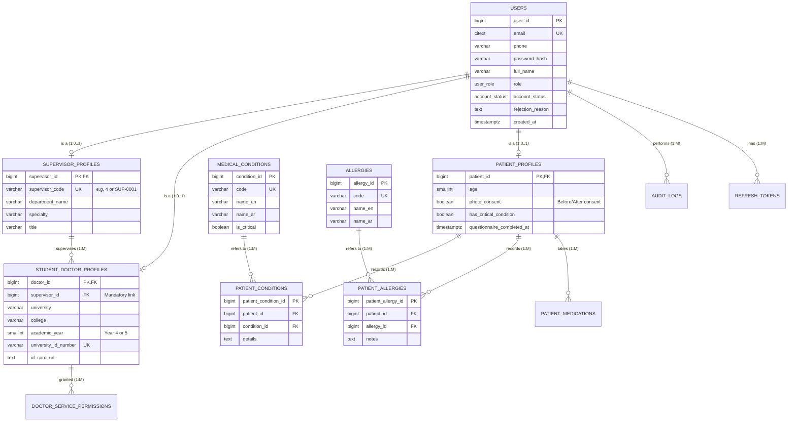
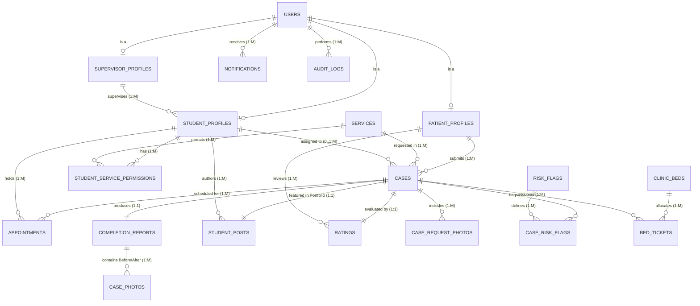

# TeethLink — Complete Database Schema & Architectural Reference

> **Documentation Date:** November 2026  
> **Institution:** 6th of October University (O6U) — Faculty of Dentistry  
> **Alignment:** `Refrences/TeethLink prototype(1).html`, `Refrences/schema (1).png`, `Refrences/01_accounts_medical (1).png`, `Refrences/dental_matching_workflow_v3 (1).docx`

---

## 1. Architectural Summary & System Workflow

The **TeethLink** system connects dental patients seeking care with senior clinical dental students (Year 4 & Year 5) under rigorous academic supervision by faculty supervisors:

1. **Four Specialized User Roles:**
   - **`PATIENT` (المريض):** Registers with personal info and a mandatory clinical medical questionnaire (Diabetes, Hypertension, Heart disease, Bleeding disorders, Allergies, Current medications, Photo consent). New accounts start as `PENDING_APPROVAL` until validated by an administrator.
   - **`DOCTOR` / Dental Student (طالب طب الأسنان):** Registers with academic credentials (University, Faculty, Academic Year 4/5, ID proof upload) and **MUST link to their academic supervisor via a mandatory `Supervisor ID`** (e.g. `4`, `7`, `SUP-0001`). Accounts require admin approval before students can view or claim cases.
   - **`SUPERVISOR` (المشرف الأكاديمي):** Registers with academic department and specialty. Upon admin approval, receives a unique, permanent **`Supervisor ID`** displayed prominently with a 1-click copy feature to share with students. Supervisors approve cases claimed by their students and review completion reports.
   - **`ADMIN` (مدير النظام):** Controls registration gatekeeping, inspects submitted ID proofs and medical questionnaires, issues Supervisor IDs, approves/rejects accounts with mandatory feedback reasons, and reviews system audit logs.

2. **Supervisor ID Linking Rule:**
   - A student *cannot* register without a valid, approved `supervisor_id`. The system validates the code against active supervisors in real time.
   - Each student belongs to exactly one supervisor, ensuring clear clinical liability.

3. **Medical Safety & Risk Flags:**
   - Fixed clinical questionnaire drives automatic, non-AI risk flags (`DIABETES`, `HYPERTENSION`, `CARDIAC`, `BLEEDING_RISK`, `PENICILLIN_ALLERGY`, `LATEX_ALLERGY`).
   - Patient contact details remain hidden from students until an appointment is mutually confirmed.

---

## 2. Part A: Dedicated Authentication & Medical Profile Schema (`sql/auth_schema.sql`)

This schema isolates the user management, credentialing, supervisor matching, and medical questionnaire subsystems:

---

## 3. Part B: Full System Relational Schema (`sql/full_system_schema.sql`)

Directly implements the complete 24-entity model from `Refrences/schema (1).png`:

### Table Inventory (24 Entities)
1. **`users`**: Central authentication table with hashed credentials, roles, and admin approval lifecycle.
2. **`supervisor_profiles`**: Faculty details, specialties, and issued `supervisor_code`.
3. **`student_doctor_profiles`**: Clinical students, academic year (4 or 5), mandatory `supervisor_id`, and ID proof verification.
4. **`patient_profiles`**: Clinical demographics, `photo_consent` toggle, and medical questionnaire metadata.
5. **`medical_conditions`**: Standard catalog of medical risk conditions (Diabetes, Hypertension, Heart disease, Bleeding disorders).
6. **`patient_conditions`**: Associative table linking patients to affirmative medical conditions.
7. **`patient_medications`**: Current pharmacological intake (dosages, anticoagulants, frequency).
8. **`allergies`**: Catalog of dental contraindicating allergies (Penicillin, Local Anesthetics, Latex, Aspirin, Iodine).
9. **`patient_allergies`**: Associative table mapping patient allergy profiles.
10. **`services`**: Approved clinical dental procedures (Initial Exam, Scaling & Cleaning, Class I/II Fillings, Extractions, Root Canals).
11. **`student_service_permissions`**: Specific procedures authorized by supervisors for each student.
12. **`risk_flags`**: System severity rules (INFO, CAUTION, HIGH) triggered by medical conditions.
13. **`cases`**: Dental treatment requests submitted by patients, tracked through state machine (`WAITING_FOR_DOCTOR` to `COMPLETED`).
14. **`case_risk_flags`**: Clinical safety flags active on each specific case.
15. **`case_request_photos`**: Patient-uploaded intraoral photos attached to initial requests.
16. **`appointments`**: Proposed clinic dates and times with patient acceptance status.
17. **`student_declined_cases`**: Tracks cases passed by a student so they do not reappear in their feed.
18. **`completion_reports`**: Post-treatment documentation submitted by students for supervisor validation.
19. **`case_photos`**: Before & After treatment photos categorized by photo type.
20. **`student_posts`**: Public clinical portfolio entries published with patient consent and supervisor approval.
21. **`ratings`**: Patient reviews measuring communication, punctuality, and overall satisfaction (1–5 stars).
22. **`notifications`**: Real-time push and in-app event notifications.
23. **`audit_logs`**: Immutable security log tracking approvals, rejections, case claims, and permission grants.
24. **`clinic_beds` & `bed_tickets`**: Physical dental chair allocation and session management.

---

## 4. Visual Diagrams & Downloadable Assets

The following visual SVG diagrams and SQL files are generated and hosted directly in the system:

| Asset Name | Direct Web Path | Purpose |
|---|---|---|
| **Auth & Medical Schema (SVG)** | [`/diagrams/01_auth_medical_schema.svg`](http://localhost:4000/diagrams/01_auth_medical_schema.svg) | High-res vector diagram of Accounts, Supervisor Matching & Medical Profile |
| **Full System Schema (SVG)** | [`/diagrams/02_full_system_schema.svg`](http://localhost:4000/diagrams/02_full_system_schema.svg) | High-res vector diagram of all 24 entities matching `schema (1).png` |
| **Authentication SQL DDL** | [`/sql/auth_schema.sql`](http://localhost:4000/sql/auth_schema.sql) | Focused, runnable PostgreSQL DDL for auth and accounts |
| **Full System SQL DDL** | [`/sql/full_system_schema.sql`](http://localhost:4000/sql/full_system_schema.sql) | Full relational DDL for the complete dental hospital matching system |

---

## 5. Seeded System Users & Credentials

Use these pre-configured accounts to sign in via the web GUI or REST API:

| Role | Name | Identifier (Email / Phone) | Password | Key Metadata |
|---|---|---|---|---|
| **ADMIN** | System Administrator | `admin@teethlink.edu.eg` / `+201000000001` | `Admin@12345` | Master Gatekeeper |
| **SUPERVISOR** | Dr. Hany Mahmoud | `hany.mahmoud@teethlink.edu.eg` / `+201000000002` | `Supervisor@12345` | Supervisor ID: **`SUP-0001` (Code 4)** |
| **SUPERVISOR** | Dr. Mona Adel | `mona.adel@teethlink.edu.eg` / `+201000000003` | `Supervisor@12345` | Supervisor ID: **`SUP-0002` (Code 7)** |
| **DOCTOR (Student)** | Dr. Omar Khaled | `omar.khaled@o6u.edu.eg` / `+201000000101` | `Doctor@12345` | Year 5 (Senior), linked to Dr. Hany |
| **DOCTOR (Student)** | Dr. Nourhan Tarek | `nourhan.tarek@o6u.edu.eg` / `+201000000102` | `Doctor@12345` | Year 5 (Senior), linked to Dr. Hany |
| **PATIENT** | Sara Ahmed Hassan | `sara.hassan@gmail.com` / `+201000000201` | `Patient@12345` | Medical: Diabetes, Penicillin Allergy |
| **PATIENT** | Mahmoud Saeed | `mahmoud.saeed@gmail.com` / `+201000000202` | `Patient@12345` | Medical: Cardiac Stent, Anticoagulant |
